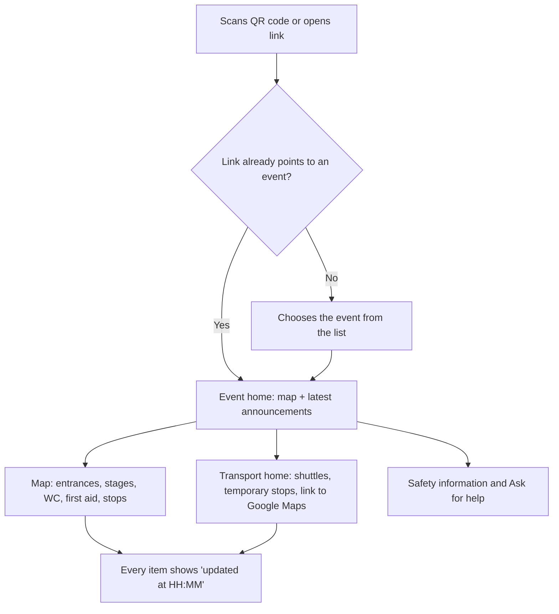
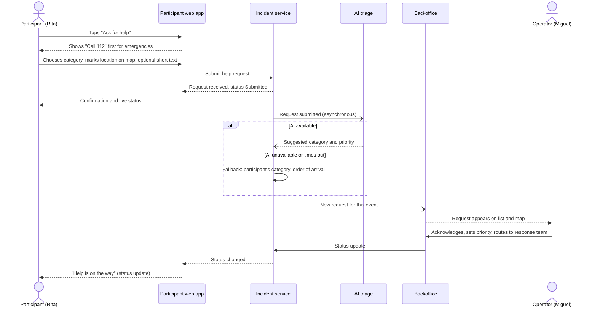
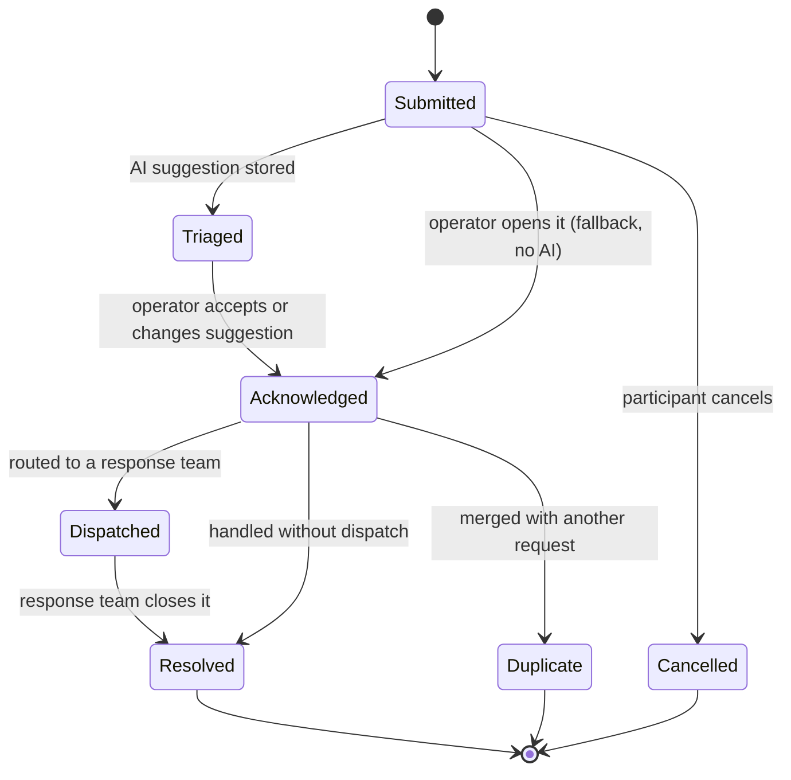
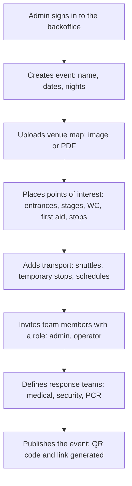
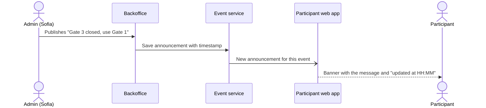
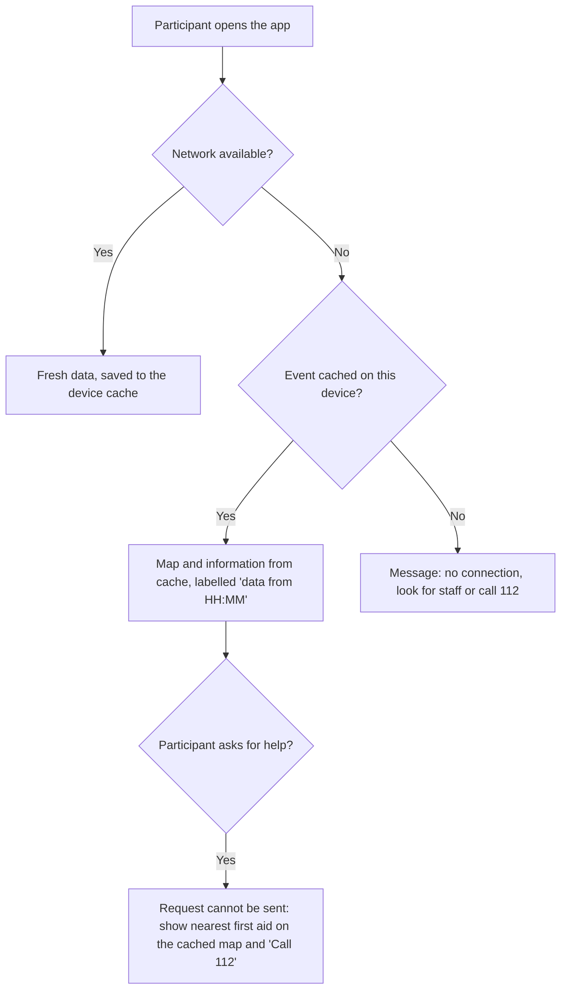

# Main User Workflows

> LABDSOF 2026/27 · Sprint 1 · Assignment §5.4 and §7.1.2 (deliverable 4, *Principal user journeys*)
> **Status:** draft. The three journeys in the report (*Principais jornadas do utilizador*) are expanded here into step-by-step flows with diagrams. Steps that are not in the report are marked **[PROPOSED]**.
> **Personas:** [`personas.md`](personas.md) · **Features:** [`features.md`](features.md) · **Domain terms:** [`domain-model.md`](../Technical/domain-model.md)
> Diagrams use Mermaid, which GitHub renders directly.

## Overview

| ID | Journey | Persona | Source in the report | Demo priority |
|---|---|---|---|---|
| **W2** | **Participant asks for help** | P1 → P2 | Third journey (help request) | **1, the core journey** (links both sides of the product) |
| W3 | Operator handles a help request | P2 | Third journey | 1 (continuation of W2) |
| W1 | Participant finds information | P1 | First journey | 2 |
| W4 | Admin sets up an event | P3 | Second journey | 3 |
| W5 | Team publishes a live update | P3 → P1 | Second journey ("atualiza informação durante a noite") | 4 |
| W6 | Participant loses the network | P1 | Risks: congested network, offline mode (report §5) | Required by assignment §6.8 |

For the 5–7 minute presentation, **W2 + W3 tell the whole story**: a participant asks for help, and the event team sees it on the map, prioritises it and routes it.

---

## W1 · Participant finds information

Source: report, first journey: *"abre a aplicação web através de um link ou QR code, seleciona o evento, consulta a planta, encontra entradas, serviços, opções de transporte e informação de segurança"*.

**[PROPOSED] details:** an event-specific QR code skips the selection step; the last-update time on every item comes from the risk "information that is out of date can make things worse" (report §5).

## W2 · Participant asks for help (core journey)

Source: report, third journey: *"Quando um participante envia um pedido de ajuda, a equipa do evento recebe esse pedido com contexto e localização, avalia a sua prioridade e encaminha-o para a equipa operacional adequada."* The AI step assumes **Option A (triage)** from [`features.md` §4](features.md#4-ai-assisted-workflow-decision-needed), which is still a **[DECISION NEEDED]**.

**Rules from the repository:**
- "Call 112" comes first; the app does not replace emergency services (report §5, regulatory risks; annex C6).
- Location is marked on the map by the participant and shared only with the request (annex C6, SafeZone pattern; survey Q10 tests acceptance).
- The AI only **suggests**; it never lowers a priority without a person (annex C9).

**[PROPOSED]:** the participant sees the status of their request (the market annex notes that no current channel shows the status of a request, §4 *UX* row).

## W3 · Operator handles a help request

Lifecycle of a help request **[PROPOSED]**. The report says the team *"avalia a sua prioridade e encaminha-o"*, but does not define statuses.

Steps:
1. A new request appears on the operator's list and on the venue map, with category, location, time and, if available, the AI suggestion.
2. The operator acknowledges it and confirms or changes the priority.
3. The operator routes it to a response team (medical, security, PCR) or handles it directly.
4. Every change is recorded with who and when (audit, assignment §6.6).
5. The response team, or the operator, closes it as resolved.

> ⚠️ **GAP:** the statuses, the list of response teams and who closes a request are assumptions. Needed: the interview with the security volunteer (report §4) to confirm how requests are handled today and which teams exist.

## W4 · Admin sets up an event

Source: report, second journey: *"cria ou seleciona um evento no backoffice, carrega ou configura a planta do recinto, adiciona pontos importantes como entradas, palcos, casas de banho, primeiros socorros e paragens de transporte"*.

**[PROPOSED]:** the steps *invite team members*, *define response teams* and *publish with QR code* are not in the report but are needed for per-event permissions (report, *Visão do produto*) and for routing (W3).

## W5 · Team publishes a live update

Source: report, *"atualiza informação durante a noite"*; root cause 2.

## W6 · Participant loses the network (degraded mode)

Source: report §5, technical risks (*"Rede móvel congestionada no recinto: exige cache, modo offline e mensagens curtas"*); assumption A8; assignment §6.8.

**[PROPOSED]:** help requests are **not** queued silently while offline, because a request that looks sent but is not is worse than an honest failure ("fail safely", assignment §6.8).

> ⚠️ **GAP: degraded-mode scenario to demonstrate.** The assignment requires the presentation to show what happens when a dependency is unavailable (§6.8). Needed: the team picks which scenario to demo (network loss, AI unavailable, transport source unavailable) and when.
