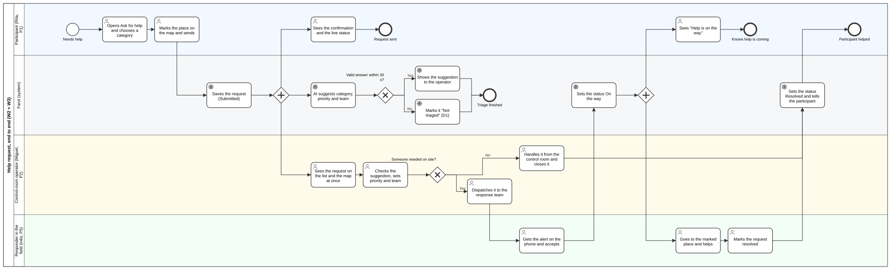
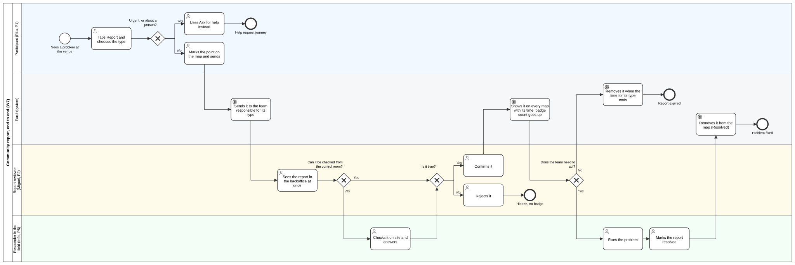
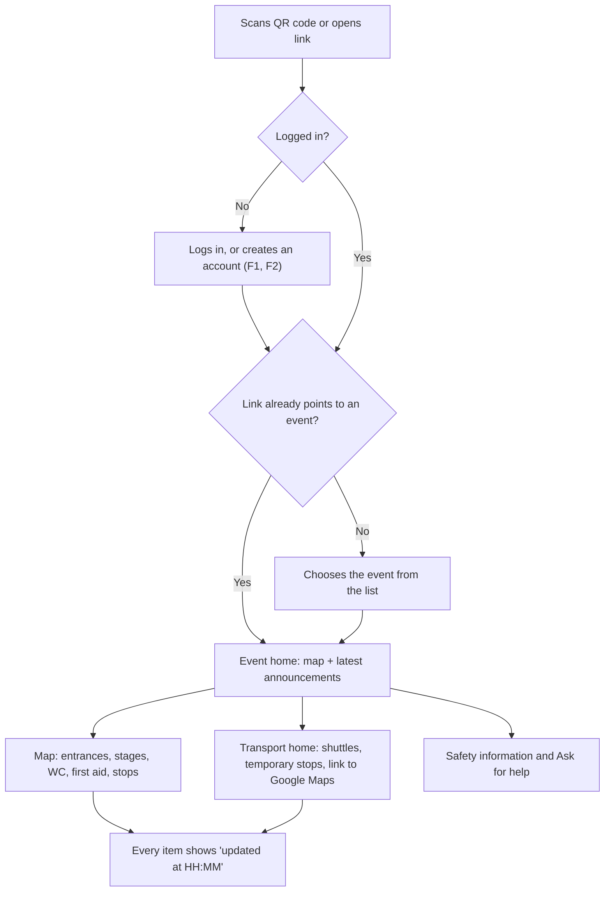
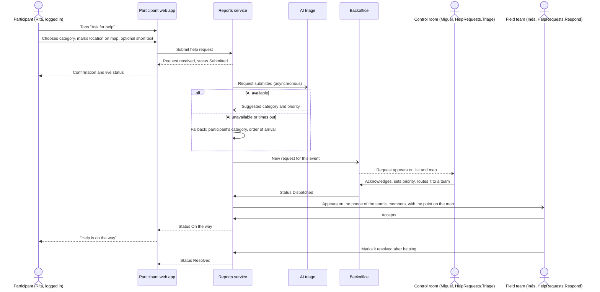
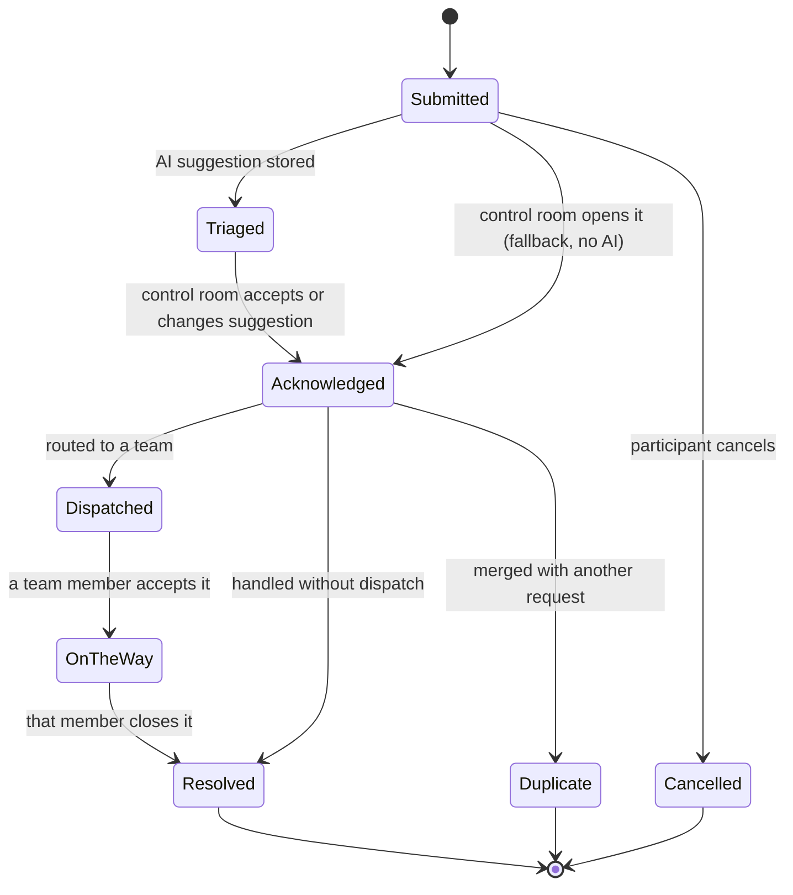
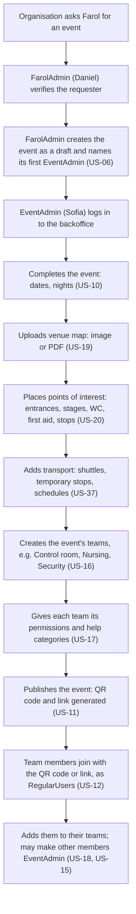
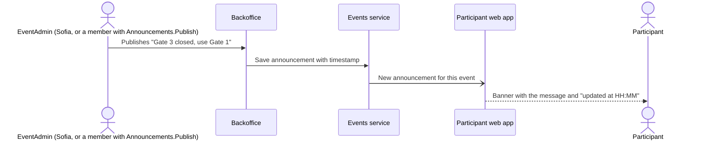
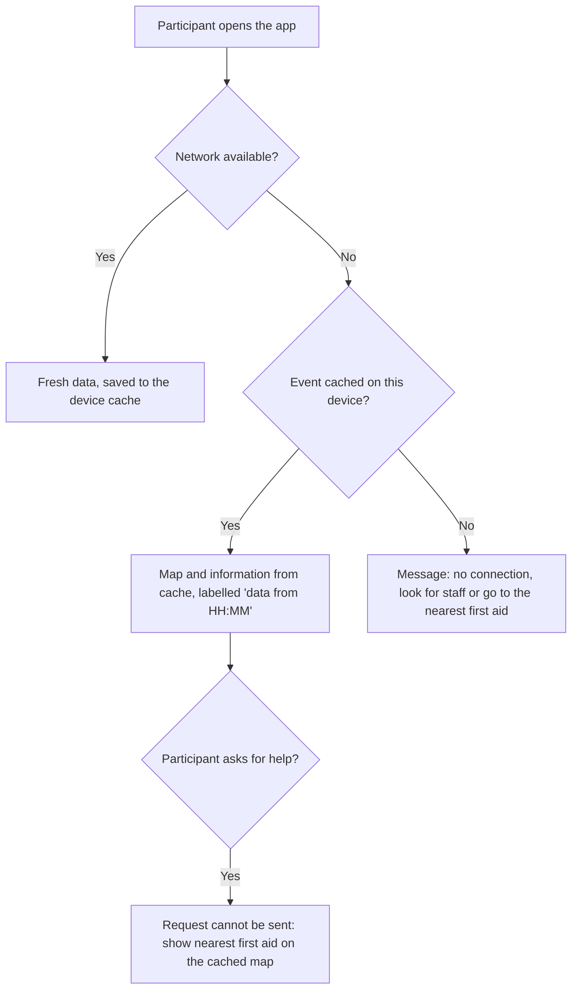
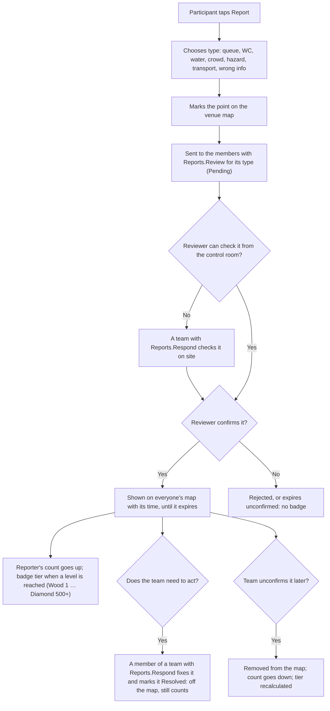
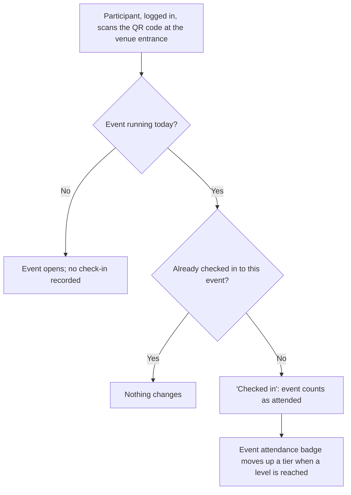

# Main User Workflows

> LABDSOF 2026/27 · Sprint 1 · Assignment §5.4 and §7.1.2 (deliverable 4, *Principal user journeys*)
> **Status:** draft. The three journeys in the report (*Main user journeys*) are expanded here into step-by-step flows with diagrams. Steps that are not in the report are marked **[PROPOSED]**.
> **Personas:** [`personas.md`](personas.md) · **Features:** [`features.md`](features.md) · **Domain terms:** [`domain-model.md`](../Technical/domain-model.md)
> Diagrams use Mermaid, which GitHub renders directly.

## Overview

| ID | Journey | Persona | Source in the report | Demo priority |
|---|---|---|---|---|
| **W2** | **Participant asks for help** | P1 → P2 → P5 | Third journey (help request) | **1, the core journey** (links both sides of the product) |
| W3 | Control room handles a help request | P2 → P5 | Third journey | 1 (continuation of W2) |
| W1 | Participant finds information | P1 | First journey | 2 |
| W4 | FarolAdmin creates an event, EventAdmin sets it up | P4 → P3 | Second journey | 3 |
| W5 | Team publishes a live update | P3 → P1 | Second journey ("updates information during the night") | 4 |
| W6 | Participant loses the network | P1 | Risks: congested network, offline mode (report §5) | Could (F11). Assignment §6.8 is covered by scenarios D1 and D2 ([`features.md` §3.1](features.md#31-degraded-mode-scenarios-decided-9-october-2026)) |
| W7 | Participant reports a problem and earns a badge | P1 → P2 → P5 | Engagement mechanism ([`features.md` §6](features.md#6-ethical-engagement-mechanism-community-reports-and-badges)) | Required by assignment §5.5 |
| W8 | Participant checks in at the venue | P1 | Attendance badges (F15, F16) | Should |

For the 5–7 minute presentation, **W2 + W3 tell the whole story**: a participant asks for help, and the event team sees it on the map, prioritises it and routes it.

## Complete journeys (BPMN)

Added after the presentation of 12 October 2026 (professor feedback): one BPMN diagram per core journey, from the participant's first tap to the end, with one lane per actor. The Mermaid diagrams in W1–W8 stay as the step-by-step detail. Who receives what is in [`features.md` §4.3](features.md#43-who-receives-what-and-who-acts). The lanes are personas, and since 22 October 2026 they are jobs given by team permissions, not roles ([`features.md` §4.2](features.md#42-teams-and-permissions)): P2 stands for the members with `HelpRequests.Triage` or `Reports.Review`, P5 for the members with `HelpRequests.Respond` or `Reports.Respond`.

### Help request, end to end (W2 + W3)

- The request reaches the control room **at once**. The AI suggestion runs in parallel and never holds it back (scenario D1).
- The **operator decides** (priority, team, whether someone must go); the **responder acts** (accepts, goes to the point, resolves).
- The participant sees two changes: *On the way* and *Resolved*.
- Not drawn, to keep it readable: the participant cancels, duplicates (see W3).

### Community report, end to end (W7)

- A report skips the shared queue: its **type** says who is responsible, so it goes straight to the members with `Reports.Review` for that type ([`features.md` §4.3](features.md#43-who-receives-what-and-who-acts)).
- The **reviewer decides**: confirms or rejects, if needed after a team with `Reports.Respond` checks on site. A member of that team **acts** when the problem needs fixing.
- Not drawn: the team unconfirms a report later (see W7).

**Files:** [`bpmn/`](bpmn/) has each diagram as `.bpmn` (BPMN 2.0; open and edit it in [bpmn.io](https://demo.bpmn.io) or Camunda Modeler) and as `.svg` (for reading here). After editing a `.bpmn`, export the SVG again. These diagrams are for the documentation, not the slides: they are too detailed to read on a projector.

---

## W1 · Participant finds information

Source: report, first journey: *"opens the web application through a link or QR code, selects the event, checks the map, finds entrances, services, transport options and safety information"*.

**Login is mandatory** (decided 9 October 2026): the participant logs in once and stays logged in on the device; one account works for every event. **[PROPOSED] details:** an event-specific QR code skips the selection step; the last-update time on every item comes from the risk "information that is out of date can make things worse" (report §5).

## W2 · Participant asks for help (core journey)

Source: report, third journey: *"When a participant sends a help request, the event team receives it with context and location, assesses its priority and routes it to the right operational team."* The AI step is the **help-request triage** chosen by the team ([`features.md` §5](features.md#5-ai-assisted-workflow-help-request-triage)); the suggestion must arrive within 30 s (SC3), otherwise the fallback applies.

**Rules from the repository:**
- Location is marked on the map by the participant and shared only with the request (annex C6, SafeZone pattern; survey Q10 tests acceptance).
- The AI only **suggests**; it never lowers a priority without a person (annex C9).

**[PROPOSED]:** the participant sees the status of their request (the market annex notes that no current channel shows the status of a request, §4 *UX* row).

## W3 · Control room handles a help request

Lifecycle of a help request **[PROPOSED]**. The report says the team *"assesses its priority and routes it to the right operational team"*, but does not define statuses.

Steps:
1. A new request appears on the list and the venue map of every member with `HelpRequests.Triage` (the control room, P2), with category, location, time and, if available, the AI suggestion (US-26, US-27).
2. A control-room member acknowledges it and confirms or changes the priority (US-28).
3. They route it to a team of the event with `HelpRequests.Respond`, by default the team that handles its help category (e.g. *Nursing* for `Health`; [`features.md` §4.2](features.md#42-teams-and-permissions), US-29), or handle it directly. The request appears on the phone of that team's members (P5, US-31); the first one who accepts it sets it *On the way* (US-32).
4. Every change is recorded with who and when (audit, assignment §6.6).
5. The team member who accepted it closes it as resolved (US-33), or the control room closes it, if it was handled from there (US-30).

> ⚠️ **GAP:** the role model is defined (features §4, to confirm with the team), and each event creates its own teams; the statuses and who closes a request are still assumptions. Needed: the interview with the security volunteer (report §4) to confirm how requests are handled today and which teams the pilot set-up should have (features §4.4).

## W4 · FarolAdmin creates an event, EventAdmin sets it up

Source: report, second journey: *"creates or selects an event in the backoffice, uploads or configures the venue map, adds key points such as entrances, stages, toilets, first aid and transport stops"*.

**[PROPOSED]:** the steps *create teams*, *set their permissions*, *add members to teams* and *publish with QR code* are not in the report but are needed for per-event permissions (report, *Product vision*) and for routing (W3). Since 22 October 2026 the teams are not fixed: each event creates its own from the permission list in [`features.md` §4.2](features.md#42-teams-and-permissions); §4.4 has a suggested set-up for the Queima. People join the event first (US-12) and are added to teams after, because only members of the event can be in its teams (US-18).

**[PROPOSED] 10 October 2026:** the first three steps (request, verification, creation by the FarolAdmin, persona P4) are not in the report either. Farol hosts many festivals, so an event can only be created for a verified organisation, and its EventAdmins manage only that event (F3, US-06; roles in [`features.md` §4](features.md#4-roles-teams-and-permissions-22-october-2026)). The FarolAdmin never sees the event's help requests or reports. To confirm with the team (personas PE-5).

## W5 · Team publishes a live update

Source: report, *"updates information during the night"*; root cause 2.

## W6 · Participant loses the network (F11, Could)

Source: report §5, technical risks (*"Congested mobile network at the venue: requires caching, offline mode and short messages"*); assumption A8; assignment §6.8.

**[PROPOSED]:** help requests are **not** queued silently while offline, because a request that looks sent but is not is worse than an honest failure ("fail safely", assignment §6.8).

**Decided (9 October 2026):** network loss is **not** one of the degraded-mode scenarios of assignment §6.8, and F11 is a Could. The §6.8 scenarios are **D1 AI triage unavailable** and **D2 transport source unavailable** ([`features.md` §3.1](features.md#31-degraded-mode-scenarios-decided-9-october-2026)).

## W7 · Participant reports a problem and earns a badge

Source: engagement mechanism decided by the team on 8 October and detailed on 9 October 2026 ([`features.md` §6](features.md#6-ethical-engagement-mechanism-community-reports-and-badges)). The participant is logged in; badges belong to the account.

Urgent situations about a person are **not** reports: the app sends the participant to *Ask for help* (W2).

## W8 · Participant checks in at the venue (F16, Should)

Source: attendance badges decided on 9 October 2026 ([`features.md` §6.3](features.md#63-badges-decided)).

Opening the event at home or from a link never counts as attendance.
