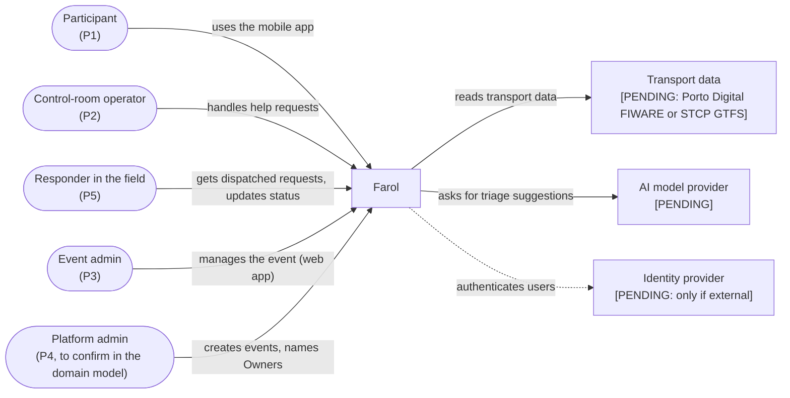
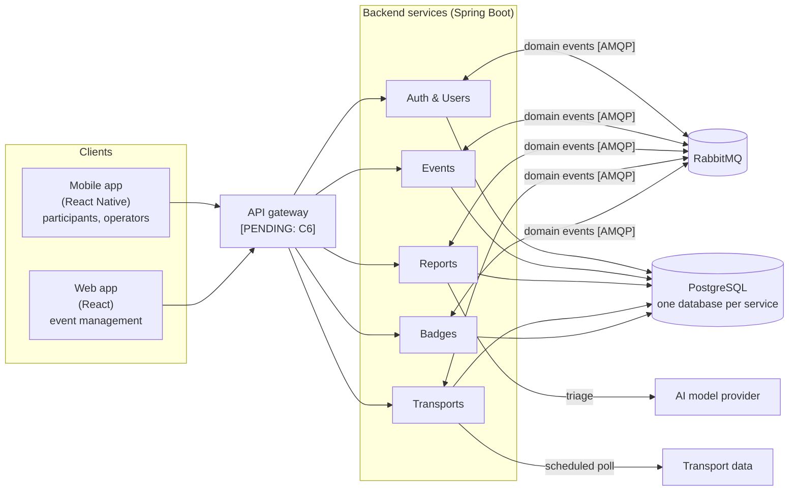

# High-Level System Architecture

> LABDSOF 2026/27 · Sprint A · Assignment §6 (Common Technical Requirements) and §7.1.2 (deliverable 7, *Technical Design*)
> **Status (15 October 2026):** reflects the team decisions recorded in [`architecture-decisions-guide.md`](architecture-decisions-guide.md) (Portuguese). Items marked **[PENDING]** wait for the professor's answer or for an investigation; the owner is in that document. The final diagrams are drawn in draw.io; the Mermaid diagrams below are working sketches.
> Legend: see [`product-vision.md`](../Product/product-vision.md#legend).

## 1. Architecture drivers

What shapes the design, and where it comes from:

| # | Driver | Source |
|---|---|---|
| D1 | **Isolation between events**: one team must never see or change another event's data | Report, *Per-event permissions*; §5 technical risks |
| D2 | **Read peaks**: tens of thousands of participant requests within minutes (e.g. end of a concert) | Report §5 technical risks |
| D3 | **Weak or congested network** at the venue: short messages, data with its update time | Report §5; assumption A8; annex C10 |
| D4 | **Freshness**: every piece of information shows when it was last updated | Report §5; annex C4 |
| D5 | **Sensitive data**: location and help requests (possibly health) need consent, minimisation, short retention | Report §5 regulatory risks |
| D6 | **AI with fallback**: the main workflow must keep working when the AI is unavailable | Assignment §5.6.2; annex C9 |
| D7 | **At least two independently deployable backend components**, or a justified modular monolith | Assignment §6.2 |
| D8 | **At least one asynchronous workflow** and **one external integration** (or realistic simulator) | Assignment §6.3, §6.5 |
| D9 | **Small team, three sprints** | Report §5 execution risks |

## 2. System context

## 3. Container view

Final state (Sprint C). In Sprints A and B the five services may run as **one modular monolith** with the same modules; this depends on the professor's answer (§11).

Not drawn: every container sends logs, metrics and health checks to the observability stack (assignment §6.7; stack **[PENDING]**). Clients get live updates by **polling** (no push in the MVP).

## 4. Responsibilities and data ownership

| Service | Responsibility (features) | Owns (see [`domain-model.md`](domain-model.md)) |
|---|---|---|
| **Auth & Users** | Authentication, authorisation, accounts, roles per event, friends (F1, F2, roles of F4, F18) | UserAccount, Membership, TeamMember; friendships |
| **Events** | Events, venue map and points of interest, response teams, announcements, check-in, entries (F3, teams of F4, F5, F10, F16, F17) | Event, VenueMap, PointOfInterest, ResponseTeam, Announcement; check-ins |
| **Reports** | Community reports and their confirmation, help requests, incident backoffice, AI triage with fallback (F6, F7, F8, F12, F13) | HelpRequest, TriageSuggestion, StatusChange; community reports |
| **Transports** | External transport integration and event shuttles (F9) | TransportOption |
| **Badges** | Badges (F14, F15) | Badges |

Entities in lower case are not in the domain model yet; Tomás and Guerra add them, together with the platform admin (P4).

**Rules:**
- Each service owns its data and its database; no service reads another service's database.
- Services talk **only through events**. Each service keeps a local copy of what it needs from another (e.g. Reports keeps the response teams from Events; every service keeps the roles per event from Auth & Users). The cost is eventual consistency.
- Each service is its own Maven project in `backend/<service>/` and depends only on the others' contracts (OpenAPI and events). Inside, it follows a **hexagonal layout**: `domain`, `application`, `adapters/in`, `adapters/out`.
- APIs are **contract-first**: hand-written OpenAPI in `backend/<service>/contracts/openapi.yaml`, paths under `/api/v1`, server and client code generated ([`spec-driven-development.md`](../Process/spec-driven-development.md)).

## 5. Communication

| From → To | Style | Why |
|---|---|---|
| Apps → services | Synchronous (HTTP/REST) | Request–response by nature |
| Apps (live lists, request status, announcements) | **Polling** | Enough for the MVP; no push infrastructure |
| Service → service | **Asynchronous only** (RabbitMQ, Spring AMQP, *topic* exchanges) | A service that is down does not stop the others |
| Transports → transport data | Scheduled poll | The external source may be slow or down; never called inside a user's request |

## 6. The asynchronous workflow: help-request triage

Required by assignment §6.3 and §7.1.2 (*Asynchronous workflow*). End-to-end flow: [`user-workflows.md`, W2](../Product/user-workflows.md#w2--participant-asks-for-help-core-journey).

| Concern (assignment §6.3) | How it is handled |
|---|---|
| **Lost messages** | Reports saves the request and the outgoing event in the same transaction (**outbox table**); a polling job publishes pending events to RabbitMQ |
| **Duplicate events** | Consumers are idempotent: each keeps a table of processed `message_id`s |
| **Retries** | **4 attempts** in the consumer (Spring Boot 4: `spring.rabbitmq.listener.simple.retry.max-retries=3`), exponential backoff **1 s → 2 s → 4 s** (at most 10 s), so about 7 s before the **dead-letter exchange**. Messages that cannot be converted or fail validation go straight to the DLQ (`AmqpRejectAndDontRequeueException`). A failing AI call is **not** a message failure: the triage worker records the fallback (§9) and acknowledges the message, so the AI retries (J1) and the message retries never multiply |
| **Dead letters** | One DLQ per queue (`<queue>.dlq`). `RepublishMessageRecoverer` adds the exception and the original routing key as headers. DLQ messages are **never lost and never reprocessed automatically**: an alert fires when a DLQ is not empty (dashboard, §6.7); once the cause is fixed, they are moved back to the original queue by hand (safe, because consumers are idempotent); messages that will never be valid are logged and deleted. No DLQ message can hide a help request from the operator: the backoffice reads Reports' own database, and an untriaged request is simply "Not triaged" |
| **Outbox publisher** | Polls every 1 s, batches of 100, with publisher confirms. If the broker is down, rows stay pending and are sent on a later run; the age of the oldest pending row is a metric, alerted above 60 s |
| **Failures** | If no suggestion arrives in time, the request stays in the operator's list with the participant's category, in order of arrival (non-AI fallback), marked "not triaged" |
| **Eventual consistency** | The backoffice shows "awaiting triage" until the suggestion arrives; the operator can act before it does |

## 7. External integration

| Integration | Purpose | Handling of unavailable, late, incomplete or invalid data (assignment §6.5) |
|---|---|---|
| **Transport data** **[PENDING]**: Porto Digital urban platform (FIWARE NGSI v2, live bus data), if the professor accepts it; otherwise STCP GTFS | Transport for F9 | Data validated on import; on failure, the last valid data is kept and shown with its time and a warning (US-09); event shuttles entered manually are unaffected |
| **AI model provider** **[PENDING]** (Tomás; local Ollama is an option) | Triage suggestions (F8) | Timeout, retry and circuit breaker, then fallback (§9.1); the suggestion is never shown as a fact (assignment §5.6.2) |

## 8. Security, authentication and authorisation

Owner: **Guerra** (identity provider, token validation, service-to-service authentication, secrets, Security & Privacy assessment).

| Concern | Decided |
|---|---|
| Accounts | **Login mandatory for every user**, participants included (9 October 2026, DM-1) |
| Authorisation | Role checked **per event** (invariant I1); authN and authZ live in Auth & Users |
| Isolation between events | `event_id` on every event-scoped table, filtered by the application; each service has an integration test proving that a member of event X cannot read or change event Y |
| Audit | Every change to a help request recorded (StatusChange, domain model I5) |
| Rate limiting of help requests | **[PENDING]** with the gateway decision (Guerra) |

> ⚠️ **GAP: Security and Privacy Assessment.** Sprint A deliverable (assignment §7.1.2, item 9). Owner: Guerra.

## 9. Degraded modes

**Decided (9 October 2026):** the §6.8 scenarios are **AI unavailable (D1)** and **transport source unavailable (D2)** ([`features.md` §3.1](../Product/features.md#31-degraded-mode-scenarios-decided-9-october-2026)). **Decided (16 October 2026):** the resilience patterns and values (§9.1), how D1 and D2 are triggered, observed and tested (§9.2), and the demo script (§9.3). Guide items J1 and J2.

| Unavailable | What the user sees |
|---|---|
| **AI provider** | Requests go to the operator untriaged, with the participant's category, in order of arrival |
| **Transport source** | Last known data with its time and a warning |
| **Another service** | The other services keep working (events only between services, local copies) |
| **RabbitMQ** | Requests are still saved (outbox); triage and copies between services catch up when the broker returns |

### 9.1 Resilience patterns and values (J1)

**Library: Resilience4j 2.4** (`resilience4j-spring-boot4`, which supports Spring Boot 4 since March 2026), used only in the outgoing adapters (`adapters/out`). It is the only mature option with a circuit breaker for Spring Boot 4, it is configured in `application.yml`, and it publishes Micrometer metrics and its state in the health check. Alternatives considered: Spring Framework 7 core retry (no circuit breaker; Spring AMQP uses it for message retries, §6), Spring Cloud Circuit Breaker (an extra layer over Resilience4j) and Failsafe (no Spring Boot auto-configuration).

Timeouts are set on the HTTP client (`RestClient`), not with a Resilience4j `TimeLimiter`. Retry wraps the circuit breaker, so every attempt counts for the circuit, and nothing is retried while the circuit is open. External calls never run inside a user's request: the AI is called by the triage worker and the transport source by a scheduled import.

| External call | Timeout | Retry | Circuit breaker | When it fails |
|---|---|---|---|---|
| **AI provider** (Reports, triage worker) | connect 2 s, response 10 s | 2 attempts, 2 s apart; only on timeout, connection error, 5xx and 429; never on other 4xx or invalid output | last 10 calls, at least 4; opens at ≥ 50 % failed or slow (> 8 s) calls; open 30 s; 1 trial call | D1 fallback. Worst case ≈ 22 s, inside the 30 s of SC3. **To confirm with K1** (Tomás): a local model (Ollama on CPU) may need a 20 s response timeout and a single attempt |
| **Transport source** (Transports, scheduled import) | connect 3 s, response 5 s | 3 attempts, 1 s and 2 s apart | last 6 calls, at least 3; opens at ≥ 50 % failed calls; open 60 s; 1 trial call | D2. Porto Digital FIWARE: import every 30 s (measured on 16 October: 1,000 buses, 300 KB in 0.7 s). **To confirm with the professor's answer**: with STCP GTFS, one import a day and a 30 s response timeout |
| **Identity provider**, only if external (JWKS keys, every service) | connect 2 s, response 3 s | none | none | Keys cached for 5 min and refreshed when an unknown `kid` arrives; if the refresh fails, the cached keys stay in use. **To confirm with E1** (Guerra); mocked authentication has no external call |

### 9.2 How D1 and D2 are triggered, observed and tested (J2)

| | D1 · AI unavailable | D2 · Transport source unavailable |
|---|---|---|
| **Detected** | No valid suggestion: timeout, connection error, provider error or invalid output (fails the JSON schema) | Import fails after its retries, the data fails validation, or the data is older than the freshness limit |
| **Degraded state** | Circuit breaker open or half-open → banner *"AI triage unavailable"*. A single fallback only labels that request | Last import failed, or data older than the limit → participant warning. Backoffice warning from the first failed import |
| **Freshness limit** | — | **24 h** for a static timetable (STCP GTFS), **confirmed**. **5 min** for live bus positions (Porto Digital FIWARE); older observations are dropped on import, which also covers *late* data (assignment §6.5) |
| **Recovery** | Circuit closes after a successful trial call; the banner disappears. Untouched "Not triaged" requests from the last 15 min are sent to triage once more; a late suggestion never overwrites an operator's decision (I4) | First valid import clears the warnings; invalid data never replaces valid data |
| **Observed in the UI** | Request in the backoffice **at once**, with the participant's category and the label *"Not triaged"*; banner | *"Data from HH:MM"*, warning *"Live transport information unavailable"*, event shuttles still shown; backoffice warning with the time of the last good import |
| **Observed in operations** | Metrics: `resilience4j.circuitbreaker.state{name=ai-provider}`, `farol.triage.fallback{reason}`. Log line per fallback with the reason and the correlation id | Metrics: `resilience4j.circuitbreaker.state{name=transport-source}`, `farol.transport.import{result}`, `farol.transport.data.age` (seconds). Log line per failed import |
| **Automated test** | **SC5**, Reports integration test, on every PR. WireMock replaces the provider and answers with a delay over the timeout, a 503, a dropped connection and an invalid body; 20 requests per case. Pass: 100 % shown to the operator as "Not triaged" within 30 s, fallback reason recorded, circuit opens and WireMock receives no more calls; after recovery, a new request gets a suggestion and an operator's priority is kept | **US-15**, Transports integration test, on every PR. WireMock replaces the source: one valid import, then a 503, a timeout and an invalid payload; a fixed `Clock` moves past the freshness limit. Pass: the API returns the last valid data with `dataAsOf` and `stale=true`, shuttles still returned, invalid data never stored; after a valid import, `stale=false` |

**How the failure is triggered in the demo:** a **fault switch** in the outgoing adapters of the AI provider and the transport source, with the modes `NONE`, `DOWN` (connection error), `SLOW` (longer than the timeout) and `INVALID` (invalid answer). It exists only when `farol.fault-injection.enabled=true`, which is on only in the demo environment and never in production, and only an admin can use it. Unlike stopping a container, it needs no restart, can show each kind of failure, and works with HTTPS providers (a network proxy such as Toxiproxy breaks their certificate check). Backup if the switch fails: set an invalid provider URL and restart the service. The demo environment depends on G4 (Tomás).

### 9.3 Demo script (D1 and D2, about 5 minutes)

Before the demo: fault injection on; one published event with a venue map, points of interest and an event shuttle; three windows side by side: **participant** (mobile app, logged in, event open), **operator** (backoffice), **dashboard** (circuit breaker state, fallbacks, transport data age).

**D1 · AI unavailable**

1. Participant sends a help request (*Health*). Operator: it appears at once, and a suggestion arrives in a few seconds, marked as a suggestion. *Normal behaviour.*
2. Presenter sets the AI switch to `DOWN`.
3. Participant sends a second request. Operator: it appears **at once** with the participant's category and the label *"Not triaged"*. Participant: the usual confirmation; nothing looks different.
4. Participant sends a third request. The circuit opens: the banner *"AI triage unavailable: requests are shown by order of arrival"* appears. Dashboard: circuit `OPEN`, fallback counter +2 with the reason `connection`.
5. Operator sets the priority and team of the second request by hand and dispatches it. *F7 works without the AI.*
6. Presenter sets the switch to `NONE`, waits 30 s, and the participant sends a fourth request. It gets a suggestion, the circuit closes and the banner disappears. The third request (untouched) receives a late suggestion; the second keeps the operator's values.
7. Optional: repeat with `SLOW` to show that even when the AI hangs, the request still appears at once.

**D2 · Transport source unavailable**

1. Participant opens *Transport*: buses near the venue and the event shuttle, with a recent *"Data from HH:MM"*.
2. Presenter sets the transport switch to `DOWN`.
3. Within one import (≤ 30 s): participant sees the same data, the time stops moving, the warning *"Live transport information unavailable"* and a link to the operator's site; the **event shuttle is still shown**. Backoffice: warning with the time of the last good import. Dashboard: failed imports, circuit `OPEN`, data age growing.
4. Presenter sets the switch to `INVALID`: the import is rejected and the data on screen does not change. *Invalid data never replaces valid data.*
5. Presenter sets the switch to `NONE`. Within about 90 s (circuit open time plus one import), the warnings disappear and the time updates.

## 10. Deployment view

**[PENDING]** (Tomás): platform (Azure, ECS or Vercel), where the containers, RabbitMQ and PostgreSQL run, environments, infrastructure as code, local execution, rollback. Azure (Azure for Students) was chosen on 11 October and reopened on 15 October.

Already decided:
- **One instance per service** for now.
- Images built with **multi-stage Dockerfiles** (Maven, Java 21, Spring Boot 4.x).
- **GitHub Actions** runs every check on every PR, merge and tag; each merge to `main` is published and deployed to production (**continuous deployment**), followed by a smoke test. The pipeline is being reviewed by Bruno.
- **Flyway** migrations run at application start and stay compatible with the previous version (*expand and contract*), because a code rollback does not undo them.
- Retention, backup and caching are **future improvements**.

### 10.1 Peak load and scaling (J3)

**Expected peak** (design target, not a measurement):

| Step | Value | Source |
|---|---|---|
| Entries per night, average | ≈ 31,000 (250,000 over 8 nights) | Evidence E1 ([problem report](../Deliverables/problem-opportunity-report-queima.md)) |
| Busiest night | 40,000 (average + 30 %) | Assumption: no official capacity per night was found; to check with the organisers (FAP) |
| People with the app that night | 60 % → 24,000 | Event-app adoption of 55–65 % with promotion (problem report; vendor figures); the top of the range on purpose |
| Open it in the 10 min after the last concert | 50 % → **12,000 open apps** | Assumption; report §5: *"tens of thousands of requests within minutes"* |
| Requests per open app | 1 poll every 10 s (SC6 ≤ 10 s) + about 5 screen loads | Polling (C5) |
| **Read peak** | ≈ 1,200 req/s of polling + ≈ 100 req/s of screen loads ≈ **1,300 req/s for 10 min** | Mostly announcements (Events) and transport (Transports) |
| **Help requests** | **1 per second** for 10 min | Far above a real night, to stress the asynchronous path |

**Scaling with one instance per service (C5)**, in this order:

1. **Less work per request:** conditional requests (ETag from the item's last-update time, so a 304 needs no data read); the venue-map image under a versioned URL with a long cache lifetime, so it is downloaded once; polling every 10 s with random jitter, only while the app is in the foreground, and slower on `429` or `503` with `Retry-After`. Rate limiting stays with the gateway decision (C6, Guerra).
2. **Isolation:** help requests live in Reports, away from the read peak (Events and Transports). A read peak can slow the map, but not a help request (SC2).
3. **Vertical scaling:** more CPU and memory for the most loaded container, connection pool sized to match.
4. **More instances, when C5 changes:** **Events first** (most read), then Transports. Both are stateless. Before that, the outbox publisher and the scheduled imports must run on a single instance (`FOR UPDATE SKIP LOCKED` or ShedLock).

**Load test (Sprint C performance evidence, assignment §7.3.2 item 7): k6.** Scripts in JavaScript, open-model scenarios (arrival rate, not a fixed number of users), and pass criteria written as *thresholds* that fail the run. It runs from GitHub Actions by hand (`workflow_dispatch`) against the deployed environment (G1, Tomás), not on every PR. The AI provider is replaced by a stub with 2–5 s latency, so the test measures Farol and costs nothing; the transport import is not affected by user load. Alternatives considered: Gatling (Java DSL, but a heavier JVM setup) and JMeter (XML plans that are hard to review in a PR).

| Scenario | Load | Pass criteria |
|---|---|---|
| **L1 Smoke** | 1 virtual user, 1 min, every endpoint | 0 errors |
| **L2 End of concert** | 0 → 1,300 req/s in 3 min, held 10 min. Mix: 85 % announcement polling, 8 % transport, 5 % map and points of interest, 2 % other | errors < 1 %; p95 < 500 ms, p99 < 1.5 s; no container restart; an announcement published during the run reaches the pollers in ≤ 10 s (SC6) |
| **L3 Help during the peak** | L2 plus 1 help request/s; an operator polls the backoffice list every 2 s | 600 of 600 requests shown (0 lost); time to the backoffice p95 ≤ 5 s (SC2); suggestion p95 ≤ 30 s (SC3) |
| **L4 Stress** | From 200 req/s, +200 req/s every 2 min, until p95 > 1 s or errors > 5 % | No pass or fail: records the limit of each service on one instance, the evidence for the scaling plan. Goal ≥ 1.5 × the peak (≈ 2,000 req/s) |
| **L5 D1 under load** (Should) | L3 with the AI fault switch on `DOWN` | 100 % of requests shown as "Not triaged" (SC5) |

## 11. Architectural style and its evolution

**Decided:** **microservices** as the final state. They meet assignment §6.2 directly, isolate failures (a read peak does not stop help requests) and give small, closed contracts per service.

**Evolution [PENDING, professor]:** proposed **modular monolith in Sprints A and B** (one deployable with the five modules, one schema per module, an ArchUnit test that fails if a module imports another's classes), then **each module becomes a service in Sprint C** (its own `main`, Dockerfile and database). Because modules already talk only through events and own their data, the split is mechanical, and it gives the *architecture evolution narrative* of §7.3.2 (item 11). Alternative, if the professor prefers: microservices from the start.

## 12. Technology choices

| Decision | Choice |
|---|---|
| Backend | **Java 21 + Spring Boot 4.x**, Maven |
| Frontend | **React** web app (event management only) · **React Native** mobile app (everything else) |
| Database | **PostgreSQL**, one database per service; Flyway |
| Message broker | **RabbitMQ** with Spring AMQP |
| Live updates | **Polling** |
| Resilience | **Resilience4j 2.4** (timeouts, retry, circuit breaker); message retries in Spring AMQP |
| Load testing | **k6** |
| API | Contract-first **OpenAPI**, `/api/v1` |
| CI/CD | **GitHub Actions**, monorepo, private repository |
| Architecture views | **C4** (all four levels, level 3 for every service) and **4+1** views without scenarios, drawn in **draw.io** |
| Cloud and deployment | **[PENDING]** Tomás |
| AI provider and model | **[PENDING]** Tomás |
| Observability | **[PENDING]** Tomás |
| Identity | **[PENDING]** Guerra |
| API gateway | **[PENDING]** Guerra |
| Venue map library (React Native) | **[PENDING]** Tiago |
| React Native setup and distribution | **[PENDING]** Bruno |

## 13. Architecture Decision Records

Location and format: `Docs/Technical/adr/NNNN-title.md`, Michael Nygard format plus *Alternatives considered*.

| ADR | Decision | Status |
|---|---|---|
| ADR-001 | Architectural style and evolution (§11) | Waits for the professor (evolution) |
| ADR-002 | Backend and frontend technology | Ready to write (Bruno) |
| ADR-003 | Database and data ownership | Ready to write (Bruno) |
| ADR-004 | Message broker, delivery guarantees, communication only through events | Ready to write (Bruno) |
| ADR-005 | AI workflow, provider and fallback | Waits for Tomás |
| ADR-006 | Identity | Waits for Guerra |
| ADR-007 | Venue map representation | Waits for Tiago |
| ADR-008 | Transport data source | Waits for the professor |
| ADR-009 | Architecture documentation (C4, 4+1, draw.io) | Ready to write (Bruno) |
| ADR-010 | CI/CD strategy | Waits for Bruno's pipeline review |

> ⚠️ **GAP: API outline and walking skeleton.** Sprint A also asks for an API outline (item 7; owner: Bruno, with the event catalogue) and a walking skeleton: a minimal end-to-end implementation with an automated build, an initial test and a containerised deployment (item 10; later phase, no owner yet).
