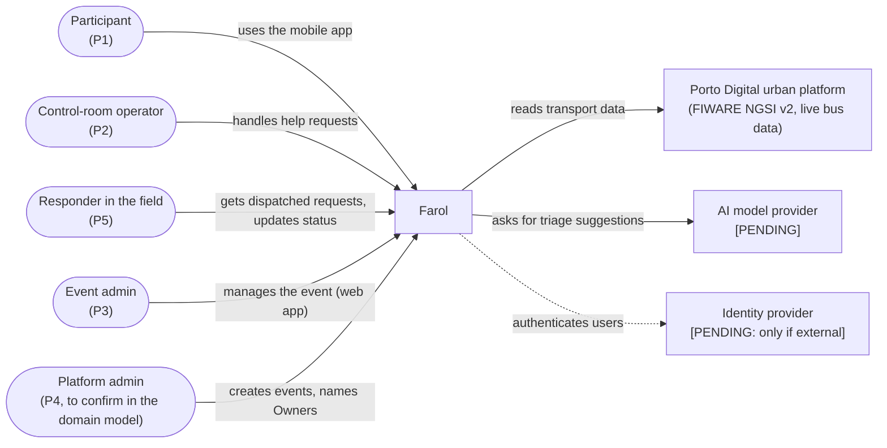
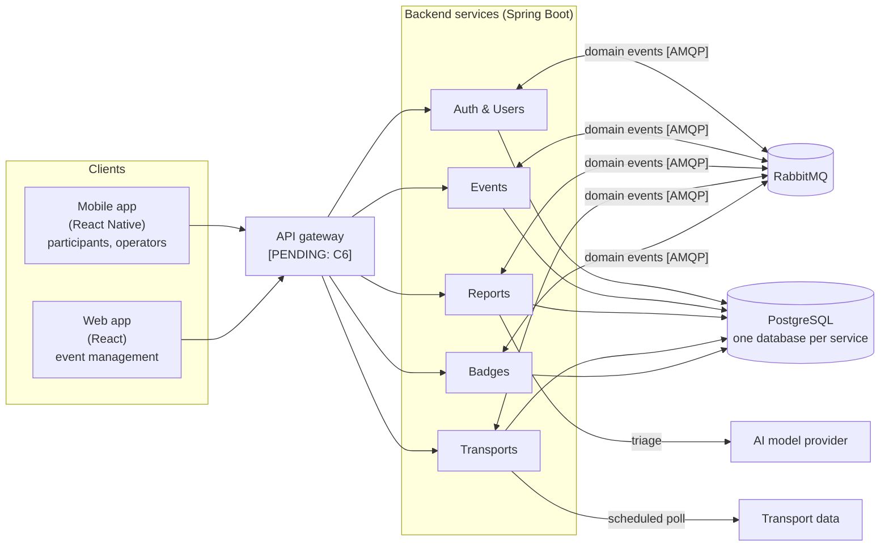

# High-Level System Architecture

> LABDSOF 2026/27 · Sprint A · Assignment §6 (Common Technical Requirements) and §7.1.2 (deliverable 7, *Technical Design*)
> **Status (21 October 2026):** reflects the team decisions recorded in [`architecture-decisions-guide.md`](architecture-decisions-guide.md) (Portuguese). Items marked **[PENDING]** wait for an investigation; the owner is in that document. The reference diagrams are drawn in draw.io and listed in §14 ([ADR-009](adr/0009-architecture-documentation.md)); the Mermaid diagrams below are working sketches.
> Legend: see [`product-vision.md`](../Product/product-vision.md#legend).

## 1. Architecture drivers

What shapes the design, and where it comes from:

| # | Driver | Source |
|---|---|---|
| D1 | **Isolation between events**: one team must never see or change another event's data | Report, *Per-event permissions*; §5 technical risks |
| D2 | **Read peaks**: tens of thousands of participant requests within minutes (e.g. end of a concert) | Report §5 technical risks |
| D3 | **Weak or congested network** at the venue: short messages, data with its update time | Report §5; assumption A8; annex C10 |
| D4 | **Freshness**: every piece of information shows when it was last updated | Report §5; annex C4 |
| D5 | **Sensitive data**: location and help requests (possibly health) need consent, minimisation, short retention | Report §5 regulatory risks |
| D6 | **AI with fallback**: the main workflow must keep working when the AI is unavailable | Assignment §5.6.2; annex C9 |
| D7 | **At least two independently deployable backend components**, or a justified modular monolith | Assignment §6.2 |
| D8 | **At least one asynchronous workflow** and **one external integration** (or realistic simulator) | Assignment §6.3, §6.5 |
| D9 | **Small team, three sprints** | Report §5 execution risks |

## 2. System context

## 3. Container view

The five services are deployed independently from Sprint A (§11).

Not drawn: every container sends logs, metrics and health checks to the observability stack (assignment §6.7; stack **[PENDING]**). Clients get live updates by **polling** (no push in the MVP).

## 4. Responsibilities and data ownership

| Service | Responsibility (features) | Owns (see [`domain-model.md`](domain-model.md)) |
|---|---|---|
| **Auth & Users** | Authentication, authorisation, accounts, roles per event, friends (F1, F2, roles of F4, F18) | UserAccount, Membership, TeamMember; friendships |
| **Events** | Events, venue map and points of interest, response teams, announcements, check-in, entries (F3, teams of F4, F5, F10, F16, F17) | Event, VenueMap, PointOfInterest, ResponseTeam, Announcement; check-ins |
| **Reports** | Community reports and their confirmation, help requests, incident backoffice, AI triage with fallback (F6, F7, F8, F12, F13) | HelpRequest, TriageSuggestion, StatusChange; community reports |
| **Transports** | External transport integration and event shuttles (F9) | TransportOption |
| **Badges** | Badges (F14, F15) | Badges |

Entities in lower case are not in the domain model yet; Tomás and Guerra add them, together with the platform admin (P4).

**Rules:**
- Each service owns its data and its database; no service reads another service's database.
- Services talk **only through events**. Each service keeps a local copy of what it needs from another (e.g. Reports keeps the response teams from Events; every service keeps the roles per event from Auth & Users). The cost is eventual consistency.
- Each service is its own Maven project in `backend/<service>/` and depends only on the others' contracts (OpenAPI and events). Inside, it follows a **hexagonal layout**: `domain`, `application`, `adapters/in`, `adapters/out`.
- APIs are **contract-first**: hand-written OpenAPI in `backend/<service>/contracts/openapi.yaml`, paths under `/api/v1`, server and client code generated ([`spec-driven-development.md`](../Process/spec-driven-development.md)).

## 5. Communication

| From → To | Style | Why |
|---|---|---|
| Apps → services | Synchronous (HTTP/REST) | Request–response by nature |
| Apps (live lists, request status, announcements) | **Polling** | Enough for the MVP; no push infrastructure |
| Service → service | **Asynchronous only** (RabbitMQ, Spring AMQP, *topic* exchanges) | A service that is down does not stop the others |
| Transports → transport data | Scheduled poll | The external source may be slow or down; never called inside a user's request |

## 6. The asynchronous workflow: help-request triage

Required by assignment §6.3 and §7.1.2 (*Asynchronous workflow*). End-to-end flow: [`user-workflows.md`, W2](../Product/user-workflows.md#w2--participant-asks-for-help-core-journey).

| Concern (assignment §6.3) | How it is handled |
|---|---|
| **Lost messages** | Reports saves the request and the outgoing event in the same transaction (**outbox table**); a polling job publishes pending events to RabbitMQ |
| **Duplicate events** | Consumers are idempotent: each keeps a table of processed `message_id`s |
| **Retries** | Retry with backoff, then the **dead-letter exchange**. Number of attempts and backoff **[PENDING]** (Tiago) |
| **Failures** | If no suggestion arrives in time, the request stays in the operator's list with the participant's category, in order of arrival (non-AI fallback), marked "not triaged" |
| **Eventual consistency** | The backoffice shows "awaiting triage" until the suggestion arrives; the operator can act before it does |

## 7. External integration

| Integration | Purpose | Handling of unavailable, late, incomplete or invalid data (assignment §6.5) |
|---|---|---|
| **Transport data**: Porto Digital urban platform (FIWARE NGSI v2, live bus positions; [ADR-008](adr/0008-transport-data-source.md)) | Transport for F9 | Calls with a timeout; data validated on import; data older than its freshness limit counts as late. On any of these, the last valid data is kept and shown with its time and a warning (US-09); event shuttles entered manually are unaffected. A **simulator or recorded real responses** under the team's control (guide J4) is used for automated tests, to cause failures and invalid data in the demo, and as a fallback on presentation day |
| **AI model provider** **[PENDING]** (Tomás; local Ollama is an option) | Triage suggestions (F8) | Timeout, then fallback (§6); the suggestion is never shown as a fact (assignment §5.6.2) |

## 8. Security, authentication and authorisation

Owner: **Guerra** (identity provider, token validation, service-to-service authentication, secrets, Security & Privacy assessment).

| Concern | Decided |
|---|---|
| Accounts | **Login mandatory for every user**, participants included (9 October 2026, DM-1) |
| Authorisation | Role checked **per event** (invariant I1); authN and authZ live in Auth & Users |
| Isolation between events | `event_id` on every event-scoped table, filtered by the application; each service has an integration test proving that a member of event X cannot read or change event Y |
| Audit | Every change to a help request recorded (StatusChange, domain model I5) |
| Rate limiting of help requests | **[PENDING]** with the gateway decision (Guerra) |

> ⚠️ **GAP: Security and Privacy Assessment.** Sprint A deliverable (assignment §7.1.2, item 9). Owner: Guerra.

## 9. Degraded modes

**Decided (9 October 2026):** the §6.8 scenarios are **AI unavailable (D1)** and **transport source unavailable (D2)** ([`features.md` §3.1](../Product/features.md#31-degraded-mode-scenarios-decided-9-october-2026)). How they are demonstrated: **[PENDING]** (Tiago).

| Unavailable | What the user sees |
|---|---|
| **AI provider** | Requests go to the operator untriaged, with the participant's category, in order of arrival |
| **Transport source** | Last known data with its time and a warning |
| **Another service** | The other services keep working (events only between services, local copies) |
| **RabbitMQ** | Requests are still saved (outbox); triage and copies between services catch up when the broker returns |

## 10. Deployment view

**[PENDING]** (Tomás): platform (Azure, ECS or Vercel), where the containers, RabbitMQ and PostgreSQL run, environments, infrastructure as code, local execution, rollback. Azure (Azure for Students) was chosen on 11 October and reopened on 15 October.

Already decided:
- **One instance per service** for now.
- Images built with **multi-stage Dockerfiles** (Maven, Java 21, Spring Boot 4.x).
- **GitHub Actions** runs every check on every PR, merge and tag; each merge to `main` is published and deployed to production (**continuous deployment**), followed by a smoke test. The pipeline is being reviewed by Bruno.
- **Flyway** migrations run at application start and stay compatible with the previous version (*expand and contract*), because a code rollback does not undo them.
- Retention, backup and caching are **future improvements**.

## 11. Architectural style and its evolution

**Decided:** **microservices from the start** ([ADR-001](adr/0001-architectural-style.md)). They meet assignment §6.2 directly, isolate failures (a read peak does not stop help requests) and give small, closed contracts per service.

**Evolution (professor's answer):** the architecture is defined from the start: the five services are independently deployable from Sprint A, which already meets the Sprint B requirement of two independently deployable backend components (§6.2); there is **no modular-monolith phase**. There is no imposed path: any change is **motivated by evidence** (measurements, tests, failures), not by the calendar, and is recorded as a new or superseding ADR. Those ADRs are the *architecture evolution narrative* of §7.3.2 (item 11).

## 12. Technology choices

| Decision | Choice |
|---|---|
| Backend | **Java 21 + Spring Boot 4.x**, Maven |
| Frontend | **React** web app (event management only) · **React Native** mobile app (everything else) |
| Database | **PostgreSQL**, one database per service; Flyway |
| Message broker | **RabbitMQ** with Spring AMQP |
| Live updates | **Polling** |
| API | Contract-first **OpenAPI**, `/api/v1` |
| CI/CD | **GitHub Actions**, monorepo, private repository |
| Architecture views | **C4** (all four levels, level 3 for every service) and **4+1** views without scenarios, drawn in **draw.io** |
| Cloud and deployment | **[PENDING]** Tomás |
| AI provider and model | **[PENDING]** Tomás |
| Observability | **[PENDING]** Tomás |
| Identity | **[PENDING]** Guerra |
| API gateway | **[PENDING]** Guerra |
| Venue map library (React Native) | **[PENDING]** Tiago |
| React Native setup and distribution | **[PENDING]** Bruno |

## 13. Architecture Decision Records

Location and format: `Docs/Technical/adr/NNNN-title.md`, Michael Nygard format plus *Alternatives considered*.

| ADR | Decision | Status |
|---|---|---|
| [ADR-001](adr/0001-architectural-style.md) | Architectural style and evolution (§11) | Accepted |
| [ADR-002](adr/0002-backend-and-frontend-technology.md) | Backend and frontend technology | Accepted |
| [ADR-003](adr/0003-database-and-data-ownership.md) | Database and data ownership | Accepted |
| [ADR-004](adr/0004-service-communication.md) | Service communication: message broker, delivery guarantees, communication only through events | Accepted |
| ADR-005 | AI workflow, provider and fallback | Waits for Tomás |
| ADR-006 | Identity | Waits for Guerra |
| ADR-007 | Venue map representation | Waits for Tiago |
| [ADR-008](adr/0008-transport-data-source.md) | Transport data source | Accepted |
| [ADR-009](adr/0009-architecture-documentation.md) | Architecture documentation (C4, 4+1, draw.io) | Accepted |
| ADR-010 | CI/CD strategy | Waits for Bruno's pipeline review |

> ⚠️ **GAP: API outline and walking skeleton.** Sprint A also asks for an API outline (item 7; owner: Bruno, with the event catalogue) and a walking skeleton: a minimal end-to-end implementation with an automated build, an initial test and a containerised deployment (item 10; later phase, no owner yet).

## 14. Architecture diagrams

4+1 views without scenarios, drawn in draw.io ([ADR-009](adr/0009-architecture-documentation.md)). Each `.drawio.svg` file renders here and opens in draw.io for editing. The logical view also includes the [domain model](domain-model.md).

| View | Levels |
|---|---|
| Logical | [1](diagrams/logical-view-level-1.drawio.svg) · [2](diagrams/logical-view-level-2.drawio.svg) · [3](diagrams/logical-view-level-3.drawio.svg) · [4 mobile](diagrams/logical-view-level-4-mobile.drawio.svg) · [4 web](diagrams/logical-view-level-4-web.drawio.svg) · [4 reports](diagrams/logical-view-level-4-reports.drawio.svg) · [4 transports](diagrams/logical-view-level-4-transports.drawio.svg) |
| Process: help request and triage | [1](diagrams/process-view-level-1-help-request.drawio.svg) · [2](diagrams/process-view-level-2-help-request.drawio.svg) · [3](diagrams/process-view-level-3-help-request.drawio.svg) · [4](diagrams/process-view-level-4-help-request.drawio.svg) |
| Process: transport import | [1](diagrams/process-view-level-1-transports.drawio.svg) · [2](diagrams/process-view-level-2-transports.drawio.svg) · [3](diagrams/process-view-level-3-transports.drawio.svg) · [4](diagrams/process-view-level-4-transports.drawio.svg) |
| Implementation (development) | [1](diagrams/implementation-view-level-1.drawio.svg) · [2](diagrams/implementation-view-level-2.drawio.svg) · [3](diagrams/implementation-view-level-3.drawio.svg) · [4 mobile](diagrams/implementation-view-level-4-mobile.drawio.svg) · [4 web](diagrams/implementation-view-level-4-web.drawio.svg) · [4 reports](diagrams/implementation-view-level-4-reports.drawio.svg) · [4 transports](diagrams/implementation-view-level-4-transports.drawio.svg) |
| Physical **[PENDING: G1]** | [1](diagrams/physical-view-level-1.drawio.svg) · [2](diagrams/physical-view-level-2.drawio.svg) · [3](diagrams/physical-view-level-3.drawio.svg) · [4 mobile](diagrams/physical-view-level-4-mobile.drawio.svg) · [4 web](diagrams/physical-view-level-4-web.drawio.svg) · [4 reports](diagrams/physical-view-level-4-reports.drawio.svg) · [4 transports](diagrams/physical-view-level-4-transports.drawio.svg) |
| Logical → implementation | [1](diagrams/mapping-logical-implementation-level-1.drawio.svg) · [2](diagrams/mapping-logical-implementation-level-2.drawio.svg) · [3](diagrams/mapping-logical-implementation-level-3.drawio.svg) · [4 mobile](diagrams/mapping-logical-implementation-level-4-mobile.drawio.svg) · [4 web](diagrams/mapping-logical-implementation-level-4-web.drawio.svg) · [4 reports](diagrams/mapping-logical-implementation-level-4-reports.drawio.svg) · [4 transports](diagrams/mapping-logical-implementation-level-4-transports.drawio.svg) |
| Logical → physical | [1](diagrams/mapping-logical-physical-level-1.drawio.svg) · [2](diagrams/mapping-logical-physical-level-2.drawio.svg) · [3](diagrams/mapping-logical-physical-level-3.drawio.svg) · [4 mobile](diagrams/mapping-logical-physical-level-4-mobile.drawio.svg) · [4 web](diagrams/mapping-logical-physical-level-4-web.drawio.svg) · [4 reports](diagrams/mapping-logical-physical-level-4-reports.drawio.svg) · [4 transports](diagrams/mapping-logical-physical-level-4-transports.drawio.svg) |
