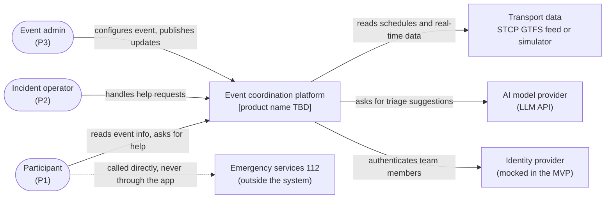
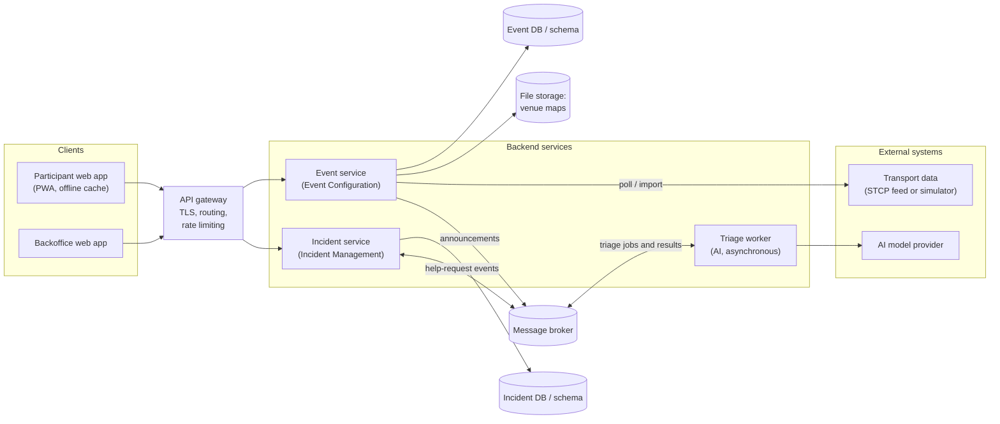
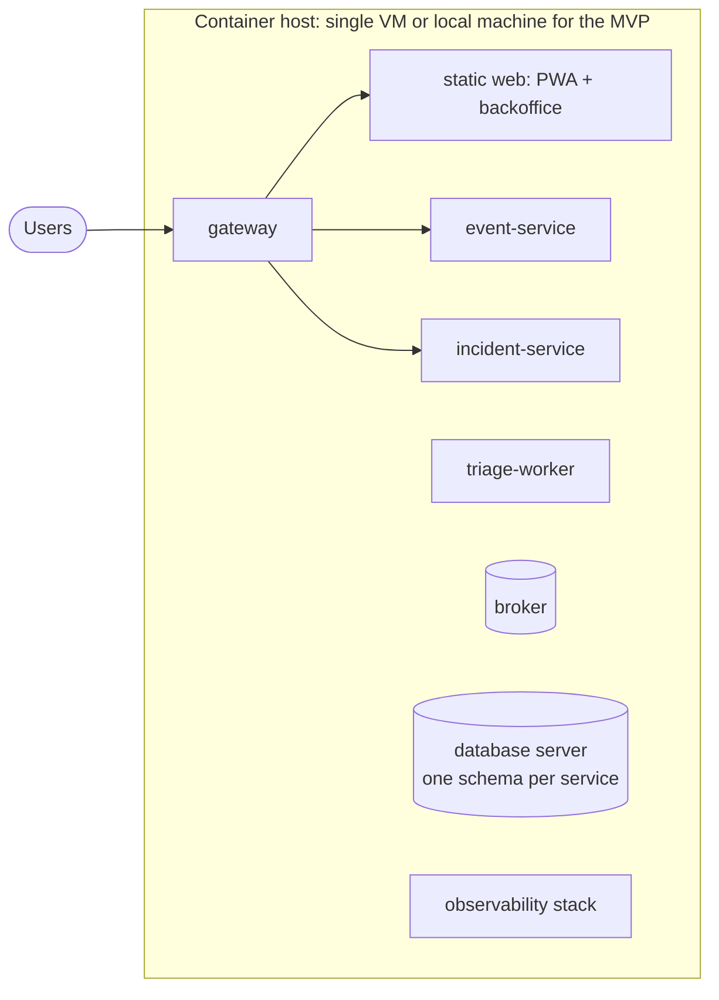

# High-Level System Architecture

> LABDSOF 2026/27 · Sprint 1 · Assignment §6 (Common Technical Requirements) and §7.1.2 (deliverable 7, *Technical Design*)
> **Status:** **[PROPOSED]** first version. No architecture existed in the repository. This document turns the constraints that are already in the repository (report §5 risks, annex C10, MVP definition) and the assignment's technical requirements into a logical architecture. **No technology has been chosen**: technology choices are listed as decisions for the team (§12).
> Legend: see [`product-vision.md`](../Product/product-vision.md#legend).

## 1. Architecture drivers

What shapes the design, and where it comes from:

| # | Driver | Source |
|---|---|---|
| D1 | **Isolation between events**: one team must never see or change another event's data | Report, *Permissões por evento*; §5 technical risks |
| D2 | **Read peaks**: tens of thousands of participant requests within minutes (e.g. end of a concert) | Report §5 technical risks |
| D3 | **Weak or congested network** at the venue: cache, offline mode, short messages | Report §5; assumption A8; annex C10 |
| D4 | **Freshness**: every piece of information shows when it was last updated | Report §5; annex C4 |
| D5 | **Sensitive data**: location and help requests (possibly health) need consent, minimisation, short retention | Report §5 regulatory risks |
| D6 | **AI with fallback**: the main workflow must keep working when the AI is unavailable | Assignment §5.6.2; annex C9 |
| D7 | **At least two independently deployable backend components**, or a justified modular monolith | Assignment §6.2 |
| D8 | **At least one asynchronous workflow** and **one external integration** (or realistic simulator) | Assignment §6.3, §6.5 |
| D9 | **Small team, three sprints** | Report §5 execution risks |

## 2. System context

The app never replaces 112: it shows "Call 112" first and lets the phone make the call (report §5).

## 3. Container view

Not drawn, to keep the diagram readable: every container sends structured logs, metrics and health checks to the observability stack and its operational dashboard (assignment §6.7), and the Event and Incident services push live updates to the clients through the gateway (WebSocket or Server-Sent Events, §5).

## 4. Responsibilities and data ownership

| Container | Responsibility | Owns (see [`domain-model.md`](domain-model.md)) | Independently deployable |
|---|---|---|---|
| **Participant web app** | Event selection, map, information, transport, help request, offline cache | Nothing (cache only) | Yes (static files) |
| **Backoffice web app** | Event configuration (P3); live request list and map (P2) | Nothing | Yes (static files) |
| **API gateway** | Single entry point, TLS, routing, rate limiting per device and IP (abuse of help requests) | Nothing | Yes |
| **Event service** | Events, memberships and roles, venue maps and points of interest, transport (including the external transport adapter), announcements. Serves the participant's read API, which must be cacheable (D2) | Event, Membership, TeamMember, ResponseTeam, VenueMap, PointOfInterest, TransportOption, Announcement | **Yes** |
| **Incident service** | Help requests, their lifecycle and audit; pushes live updates to the backoffice and status to the participant; applies the non-AI fallback | HelpRequest, TriageSuggestion, StatusChange | **Yes** |
| **Triage worker** | Consumes new requests, asks the AI for category and priority, publishes the suggestion. Holds no business data | Nothing | **Yes** |

Each service owns its data; no service reads another service's database. The Incident service gets the event's response teams and points of interest through the Event service's API or by caching them from events **[PROPOSED]**.

## 5. Communication

| From → To | Style | Why |
|---|---|---|
| Clients → Gateway → services | Synchronous (HTTP/REST) | Request–response by nature |
| Incident service → Triage worker | **Asynchronous** (message broker) | The participant gets a confirmation immediately; triage may take seconds or fail (D6) |
| Triage worker → Incident service | Asynchronous | Same reason; the suggestion arrives when ready |
| Event service → clients (announcements) | Asynchronous push (WebSocket or Server-Sent Events) **[PROPOSED]** | Live updates without reloading (US-10) |
| Incident service → backoffice / participant | Asynchronous push | New requests appear without reloading (US-06); participant sees status |
| Event service → transport data | Scheduled poll or import | The external source may be slow or down; never called inside a participant's request |

## 6. The asynchronous workflow: help-request triage

Required by assignment §6.3 and §7.1.2 (*Asynchronous workflow*). Assumes AI Option A ([`features.md` §4](../Product/features.md#4-ai-assisted-workflow-help-request-triage-decided)). End-to-end flow: [`user-workflows.md`, W2](../Product/user-workflows.md#w2--participant-asks-for-help-core-journey).

| Concern (assignment §6.3) | How it is handled **[PROPOSED]** |
|---|---|
| **Retries** | The triage worker retries the AI call with backoff, up to a limit; after that the message goes to a dead-letter queue |
| **Duplicate events** | Messages carry the `requestId`; the worker and the Incident service process each `requestId` once (idempotent consumer) |
| **Failures** | If no suggestion arrives within a time limit, the request stays in the operator's list with the participant's category, in order of arrival (non-AI fallback), marked "not triaged" |
| **Eventual consistency** | The backoffice shows "awaiting triage" until the suggestion arrives; the operator can act before it does |
| **Lost messages** | The Incident service saves the request and the outgoing event in the same transaction (outbox pattern), so a request is never saved without its event, or the reverse |

## 7. External integration

| Integration | Purpose | Handling of unavailable, late, incomplete or invalid data (assignment §6.5) |
|---|---|---|
| **Transport data** (STCP GTFS feed or a realistic simulator) **[DECISION NEEDED]** | Real-time and scheduled transport for F6 | Data validated on import; on failure, the last valid data is kept and shown with its time and a warning (US-09); event shuttles entered manually are unaffected |
| **AI model provider** | Triage suggestions (F9) | Timeout, then fallback (§6); the suggestion is never shown as a fact (assignment §5.6.2) |

> ⚠️ **GAP: transport source.** The annex notes that STCP real-time data reached Google Maps in June 2026 but it is not known whether the event shuttles are included (annex C5, *[H: verificar no GTFS]*). Needed: check whether the STCP GTFS feed is openly available and usable; otherwise decide to build a simulator.

## 8. Security, authentication and authorisation

| Concern | Approach **[PROPOSED]** | Source |
|---|---|---|
| Team members | Authenticated through an identity provider; token carries the user ID. **Mocked in the MVP** is allowed | Assignment §6.6, footnote 1 |
| Authorisation | Role checked **per event** on every request (invariant I1); enforced in each service, not only in the gateway | Report §5; domain model I1 |
| Participants | Anonymous device token, no account **(depends on open question DM-1)** | Report: "sem instalação obrigatória" |
| Service to service | Services only accept calls from the gateway or the internal network; broker credentials per service | Assignment §6.6 |
| Audit | Every change to a help request recorded (StatusChange) | Domain model I5; assignment §6.6 |
| Abuse | Rate limit on help requests per device and IP in the gateway | **[PROPOSED]** |
| Isolation tests | Automated tests that try to access event Y as a member of event X | Report §5: "exige testes automáticos dedicados a este isolamento" |

> ⚠️ **GAP: Security and Privacy Assessment.** A Sprint 1 deliverable (assignment §7.1.2, item 9: threat model, sensitive data, access control, data minimisation, retention) does not exist. This section and the domain model §5 are starting points.

## 9. Degraded modes

The assignment requires at least one degraded-mode scenario to be implemented and demonstrated (§6.8). Candidates, all derived from the drivers:

| Unavailable | What the user sees **[PROPOSED]** | Driver |
|---|---|---|
| **Network** (participant) | Map and information from cache, labelled "data from HH:MM"; help request cannot be sent, so the app shows the nearest first aid and "Call 112" (W6) | D3 |
| **AI service** | Requests go to the operator untriaged, with the participant's category, in order of arrival | D6 |
| **Transport data provider** | Last known data with its time and a warning | D4 |
| **Incident service** | Participant app shows "Help requests are temporarily unavailable: call 112 or go to the nearest first aid"; event information still works because it comes from the Event service | D7 |
| **Message broker** | Requests are still saved (outbox); triage and live updates resume when the broker returns; backoffice falls back to periodic refresh | D6 |

> ⚠️ **GAP:** the team has to choose which scenario to demonstrate in the presentation (see [`user-workflows.md`, W6](../Product/user-workflows.md#w6--participant-loses-the-network-degraded-mode)).

## 10. Deployment view

**[PROPOSED]:** every container is built by the CI pipeline and started with one compose file for the MVP (assignment §8.4: reproducible builds, environment configuration, secrets outside the repository, deployment instructions, rollback). Orchestration (e.g. Kubernetes) only if justified (assignment §8.4).

> ⚠️ **GAP: target environment.** Needed: where the MVP will be deployed (university infrastructure, a cloud free tier, a team member's machine) and how the teaching staff will access it (assignment §12).

## 11. Why separate services, and the alternative

**Proposal:** two business services (Event, Incident) plus a triage worker.

| For | Against |
|---|---|
| The two contexts have different load: the Event service takes the participant read peaks (D2, cacheable); the Incident service takes few writes that must not be lost | More moving parts to build, deploy and monitor in three sprints (D9) |
| Failure isolation: a read spike on event content must not stop help requests, and the reverse (§9) | Data needed by both sides (response teams, points of interest) must be copied or fetched |
| The triage worker can fail or be slow without affecting anything else (D6) | |
| Meets assignment §6.2 directly | |

**Alternative:** a **modular monolith** with the same two modules and a background job for triage. The assignment accepts it only "when the team presents convincing evidence that independently deployable services would introduce unnecessary complexity", with module boundaries that stay explicit and enforceable (§6.2). **[DECISION NEEDED]**, to record as ADR-001.

## 12. Technology choices **[DECISION NEEDED]**

The repository says nothing about technology. Each line below needs a decision and an ADR (assignment §7.1.2, item 8). The options are examples, not recommendations.

| Decision | Examples of options | Constraint from the assignment or repository |
|---|---|---|
| Backend language and framework | .NET, Java/Spring, Node.js, Python | Team skills; justify the choice |
| Frontend (PWA and backoffice) | React, Angular, Vue, Svelte | Must work as a PWA with offline cache (D3) |
| Database | PostgreSQL, MongoDB, … | **One** database technology unless justified (§6.4) |
| Message broker | RabbitMQ, Redis Streams, Kafka, cloud queue | Retries, dead-letter queue, at-least-once delivery (§6.3) |
| Real-time push | WebSocket, Server-Sent Events | Weak network (D3) |
| Map rendering | Image with overlay coordinates, or a mapping library | Map is an image or PDF uploaded by the team (annex C3) |
| AI provider and model | Hosted LLM API or a local model | Cost, latency, data sent to a third party (D5) |
| Identity | Mocked JWT issuer, Keycloak, cloud identity | Mock allowed in the MVP (§6.6) |
| Observability | Structured logs + metrics + dashboard stack | Logs, health checks, metrics, correlation IDs, error reporting, dashboard (§6.7) |
| CI/CD | GitHub Actions or another pipeline | Build, tests, static analysis, dependency checks, images, deployment (§8.5) |

## 13. Architecture Decision Records to write

| ADR | Decision |
|---|---|
| ADR-001 | Separate services or modular monolith (§11) |
| ADR-002 | Backend and frontend technology |
| ADR-003 | Database technology and data ownership per service |
| ADR-004 | Message broker and delivery guarantees |
| ADR-005 | AI workflow (Option A or B), provider and fallback |
| ADR-006 | Participant identity: anonymous token or account (domain model DM-1) |
| ADR-007 | Venue map representation (image coordinates or geospatial) |
| ADR-008 | Transport data source: STCP GTFS or simulator |

> ⚠️ **GAP: ADRs, API outline and walking skeleton.** Sprint 1 also asks for Architecture Decision Records (item 8), an API outline (item 7) and a walking skeleton: a minimal end-to-end implementation with an automated build, an initial test and a containerised deployment (item 10). None of these exists in the repository yet.
