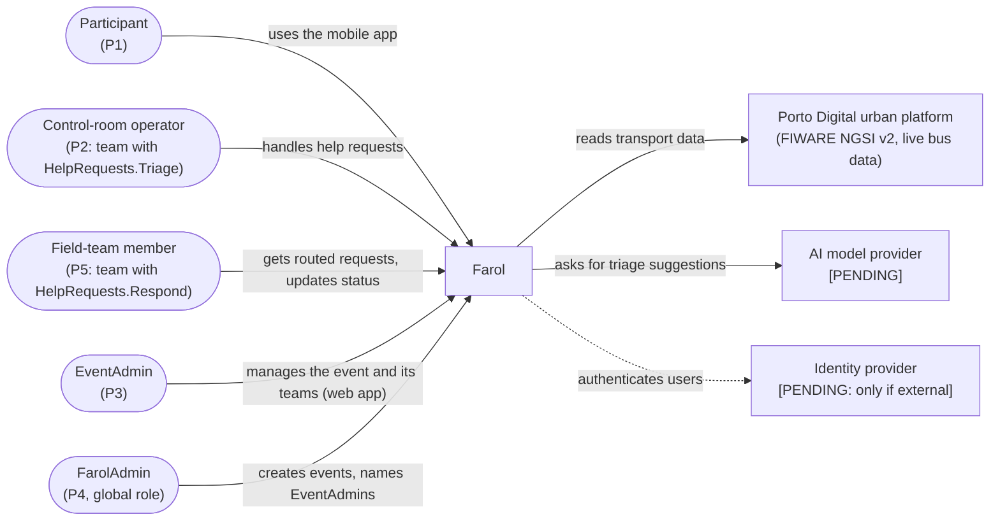
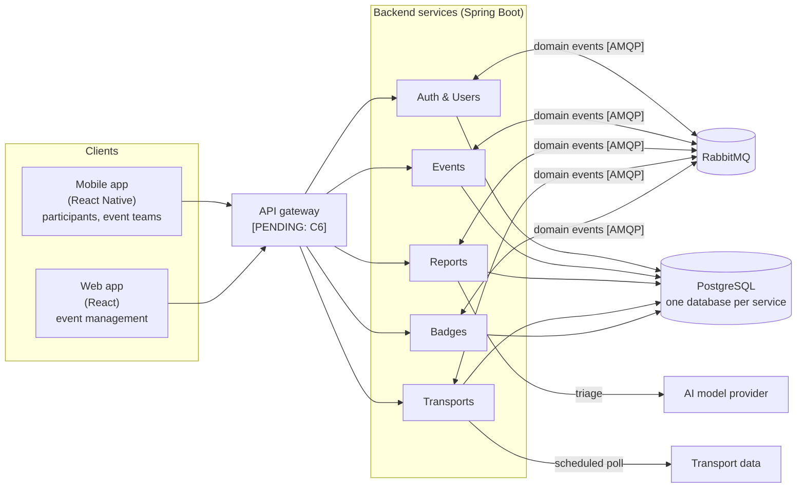

# High-Level System Architecture

> LABDSOF 2026/27 · Sprint A · Assignment §6 (Common Technical Requirements) and §7.1.2 (deliverable 7, *Technical Design*)
> **Status (21 October 2026):** reflects the team decisions recorded in [`architecture-decisions-guide.md`](architecture-decisions-guide.md) (Portuguese). Items marked **[PENDING]** wait for an investigation; the owner is in that document. The reference diagrams are drawn in draw.io and listed in §14 ([ADR-009](adr/0009-architecture-documentation.md)); the Mermaid diagrams below are working sketches.
> Legend: see [`product-vision.md`](../Product/product-vision.md#legend).

> **Research update (22 October 2026, #53):** The [investigation](../Research/architecture-investigation/README.md) supplies recommendations for deployment, observability and AI, including C1 hosting and D2 server topology. ADR-005 and ADR-012 remain **Proposed**. [ADR-011](adr/0011-deployment-and-infrastructure.md) now records the professor-authorised local-only delivery due to costs, as reported by Tomás; the cloud evaluation is retained. Detailed implementation/evidence and diagram alignment remain pending.

## 1. Architecture drivers

What shapes the design, and where it comes from:

| # | Driver | Source |
|---|---|---|
| D1 | **Isolation between events**: one team must never see or change another event's data | Report, *Per-event permissions*; §5 technical risks |
| D2 | **Read peaks**: tens of thousands of participant requests within minutes (e.g. end of a concert) | Report §5 technical risks |
| D3 | **Weak or congested network** at the venue: short messages, data with its update time | Report §5; assumption A8; annex C10 |
| D4 | **Freshness**: every piece of information shows when it was last updated | Report §5; annex C4 |
| D5 | **Sensitive data**: location and help requests (possibly health) need consent, minimisation, short retention | Report §5 regulatory risks |
| D6 | **AI with fallback**: the main workflow must keep working when the AI is unavailable | Assignment §5.6.2; annex C9 |
| D7 | **At least two independently deployable backend components**, or a justified modular monolith | Assignment §6.2 |
| D8 | **At least one asynchronous workflow** and **one external integration** (or realistic simulator) | Assignment §6.3, §6.5 |
| D9 | **Small team, three sprints** | Report §5 execution risks |

## 2. System context

## 3. Container view

The five services are deployed independently from Sprint A (§11).

Not drawn: every container sends logs, metrics and health checks to the observability stack (assignment §6.7; stack **[PENDING team acceptance]**; [observability proposal](../Research/architecture-investigation/observability.md)). Clients get live updates by **polling** (no push in the MVP).

## 4. Responsibilities and data ownership

| Service | Responsibility (features) | Owns (see [`domain-model.md`](domain-model.md)) |
|---|---|---|
| **Auth & Users** | Authentication, authorisation, accounts, the global `FarolAdmin` role, memberships of events with their role (`EventAdmin`, `RegularUser`) and team assignments, friends (F1, F2, roles and team members of F4, F18) | UserAccount, GlobalRoleGrant, EventMembership, TeamAssignment; friendships |
| **Events** | Events, venue map and points of interest, teams with their permissions and help categories, announcements, check-in, entries (F3, teams of F4, F5, F10, F16, F17) | Event, VenueMap, PointOfInterest, Team, TeamPermission, Announcement; check-ins |
| **Reports** | Community reports and their confirmation, help requests, incident backoffice, AI triage with fallback (F6, F7, F8, F12, F13) | HelpRequest, TriageSuggestion, StatusChange; community reports |
| **Transports** | External transport integration and event shuttles (F9) | TransportOption |
| **Badges** | Badges (F14, F15) | Badges |

Entities in lower case are not in the domain model yet; Tomás and Guerra add them.

**Where roles and permissions live** ([`features.md` §4](../Product/features.md#4-roles-teams-and-permissions-22-october-2026), to confirm with the team):
- **Auth & Users** holds who is who: the `FarolAdmin` grant, each user's membership of each event with its role, and which members are in which team. It publishes a domain event when any of these changes.
- **Events** holds the teams: their names, permissions (fixed list, with the report types for `Reports.Review`) and help categories. It publishes a domain event when a team or its permissions change.
- A member's permissions in an event are the union of their teams' permissions; an `EventAdmin` has all of them. Each service that checks a permission keeps a local copy of the memberships, team assignments and team permissions it needs (rules below). Where the check runs and how the token carries it is guide E2 (Guerra).

**Rules:**
- Each service owns its data and its database; no service reads another service's database.
- Services talk **only through events**. Each service keeps a local copy of what it needs from another (e.g. Reports keeps the teams, their permissions and help categories from Events; every service keeps the memberships and team assignments of its events from Auth & Users). The cost is eventual consistency.
- Each service is its own Maven project in `backend/<service>/` and depends only on the others' contracts (OpenAPI and events). Inside, it follows a **hexagonal layout**: `domain`, `application`, `adapters/in`, `adapters/out`.
- APIs are **contract-first**: hand-written OpenAPI in `backend/<service>/contracts/openapi.yaml`, paths under `/api/v1`, server and client code generated ([`spec-driven-development.md`](../Process/spec-driven-development.md)).

## 5. Communication

| From → To | Style | Why |
|---|---|---|
| Apps → services | Synchronous (HTTP/REST) | Request–response by nature |
| Apps (live lists, request status, announcements) | **Polling** | Enough for the MVP; no push infrastructure |
| Service → service | **Asynchronous only** (RabbitMQ, Spring AMQP, *topic* exchanges) | A service that is down does not stop the others |
| Transports → transport data | Scheduled poll | The external source may be slow or down; never called inside a user's request |

## 6. The asynchronous workflow: help-request triage

Required by assignment §6.3 and §7.1.2 (*Asynchronous workflow*). End-to-end flow: [`user-workflows.md`, W2](../Product/user-workflows.md#w2--participant-asks-for-help-core-journey).

| Concern (assignment §6.3) | How it is handled |
|---|---|
| **Lost messages** | Reports saves the request and the outgoing event in the same transaction (**outbox table**); a polling job publishes pending events to RabbitMQ |
| **Duplicate events** | Consumers are idempotent: each keeps a table of processed `message_id`s |
| **Retries** | Retry with backoff, then the **dead-letter exchange**. Number of attempts and backoff **[PENDING]** (Tiago) |
| **Failures** | If no suggestion arrives in time, the request stays in the operator's list with the participant's category, in order of arrival (non-AI fallback), marked "not triaged" |
| **Eventual consistency** | The backoffice shows "awaiting triage" until the suggestion arrives; the operator can act before it does |

## 7. External integration

| Integration | Purpose | Handling of unavailable, late, incomplete or invalid data (assignment §6.5) |
|---|---|---|
| **Transport data**: Porto Digital urban platform (FIWARE NGSI v2, live bus positions; [ADR-008](adr/0008-transport-data-source.md)) | Transport for F9 | Calls with a timeout; data validated on import; data older than its freshness limit counts as late. On any of these, the last valid data is kept and shown with its time and a warning (US-42, US-43); event shuttles entered manually are unaffected. A **simulator or recorded real responses** under the team's control (guide J4) is used for automated tests, to cause failures and invalid data in the demo, and as a fallback on presentation day |
| **AI model provider** **[PENDING]** (Tomás; local Ollama is an option) | Triage suggestions (F8) | Timeout, then fallback (§6); the suggestion is never shown as a fact (assignment §5.6.2) |

## 8. Security, authentication and authorisation

Owner: **Guerra** (identity provider, token validation, service-to-service authentication, secrets, Security & Privacy assessment).

| Concern | Decided |
|---|---|
| Accounts | **Login mandatory for every user**, participants included (9 October 2026, DM-1) |
| Authorisation | Checked **per event** (invariant I1): the user's role in that event (`EventAdmin` or `RegularUser`) and the permissions of their teams there (§4). `FarolAdmin` is the only global role and gives no access to any event's data. Accounts, roles and memberships live in Auth & Users, teams and their permissions in Events; where the token is validated and the permission is checked is **[PENDING]** (guide E2, Guerra) |
| Isolation between events | `event_id` on every event-scoped table, filtered by the application; each service has an integration test proving that a member of event X cannot read or change event Y |
| Audit | Every change to a help request recorded (StatusChange, domain model I5) |
| Rate limiting of help requests | **[PENDING]** with the gateway decision (Guerra) |

> ⚠️ **GAP: Security and Privacy Assessment.** Sprint A deliverable (assignment §7.1.2, item 9). Owner: Guerra.

## 9. Degraded modes

**Decided (9 October 2026):** the §6.8 scenarios are **AI unavailable (D1)** and **transport source unavailable (D2)** ([`features.md` §3.1](../Product/features.md#31-degraded-mode-scenarios-decided-9-october-2026)). How they are demonstrated: **[PENDING]** (Tiago); for D2, the transport simulator injects unavailability, delays and invalid data (guide J4).

| Unavailable | What the user sees |
|---|---|
| **AI provider** | Requests go to the operator untriaged, with the participant's category, in order of arrival |
| **Transport source** | Last known data with its time and a warning |
| **Another service** | The other services keep working (events only between services, local copies) |
| **RabbitMQ** | Requests are still saved (outbox); triage and copies between services catch up when the broker returns |

## 10. Deployment view

**Current scope: local-only deployment/execution.** Tomás reported that the professor authorised proceeding locally **because of cloud-hosting costs**, provided the team explains that reason in the final report/presentation. See the [clarification record](../Meetings/2026-10-22-local-deployment-clarification.md) and [ADR-011](adr/0011-deployment-and-infrastructure.md). The [cloud assessment and dated costs](../Research/architecture-investigation/deployment.md) remain documented evidence and future alternatives, not a requirement to provision cloud resources.

The local topology recommendation is one machine with five independently replaceable backend containers, one RabbitMQ with a persistent volume, one PostgreSQL instance with five separate databases/users and a web-server container for the React app. Gateway, simulator, observability and optional inference add components as needed; the mobile client runs on a device/emulator. Separate database containers are also possible without separate machines. Exact Compose configuration and resource sizing still need implementation/measurement.

Preserved requirements and limits:
- **One instance per service** initially; independent images and service replacement still demonstrate the microservice boundaries.
- **Multi-stage Dockerfiles**, Maven, Java 21 and Spring Boot 4.x; **GitHub Actions** checks every service on every PR/merge/tag.
- The earlier automatic-deploy-to-cloud-production promise is superseded for this delivery scope. Bruno defines reproducible local startup/update and smoke-test handoff; cloud credentials/ACR/provisioning are not prerequisites.
- **Versioning (guide H7):** one **SemVer** version for the whole monorepo, set by an annotated git tag `vX.Y.Z` on `main`; every service image and the web app get the same version without the `v` (`farol-<service>:0.2.0`), other builds are `dev`. One MINOR release at the end of each sprint (`v0.1.0` Sprint A, `v0.2.0` Sprint B, `v1.0.0` Sprint C), PATCH only to fix a release already demonstrated. Git tags only: no registry and no GitHub Releases; images are built from the tag, rolling back means building the previous tag, and release notes go in the `CHANGELOG.md`.
- **Flyway** migrations remain compatible with the previous application image (*expand and contract*); rolling back code does not undo database migrations.
- Local metrics/traces/logs and degraded-mode/integration tests still provide evidence. No cloud HA, managed scaling or cloud recovery result is claimed.
- Persistent local volumes are not a backup or a guarantee against host/disk loss. Backup scope and observed recovery limits remain explicit.

## 11. Architectural style and its evolution

**Decided:** **microservices from the start** ([ADR-001](adr/0001-architectural-style.md)). They meet assignment §6.2 directly, isolate failures (a read peak does not stop help requests) and give small, closed contracts per service.

**Evolution (decided 21 October 2026, guide A4; professor's answer):** the architecture is defined from the start: the five services are independently deployable from Sprint A, each with its own `main`, Dockerfile and database, which already meets the Sprint B requirement of two independently deployable backend components (§6.2); there is **no modular-monolith phase**. There is no imposed path: any change is **motivated by evidence** (measurements, tests, failures), not by the calendar, and is recorded as a new or superseding ADR. For example, scaling a service for the peak (J3) would be recorded with the evidence that motivated it. Those ADRs are the *architecture evolution narrative* of §7.3.2 (item 11). This replaces the proposal of 15 October (modular monolith in Sprints A–B, split in Sprint C).

## 12. Technology choices

| Decision | Choice |
|---|---|
| Backend | **Java 21 + Spring Boot 4.x**, Maven |
| Frontend | **React** web app (event management only) · **React Native** mobile app (everything else) |
| Database | **PostgreSQL**, one database per service; Flyway |
| Message broker | **RabbitMQ** with Spring AMQP |
| Live updates | **Polling** |
| API | Contract-first **OpenAPI**, `/api/v1` |
| CI/CD | **GitHub Actions**, monorepo, private repository |
| Versioning | **SemVer**, one version for the monorepo, git tag `vX.Y.Z` per sprint; images `farol-<service>:X.Y.Z`, no registry (§10) |
| Architecture views | **C4** (all four levels, level 3 for every service) and **4+1** views without scenarios, drawn in **draw.io** |
| Deployment | **Local-only scope authorised by the professor, reported by Tomás; cloud omitted due to costs.** [ADR-011](adr/0011-deployment-and-infrastructure.md); local implementation pending |
| AI provider and model | **[PROPOSED]** Hosted Mistral Small vs local Ollama comparison; selection gates in [ADR-005](adr/0005-ai-triage-provider-and-evaluation.md) |
| Observability | **[PROPOSED]** Local Micrometer/OpenTelemetry + Prometheus/Grafana; Azure Monitor retained as cloud alternative. [ADR-012](adr/0012-observability.md) |
| Identity | **[PENDING]** Guerra |
| API gateway | **[PENDING]** Guerra |
| Venue map (React Native) | **`react-native-svg`** markers inside a **`react-native-zoom-toolkit`** zoom/pan container (Gesture Handler + Reanimated); normalised `MapPosition` coordinates; works on iOS and Android, with Expo and bare React Native (to confirm with a spike on real devices before the map is built). The web app uses a plain `` with positioned markers. PDF maps are rendered to a PNG on upload by the Events service (**Apache PDFBox**). See [ADR-007](adr/0007-venue-map-representation.md) |
| React Native setup and distribution | **[PENDING]** Bruno |

## 13. Architecture Decision Records

Location and format: `Docs/Technical/adr/NNNN-title.md`, Michael Nygard format plus *Alternatives considered*.

| ADR | Decision | Status |
|---|---|---|
| [ADR-001](adr/0001-architectural-style.md) | Architectural style and evolution (§11) | Accepted |
| [ADR-002](adr/0002-backend-and-frontend-technology.md) | Backend and frontend technology | Accepted |
| [ADR-003](adr/0003-database-and-data-ownership.md) | Database and data ownership | Accepted |
| [ADR-004](adr/0004-service-communication.md) | Service communication: message broker, delivery guarantees, communication only through events | Accepted |
| [ADR-005](adr/0005-ai-triage-provider-and-evaluation.md) | AI workflow, provider and fallback | Proposed; evaluation/privacy gates pending |
| ADR-006 | Identity | Waits for Guerra |
| [ADR-007](adr/0007-venue-map-representation.md) | Venue map representation | Accepted |
| [ADR-008](adr/0008-transport-data-source.md) | Transport data source | Accepted |
| [ADR-009](adr/0009-architecture-documentation.md) | Architecture documentation (C4, 4+1, draw.io) | Accepted |
| ADR-010 | CI/CD strategy, including versioning (§10, guide H7) | Waits for Bruno's pipeline review; versioning decided |
| [ADR-011](adr/0011-deployment-and-infrastructure.md) | Local deployment and cloud alternatives | Local-only delivery authorised; detailed implementation/recovery pending |
| [ADR-012](adr/0012-observability.md) | Observability | Proposed; instrumentation and SLO validation pending |

> ⚠️ **GAP: API outline and walking skeleton.** Sprint A also asks for an API outline (item 7; owner: Bruno, with the event catalogue) and a walking skeleton: a minimal end-to-end implementation with an automated build, an initial test and a containerised deployment (item 10; later phase, no owner yet).

## 14. Architecture diagrams

4+1 views without scenarios, drawn in draw.io ([ADR-009](adr/0009-architecture-documentation.md)). Each `.drawio.svg` file renders here and opens in draw.io for editing. The logical view also includes the [domain model](domain-model.md).

| View | Levels |
|---|---|
| Logical | [1](diagrams/logical-view-level-1.drawio.svg) · [2](diagrams/logical-view-level-2.drawio.svg) · [3](diagrams/logical-view-level-3.drawio.svg) · [4 mobile](diagrams/logical-view-level-4-mobile.drawio.svg) · [4 web](diagrams/logical-view-level-4-web.drawio.svg) · [4 reports](diagrams/logical-view-level-4-reports.drawio.svg) · [4 transports](diagrams/logical-view-level-4-transports.drawio.svg) |
| Process: help request and triage | [1](diagrams/process-view-level-1-help-request.drawio.svg) · [2](diagrams/process-view-level-2-help-request.drawio.svg) · [3](diagrams/process-view-level-3-help-request.drawio.svg) · [4](diagrams/process-view-level-4-help-request.drawio.svg) |
| Process: transport import | [1](diagrams/process-view-level-1-transports.drawio.svg) · [2](diagrams/process-view-level-2-transports.drawio.svg) · [3](diagrams/process-view-level-3-transports.drawio.svg) · [4](diagrams/process-view-level-4-transports.drawio.svg) |
| Implementation (development) | [1](diagrams/implementation-view-level-1.drawio.svg) · [2](diagrams/implementation-view-level-2.drawio.svg) · [3](diagrams/implementation-view-level-3.drawio.svg) · [4 mobile](diagrams/implementation-view-level-4-mobile.drawio.svg) · [4 web](diagrams/implementation-view-level-4-web.drawio.svg) · [4 reports](diagrams/implementation-view-level-4-reports.drawio.svg) · [4 transports](diagrams/implementation-view-level-4-transports.drawio.svg) |
| Physical **[TO ALIGN: local deployment scope]** | [1](diagrams/physical-view-level-1.drawio.svg) · [2](diagrams/physical-view-level-2.drawio.svg) · [3](diagrams/physical-view-level-3.drawio.svg) |
| Logical → implementation | [1](diagrams/mapping-logical-implementation-level-1.drawio.svg) · [2](diagrams/mapping-logical-implementation-level-2.drawio.svg) · [3](diagrams/mapping-logical-implementation-level-3.drawio.svg) · [4 mobile](diagrams/mapping-logical-implementation-level-4-mobile.drawio.svg) · [4 web](diagrams/mapping-logical-implementation-level-4-web.drawio.svg) · [4 reports](diagrams/mapping-logical-implementation-level-4-reports.drawio.svg) · [4 transports](diagrams/mapping-logical-implementation-level-4-transports.drawio.svg) |
| Logical → physical | [1](diagrams/mapping-logical-physical-level-1.drawio.svg) · [2](diagrams/mapping-logical-physical-level-2.drawio.svg) · [3](diagrams/mapping-logical-physical-level-3.drawio.svg) |
