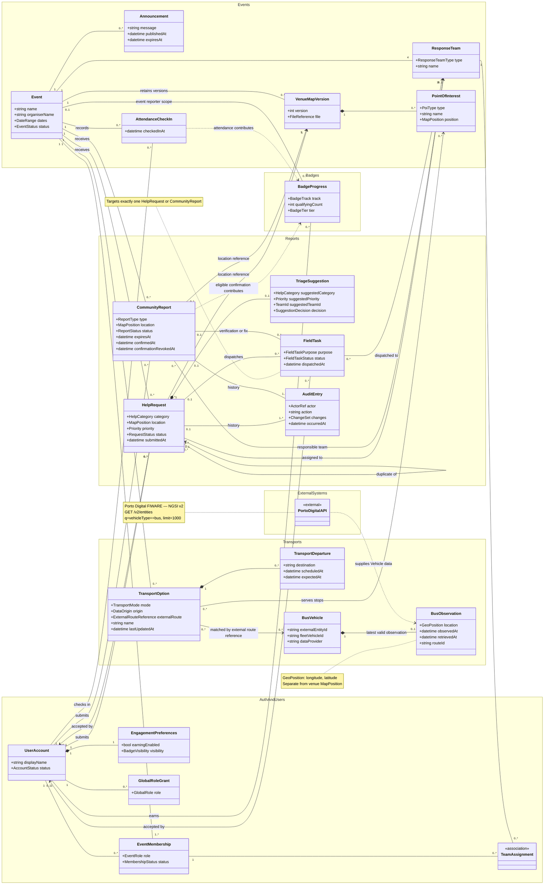

# Farol — Domain Model

> Conceptual model organised into five services: **Auth & Users**, **Events**, **Reports**, **Transports** and **Badges**. Service boundaries, attributes and cardinalities are proposed for review.

## Entities and concepts

| Service / area | Entity or concept | Purpose and main rule |
|---|---|---|
| Auth & Users | **UserAccount** | One account across events for participants and staff. Staff permissions come from event memberships, not from simply having an account. |
| Auth & Users | **EngagementPreferences** | The account's badge earning and visibility preferences. Badges are private by default; earning is optional. |
| Auth & Users | **GlobalRoleGrant** | Grants a platform-wide role such as PlatformAdmin. It does not itself grant access to event help requests, reports or participants. |
| Auth & Users | **EventMembership** | Links an account to one event with a role and membership status. Proposed roles: Owner, Admin, Operator and Responder; an event keeps at least one active Owner. |
| Auth & Users | **TeamAssignment** | Associates an event membership with a response team in the same event. Determines which team-specific work a member can access. |
| Events | **Event** | A festival edition with its own organiser, dates, status and operational data. Defines the isolation boundary for event-specific information. |
| Events | **ResponseTeam** | An event's Medical, Security, PCR or Logistics team. Help requests can be assigned to the first three; Logistics handles community reports. |
| Events | **VenueMapVersion** | A version of the uploaded venue image/PDF. Historical versions remain available for the requests and reports that refer to them. |
| Events | **PointOfInterest** | A named place on a map version, such as an entrance, stage, WC, first-aid point or transport stop. |
| Events | **Announcement** | Official event information published by authorised staff, with publication time and optional expiry. |
| Events | **AttendanceCheckIn** | Records an authenticated participant's attendance at the venue during the event dates. Counts once per account/event; included as a Should-have feature. |
| Reports | **HelpRequest** | A participant's request for assistance, with category, map location, priority and status. Goes to the event's control-room queue; it never earns badges. |
| Reports | **TriageSuggestion** | Optional AI recommendation attached to a help request. An operator accepts or changes it; it never overwrites a human decision or blocks the request. |
| Reports | **CommunityReport** | A report about a place or service, routed by type to the responsible team. Visible to other participants only while confirmed and active. |
| Reports | **FieldTask** | Work dispatched to a response team to assist with a request, verify a report or fix a problem. Targets exactly one request or report; only one responder can accept it. |
| Cross-cutting; shown in Reports | **AuditEntry** | Records the actor, time and previous/new values of a change. Each service owns its own audit history; the diagram shows request/report history as the operational example. |
| Transports | **TransportOption** | A transport service relevant to an event: manual shuttle or an external service reference. Can serve several stops and match several observed buses. |
| Transports | **TransportDeparture** | A scheduled or expected departure associated with a transport option. Requires manual data or another validated source; the bus-vehicle endpoint does not supply departure times. |
| Transports | **BusVehicle** | A bus identified by its external entity ID and provider. Shared external transport data, rather than an event-owned vehicle. |
| Transports | **BusObservation** | The latest valid bus position, route reference and observation/retrieval timestamps. A fresh retrieval does not imply a fresh observation. |
| Badges | **BadgeProgress** | Derived account progress for ReportHistory, EventReporter or EventAttendance. Confirmed reports count after expiry/resolution; withdrawing confirmation removes their credit. |
| External system | **PortoDigitalAPI** | [Porto Digital FIWARE bus API](https://broker.fiware.urbanplatform.portodigital.pt/v2/entities?q=vehicleType==bus&limit=1000), supplying NGSI v2 vehicle observations. Provides bus context, not timetables or predicted arrivals. |

## How to read the model

- **Scope:** event-specific references must resolve within the same event. Accounts, account-wide badge progress and external bus observations can span events. Associations across services express conceptual references, not shared database tables.
- **Locations:** `MapPosition` uses normalised coordinates on a specific venue-map version. `GeoPosition` uses geographic longitude/latitude for buses. They are different coordinate systems.
- **Cardinalities:** `1` means exactly one; `0..1` means optional; `0..*` means zero or more; `1..*` means one or more. The optional Event association on BadgeProgress applies only to the EventReporter track.
- **Notation:** a filled diamond denotes composition; a plain association connects concepts; a dashed arrow expresses a dependency or contribution. Namespace boxes group concepts by service; ExternalSystems contains the external provider.
