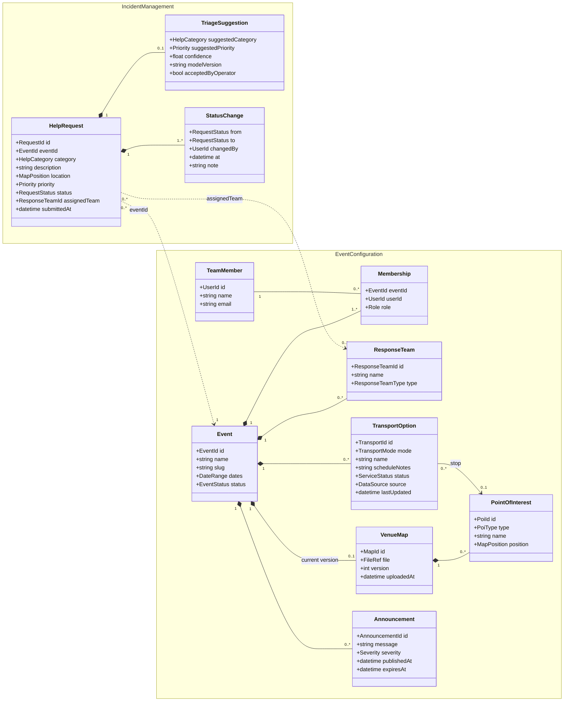

# Domain Model

> LABDSOF 2026/27 · Sprint 1 · Assignment §6.4 (Data Management) and §7.1.2 (deliverable 7, *Data model*)
> **Status:** **[PROPOSED]** first version. No domain model existed in the repository. Every entity below is derived from concepts that already appear in the repository documents (source given for each one); attributes, relationships and invariants are proposals for the team to review.
> Legend: see [`product-vision.md`](../Product/product-vision.md#legend).

## 1. Bounded contexts

The product has two halves that change for different reasons and are used by different people (report, *Visão do produto*; market analysis §3), so the model is split into two contexts. They map to the two backend services in [`architecture.md`](architecture.md).

| Context | Purpose | Main users | Entities |
|---|---|---|---|
| **Event Configuration** | Everything the event team sets up and publishes: the event, its team, the venue map, points of interest, transport and announcements | P3 (admin) writes, P1 (participant) reads | Event, Membership, TeamMember, ResponseTeam, VenueMap, PointOfInterest, TransportOption, Announcement |
| **Incident Management** | Help requests from participants and their handling by the team | P1 creates, P2 (operator) handles | HelpRequest, TriageSuggestion, StatusChange |

**Event** is the boundary between tenants: every entity belongs to exactly one event, and nothing is shared between events (report, *Permissões por evento*). The Incident Management context refers to the event, to response teams and to points of interest **by ID only**.

## 2. Class diagram

## 3. Entities

### Event Configuration

| Entity | Description | Source in the repository |
|---|---|---|
| **Event** | One academic festival edition (e.g. Queima das Fitas do Porto 2027). Root of everything else. Status: `Draft → Published → Live → Closed` **[PROPOSED]** | Report, *Visão do produto*: "uma única aplicação que reúne vários eventos" |
| **TeamMember** | A person who uses the backoffice. Can belong to several events | Report: "cada evento tem um owner e uma equipa" |
| **Membership** | Links a team member to an event with a **Role**: `Owner`, `Admin`, `Operator` **[PROPOSED]**. Permissions are always evaluated per event | Report: "cada equipa só vê e altera o seu próprio evento" |
| **ResponseTeam** | A group that requests are routed to: medical, security, PCR **[PROPOSED list]** | Report, journeys: "encaminha-o para a equipa operacional adequada"; stakeholder map (PCR, security, INEM) |
| **VenueMap** | The venue plan uploaded as an image or PDF. Versioned, so that old help requests keep pointing at the map they were made on | Report, *Oportunidade*; assumption A5 |
| **PointOfInterest** | A place on the map: `Entrance`, `Stage`, `WC`, `FirstAid`, `TransportStop`, `InfoPoint` **[PROPOSED list]**. Position in coordinates relative to the map image (0–1), not GPS | Report, journeys: "entradas, palcos, casas de banho, primeiros socorros e paragens"; annex C3 |
| **TransportOption** | An event shuttle, reinforced line or temporary stop. `source` is `Manual` (entered by the team) or `External` (read from a transport feed); `lastUpdated` is always shown | Annex C5; assumption A6; report §5 ("indicação clara de quando cada dado foi atualizado") |
| **Announcement** | A message the team publishes during the night, with severity and an optional expiry | Report, root cause 2; annex C4 |

### Incident Management

| Entity | Description | Source in the repository |
|---|---|---|
| **HelpRequest** | A request for help from a participant: category, optional short text, location on the map, status and priority. Aggregate root of the context. Status values in [`user-workflows.md`, W3](../Product/user-workflows.md#w3--operator-handles-a-help-request) | Report, journeys; annex C6, C7 |
| **TriageSuggestion** | The AI's suggested category and priority, with confidence and model version. Kept separate from the request's own values, so a suggestion never overwrites a human decision. Only exists if the AI option A is chosen | Annex C9 ("a IA sugere, a pessoa decide"); report assumption A7 |
| **StatusChange** | Audit record of every change of status, priority or assignment: who, when, from, to | Report, root cause 4 ("não deixa histórico estruturado"); assignment §6.6 (*audit records*) |

### Value objects

`MapPosition` (x, y relative to the map, plus map version) · `DateRange` · `HelpCategory` (e.g. `Health`, `Safety`, `LostPerson`, `Theft`, `Other` **[PROPOSED]**; survey Q3 uses health, security, theft) · `Priority` (`Low`, `Medium`, `High`, `Critical`) · `Role` · `PoiType` · `TransportMode` (`Shuttle`, `Bus`, `Metro`) · `ServiceStatus` (`Normal`, `Delayed`, `Suspended`).

## 4. Invariants (business rules)

| # | Rule | Why | Source |
|---|---|---|---|
| I1 | Every read or write of event data checks that the user has a Membership in **that** event | Isolation between events is a top technical risk | Report §5 |
| I2 | An event has at least one Owner at all times | Someone must always be able to manage the event | **[PROPOSED]** |
| I3 | A HelpRequest's location refers to a specific VenueMap version | The map can change between nights; old requests must still show the right place | **[PROPOSED]** |
| I4 | The AI cannot lower a priority. A priority set by an operator is never overwritten by the AI | Human approval for consequential actions | Annex C9; assignment §5.6.3 |
| I5 | Every change to a HelpRequest creates a StatusChange | Structured history | Report, root cause 4 |
| I6 | Every TransportOption and Announcement shown to participants carries its `lastUpdated` / `publishedAt` time | Out-of-date information can make things worse | Report §5 |
| I7 | Location is stored only on a HelpRequest, never tracked continuously | Data minimisation; location only at the moment of the request | Report §5 (RGPD); annex C6 |

## 5. Data lifecycle and privacy

| Data | Sensitivity | Retention **[PROPOSED]** | Source |
|---|---|---|---|
| HelpRequest text and location | High (may contain health information) | Personal content anonymised N days after the event closes; statistics kept | Report §5: "consentimento explícito, minimização e retenção curta" |
| TeamMember name and email | Personal | While the member belongs to at least one event | — |
| Event configuration (map, POIs, transport) | Not personal | Kept, so the next edition can reuse it (annual board turnover, stakeholder conflict 5) | Report §3 |

> ⚠️ **GAP: retention period.** "Retenção curta" is in the report but has no number. Needed: the retention period (N days) and whether anonymised statistics are kept. This also belongs in the Security and Privacy Assessment (assignment §7.1.2, item 9), which does not exist yet.

## 6. Open questions **[DECISION NEEDED]**

| # | Question | Options | Impact |
|---|---|---|---|
| DM-1 | Is the participant anonymous, or do they create an account? | (a) Fully anonymous, identified by a random device token; (b) optional phone number for call-back; (c) account | Privacy (RGPD), abuse prevention (fake requests), how the operator contacts the person. The survey and report say "sem instalação obrigatória" but nothing about accounts |
| DM-2 | Is "help request" (participant side) the same entity as "incident" (team side)? | (a) One entity, HelpRequest, with a lifecycle (as modelled); (b) a team can create an Incident that groups several requests | (b) is useful for duplicates and team-reported incidents, but adds complexity |
| DM-3 | Can operators create a request themselves (e.g. reported by radio)? | Yes / no | If yes, `HelpRequest` needs a `channel` attribute (App, Radio, Phone) |
| DM-4 | Which help categories and response teams? | The lists above are proposals | Depends on the interview with the security volunteer |
| DM-5 | Does an event have several nights with different configuration? | (a) One configuration for the whole event; (b) per-night schedule | Affects TransportOption and Announcement |
