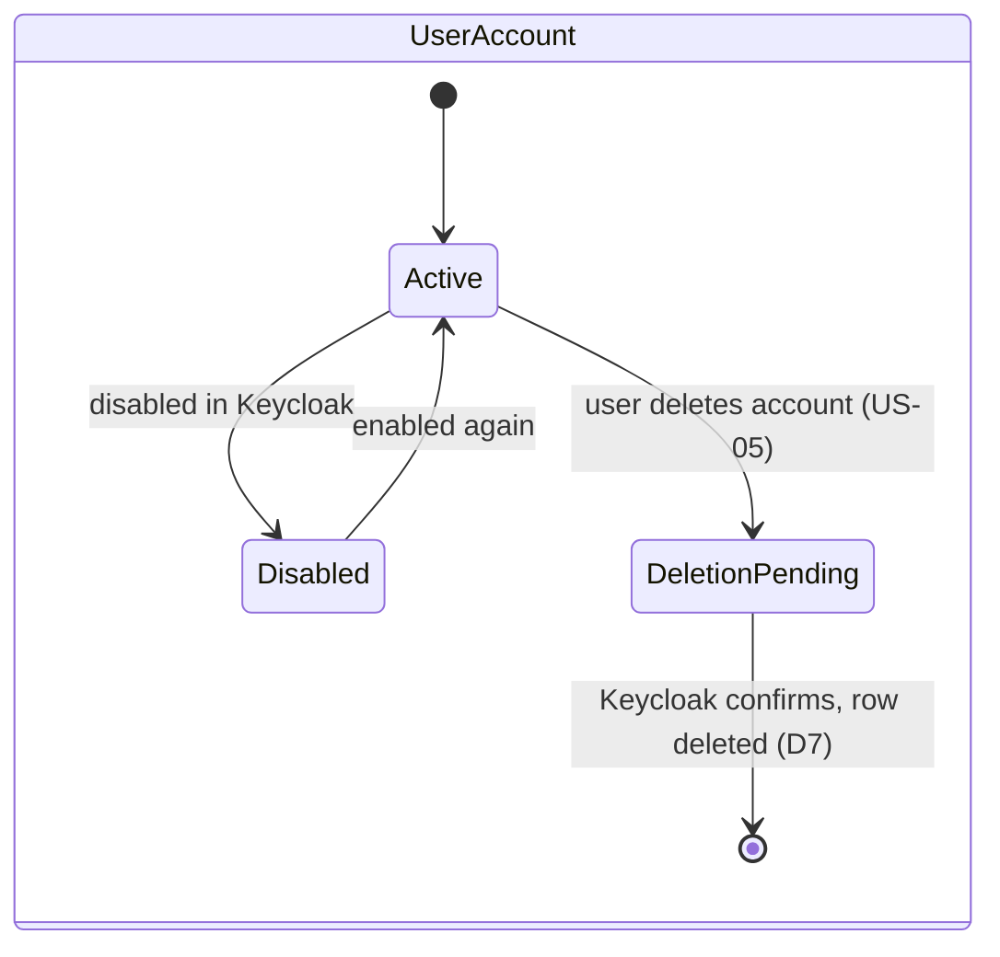
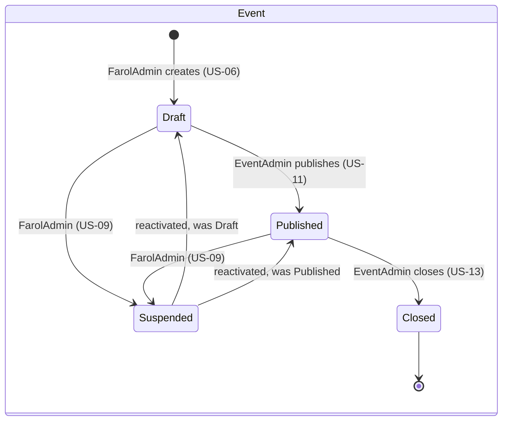
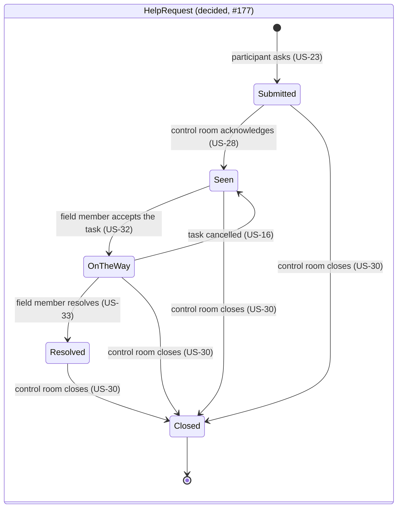
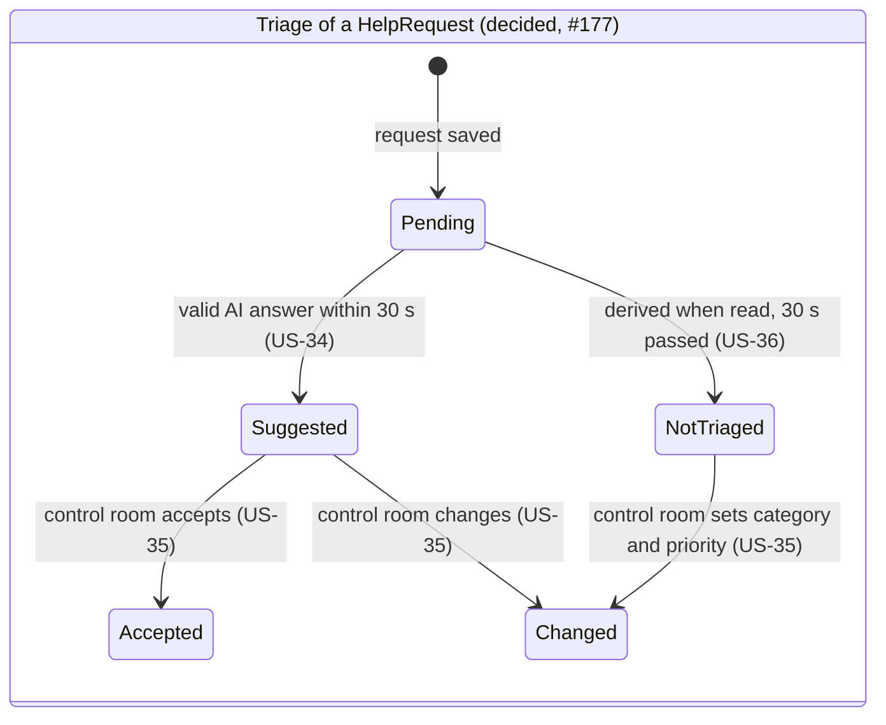
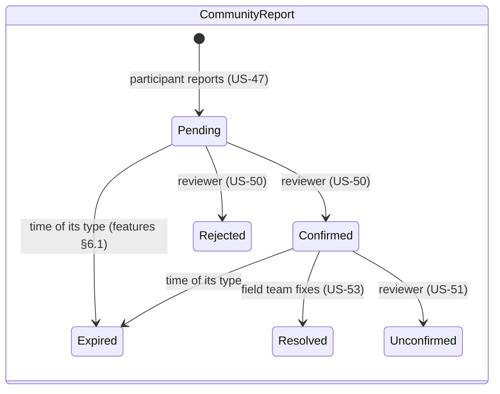
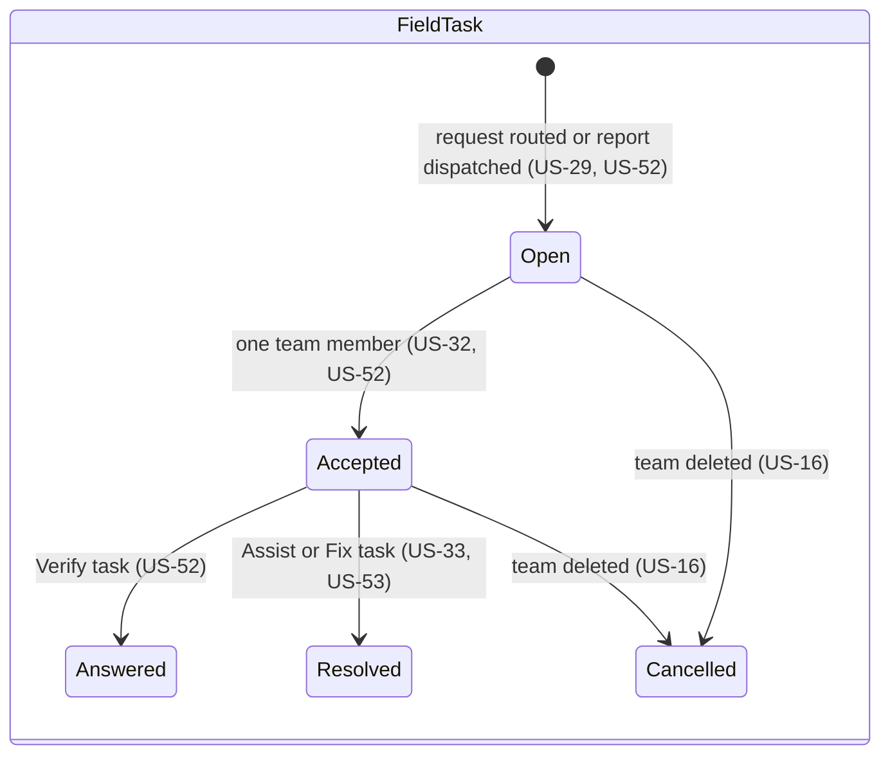

# Farol — Domain Model

> Conceptual model organised into five services: **Auth & Users**, **Events**, **Reports**, **Transports** and **Badges**. Service boundaries, attributes and cardinalities are proposed for review.
> **22 October 2026:** roles, teams and permissions follow the role model in [`features.md` §4](../Product/features.md#4-roles-teams-and-permissions-22-october-2026) (confirmed by the team on 15 November 2026, [record](../Meetings/2026-11-15-sprint-a-review-and-sprint-b-planning.md), #178). The draw.io export [`domain-model.svg`](domain-model.svg) was redrawn on 31 October 2026 (#170) to match the diagram below: event-defined `Team`, `TeamPermission` and `TeamAssignment`, `GlobalRoleGrant` / `FarolAdmin` and per-event `EventMembership` replace the fixed `ResponseTeam` types. This is documentary alignment only: no new team vote and no implementation. Open point still shown in the diagram: which team is the default when two teams handle the same category. The Mermaid diagram and this file remain the source; the SVG opens and edits in draw.io. **31 October 2026 (#162):** the diagram below gained the help-request text, the AI reason, the e-mail, the consent fields and an optional first membership (API outline D3); `domain-model.svg` does not show them yet, nor the 2 km geo-query of the Porto Digital note (1 November 2026, #175), and must be updated in draw.io. **15 November 2026 (#188):** the AI no longer suggests a team, so `suggestedTeamId` left the diagram below (it is still in `domain-model.svg`); the help categories and the priority scale are under *How to read the model*, and the proposed states under *States and transitions*.

```mermaid
classDiagram
    direction LR
    namespace AuthAndUsers {
        class UserAccount {
            +string email
            +string displayName
            +AccountStatus status
            +string termsVersion
            +datetime termsAcceptedAt
        }
        class EngagementPreferences {
            +bool earningEnabled
            +BadgeVisibility visibility
        }
        class GlobalRoleGrant {
            +GlobalRole role
        }
        class EventMembership {
            +EventRole role
            +MembershipStatus status
            +string helpConsentVersion
            +datetime helpConsentedAt
        }
        class TeamAssignment {
            <<association>>
        }
    }
    namespace Events {
        class Event {
            +string name
            +string organiserName
            +DateRange dates
            +EventStatus status
        }
        class Team {
            +string name
            +Set~HelpCategory~ handledCategories
        }
        class TeamPermission {
            +Permission permission
            +Set~ReportType~ reportTypes
        }
        class VenueMapVersion {
            +int version
            +FileReference file
        }
        class PointOfInterest {
            +PoiType type
            +string name
            +MapPosition position
        }
        class Announcement {
            +string message
            +datetime publishedAt
            +datetime expiresAt
        }
        class AttendanceCheckIn {
            +datetime checkedInAt
        }
    }
    namespace Reports {
        class HelpRequest {
            +HelpCategory category
            +MapPosition location
            +string description
            +Priority priority
            +RequestStatus status
            +datetime submittedAt
        }
        class TriageSuggestion {
            +HelpCategory suggestedCategory
            +Priority suggestedPriority
            +string reason
            +SuggestionDecision decision
        }
        class CommunityReport {
            +ReportType type
            +MapPosition location
            +ReportStatus status
            +datetime expiresAt
            +datetime confirmedAt
            +datetime confirmationRevokedAt
        }
        class FieldTask {
            +FieldTaskPurpose purpose
            +FieldTaskStatus status
            +datetime dispatchedAt
        }
        class AuditEntry {
            +ActorRef actor
            +string action
            +ChangeSet changes
            +datetime occurredAt
        }
    }
    namespace Transports {
        class TransportOption {
            +TransportMode mode
            +DataOrigin origin
            +ExternalRouteReference externalRoute
            +string name
            +datetime lastUpdatedAt
        }
        class TransportDeparture {
            +string destination
            +datetime scheduledAt
            +datetime expectedAt
        }
        class BusVehicle {
            +string externalEntityId
            +string fleetVehicleId
            +string dataProvider
        }
        class BusObservation {
            +GeoPosition location
            +datetime observedAt
            +datetime retrievedAt
            +string routeId
        }
    }
    namespace Badges {
        class BadgeProgress {
            +BadgeTrack track
            +int qualifyingCount
            +BadgeTier tier
        }
    }
    namespace ExternalSystems {
        class PortoDigitalAPI {
            <<external>>
        }
    }

    UserAccount "1" *-- "1" EngagementPreferences
    UserAccount "1" -- "0..*" GlobalRoleGrant
    UserAccount "1" -- "0..*" EventMembership
    Event "1" -- "0..*" EventMembership
    Event "1" -- "0..*" Team
    Team "1" *-- "0..*" TeamPermission
    EventMembership "1" -- "0..*" TeamAssignment
    Team "1" -- "0..*" TeamAssignment
    Event "1" -- "0..*" VenueMapVersion : retains versions
    VenueMapVersion "1" *-- "0..*" PointOfInterest
    Event "1" -- "0..*" TransportOption
    TransportOption "1" *-- "0..*" TransportDeparture
    TransportOption "0..*" --> "0..*" PointOfInterest : serves stops
    Event "1" -- "0..*" Announcement
    TransportOption "0..*" --> "0..*" BusVehicle : matched by external route reference
    BusVehicle "1" *-- "0..1" BusObservation : latest valid observation
    PortoDigitalAPI ..> BusObservation : supplies Vehicle data
    HelpRequest "1" *-- "0..1" TriageSuggestion
    HelpRequest "0..*" --> "0..1" HelpRequest : duplicate of
    HelpRequest "0..1" -- "0..*" FieldTask : dispatches
    CommunityReport "0..1" -- "0..*" FieldTask : verification or fix
    HelpRequest "0..1" -- "1..*" AuditEntry : history
    CommunityReport "0..1" -- "1..*" AuditEntry : history
    CommunityReport ..> BadgeProgress : eligible confirmation contributes
    AttendanceCheckIn ..> BadgeProgress : attendance contributes
    UserAccount "1" -- "0..*" HelpRequest : submits
    Event "1" -- "0..*" HelpRequest : receives
    HelpRequest "0..*" --> "0..1" Team : routed to
    UserAccount "1" -- "0..*" CommunityReport : submits
    Event "1" -- "0..*" CommunityReport : receives
    CommunityReport "0..*" ..> "0..*" TeamPermission : reviewed under Reports.Review for its type
    HelpRequest "0..*" --> "1" VenueMapVersion : location reference
    CommunityReport "0..*" --> "1" VenueMapVersion : location reference
    FieldTask "0..*" --> "1" Team : dispatched to
    UserAccount "0..1" <-- "0..*" FieldTask : accepted by
    UserAccount "1" -- "0..*" AttendanceCheckIn : checks in
    Event "1" -- "0..*" AttendanceCheckIn : records
    UserAccount "1" -- "0..*" BadgeProgress : earns
    Event "0..1" -- "0..*" BadgeProgress : event reporter scope
    note for FieldTask "Targets exactly one HelpRequest or CommunityReport"
    note for Team "Open product decision:<br/>default team when two teams<br/>handle the same category"
    note for TeamPermission "Permission: fixed list (features §4.2)<br/>reportTypes only for Reports.Review"
    note for BusObservation "GeoPosition: longitude, latitude<br/>Separate from venue MapPosition"
    note for PortoDigitalAPI "Porto Digital FIWARE — NGSI v2<br/>GET /v2/entities<br/>q=vehicleType==bus, buses within 2 km of the venue<br/>(georel=near;maxDistance:2000)"
```

## Entities and concepts

| Service / area | Entity or concept | Purpose and main rule |
|---|---|---|
| Auth & Users | **UserAccount** | One account across events for participants and event teams. Holds the e-mail (login name, also kept by Keycloak; assessment §3) and the display name only (NFR-19, assessment M-6). **[PROPOSED]** (assessment §8.4): the version and time of the accepted terms. What a user can do in an event comes from their membership of that event and the teams they are in, not from simply having an account. |
| Auth & Users | **EngagementPreferences** | The account's badge earning and visibility preferences. Badges are private by default; earning is optional. |
| Auth & Users | **GlobalRoleGrant** | Grants the only platform-wide role, `FarolAdmin` (persona P4): creates events for verified organisations, names EventAdmins, suspends and reactivates events. It does not grant access to any event's help requests, reports or participants. |
| Auth & Users | **EventMembership** | Links an account to one event with a role (`EventAdmin` or `RegularUser`) and a membership status. Created as `RegularUser` when the user joins the event (US-12), or as `EventAdmin` when the FarolAdmin names them (US-06, US-08). The same account can be EventAdmin in one event and RegularUser in another. Once the first EventAdmin is named, the event keeps at least one active EventAdmin: the last one cannot be removed or demoted. A new event has no membership until then (API outline D3 = B). **[PROPOSED]** (assessment §8.3): the version and time of the help-request consent given when joining. |
| Auth & Users | **TeamAssignment** | Puts a member of an event in one of that event's teams. Only members of the event can be assigned (US-18). A member can be in several teams and gets the permissions of all of them. |
| Events | **Event** | A festival edition with its own organiser, dates, status and operational data. Defines the isolation boundary for event-specific information. |
| Events | **Team** | A team created by an EventAdmin for one event (e.g. *Control room*, *Nursing*, *Security*), with a name unique in the event and the help categories it handles. The handled categories give the default team when a request is routed (the AI suggests a category, never a team). Deleting a team returns the requests routed to it to the control-room queue (US-16). Which team is the default when two teams handle the same category is still open. |
| Events | **TeamPermission** | One permission given to a team, from the fixed list in features §4.2: `HelpRequests.Triage`, `HelpRequests.Respond`, `Reports.Review`, `Reports.Respond`, `Announcements.Publish`, `Map.Edit`, `Transport.Edit`, `Entrances.Update`. For `Reports.Review` it also lists the report types the team reviews. A change applies at the member's next action and is audited. |
| Events | **VenueMapVersion** | A version of the uploaded venue image/PDF. Historical versions remain available for the requests and reports that refer to them. Uploaded by an EventAdmin or a member with `Map.Edit`. |
| Events | **PointOfInterest** | A named place on a map version, such as an entrance, stage, WC, first-aid point or transport stop. Edited by an EventAdmin or a member with `Map.Edit`. |
| Events | **Announcement** | Official event information published by an EventAdmin or a member with `Announcements.Publish`, with publication time and optional expiry. |
| Events | **AttendanceCheckIn** | Records an authenticated participant's attendance at the venue during the event dates. Counts once per account/event; included as a Should-have feature. |
| Reports | **HelpRequest** | A participant's request for assistance, with a map location and a required short description of 1 to 500 characters (assessment M-2), a status, and a category and priority that stay empty until the AI suggestion is accepted or a member sets them (the participant does not choose a category, 15 November 2026). Goes to the shared queue of the members with `HelpRequests.Triage` (the control room), who route it to a team with `HelpRequests.Respond`; it never earns badges. |
| Reports | **TriageSuggestion** | Optional AI recommendation attached to a help request, with a suggested category and priority, read from the description only, and a short reason shown to the operator (ADR-005 decision 2). It suggests no team: the default team is the event's team that handles the category. A member with `HelpRequests.Triage` accepts or changes it; it never overwrites a human decision or blocks the request. |
| Reports | **CommunityReport** | A report about a place or service, routed by type to the members with `Reports.Review` for that type. Visible to other participants only while confirmed and active. |
| Reports | **FieldTask** | Work dispatched to a team to assist with a request (team with `HelpRequests.Respond`), or to verify or fix a report (team with `Reports.Respond`). Targets exactly one request or report; only one member of that team can accept it. |
| Cross-cutting; shown in Reports | **AuditEntry** | Records the actor, time and previous/new values of a change. Each service owns its own audit history; the diagram shows request/report history as the operational example. |
| Transports | **TransportOption** | A transport service relevant to an event: manual shuttle or an external service reference. Can serve several stops and match several observed buses. |
| Transports | **TransportDeparture** | A scheduled or expected departure associated with a transport option. Requires manual data or another validated source; the bus-vehicle endpoint does not supply departure times. |
| Transports | **BusVehicle** | A bus identified by its external entity ID and provider. Shared external transport data, rather than an event-owned vehicle. |
| Transports | **BusObservation** | The latest valid bus position, route reference and observation/retrieval timestamps. A fresh retrieval does not imply a fresh observation. |
| Badges | **BadgeProgress** | Derived account progress for ReportHistory, EventReporter or EventAttendance. Confirmed reports count after expiry/resolution; withdrawing confirmation removes their credit. |
| External system | **PortoDigitalAPI** | [Porto Digital FIWARE bus API](https://broker.fiware.urbanplatform.portodigital.pt/v2/entities?q=vehicleType==bus&limit=1000), supplying NGSI v2 vehicle observations. Provides bus context, not timetables or predicted arrivals. |

## How to read the model

- **Scope:** event-specific references must resolve within the same event. Accounts, account-wide badge progress and external bus observations can span events. Associations across services express conceptual references, not shared database tables.
- **Roles and permissions:** a member's permissions in an event are those of the teams they are in (TeamAssignment → Team → TeamPermission). An `EventAdmin` has every permission in their event without being in a team; a `RegularUser` in no team has only the participant features. `FarolAdmin` is outside every event and has no event permission. Memberships and team assignments live in Auth & Users, teams and their permissions in Events.
- **Locations:** `MapPosition` uses normalised coordinates on a specific venue-map version. `GeoPosition` uses geographic longitude/latitude for buses. They are different coordinate systems.
- **Cardinalities:** `1` means exactly one; `0..1` means optional; `0..*` means zero or more; `1..*` means one or more. The optional Event association on BadgeProgress applies only to the EventReporter track.
- **Notation:** a filled diamond denotes composition; a plain association connects concepts; a dashed arrow expresses a dependency or contribution. Namespace boxes group concepts by service; ExternalSystems contains the external provider.
- **Value sets:** `HelpCategory` is `Health`, `Safety`, `LostPerson`, `Infrastructure` or `Other` (`Theft` removed on 15 November 2026: a theft is a `Safety` case; `Infrastructure` is something broken or damaged on the site that needs a team now). `Priority` is `Low`, `Medium`, `High` or `Critical`, with the meanings and examples of the [meeting record of 15 November 2026](../Meetings/2026-11-15-sprint-a-review-and-sprint-b-planning.md#priority-scale-decision-2) (AI-3, API outline O7).

## States and transitions **[PROPOSED]**

Proposed on 15 November 2026 ([meeting record](../Meetings/2026-11-15-sprint-a-review-and-sprint-b-planning.md) §4), to be confirmed by the team in #198. The help-request status set and the triage state were decided at that meeting (#177). The professor's feedback on the PL presentation asks for every entity a front-end story shows to have its states defined (DoR).

*21 November 2026 (#82, US-35): also `Pending → Changed` (a member sets a value before the AI answers; the late suggestion is then discarded, NFR-22) and `Accepted → Changed` (a member corrects an accepted value), proposed for the team's review in [spec US-35](../specs/US-35-accept-or-change-suggestion.md) D2. Every decision is recorded per field with who and when (D3).*

- **EventMembership:** no MVP story ends a membership other than account deletion, which deletes it. Proposal: drop `MembershipStatus` (and the `status` of `MembershipChanged`, API outline §7.4); a membership exists or it does not.
- Routing a help request (US-29) creates a field task and does not change the request's status. `NotTriaged` is not stored: a read derives it (API outline §4.1).
