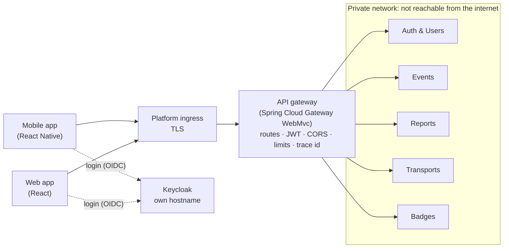

# API Gateway: Options and Recommendation

> LABDSOF 2026/27 · Sprint A · Assignment §6.2 (backend architecture), §6.6 (authorisation), §6.7 (observability), §6.8 (resilience), §7.1.2 item 7 (technical design)
> **Scope:** question **C6** of the [architecture decisions guide](../architecture-decisions-guide.md) (owner: Guerra): whether Farol has an API gateway, which one, and where **rate limiting** and **CORS** live. Also the open *Rate limiting of help requests* item in [`architecture.md`](../architecture.md) §8. Identity is in the companion document [`identity-and-access.md`](identity-and-access.md).
> **Status (17 October 2026):** investigation. Everything below is **[PROPOSED]** until the team decides. The decisions already taken (guide ✅) are treated as fixed.
> Legend: see [`product-vision.md`](../../Product/product-vision.md#legend).

## 0. Summary

| Question | Recommendation **[PROPOSED]** | Section |
|---|---|---|
| Gateway or not | **Yes, one gateway**, the only public entry point for both apps. It keeps the public API stable while the backend changes shape (modular monolith → services, A4) | §2 |
| Which | **Spring Cloud Gateway, Server WebMvc flavour**, as its own Spring Boot project `backend/gateway/` (Spring Cloud 2025.1, compatible with Spring Boot 4), with virtual threads | §2.2 |
| Routing | **Resource paths** (`/api/v1/events/{id}/help-requests`), each owned by exactly one service, mapped by the gateway's route table. Clients never see the service split | §3 |
| CORS | **Only at the gateway**, only for the React web app's origins. The React Native app is not subject to CORS | §4 |
| Rate limiting | **Per account (`sub`), never per IP** (carrier-grade NAT at the venue). Coarse limits at the gateway; the *reports per account* rule stays in the Reports service, because it is a business rule | §5 |
| Edge security | JWT validated at the gateway too (services still validate); body-size limit; Spring Security default headers; actuator not public | §6 |
| Observability | The gateway starts the trace (`traceparent`) and returns `X-Correlation-Id`; metrics per route, including 429s | §7 |

---

## 1. What the gateway has to do

| # | Need | Source |
|---|---|---|
| N1 | One public address for the **two clients** (React Native mobile, React web) | Guide F1 |
| N2 | The public API must **not change when the modular monolith is split** into services in Sprint C (if A4 is confirmed), so the apps and their tests survive the split | Guide A4 (waiting for the professor); assignment §7.3.2 item 11 (*architecture evolution narrative*) |
| N3 | **CORS** for the web app | Guide C6 |
| N4 | **Rate limiting**: reports are rate-limited per account; the limit for help requests is pending | [`features.md`](../../Product/features.md) §6.4, US-18; [`architecture.md`](../architecture.md) §8 |
| N5 | Answer **429 or 503 with `Retry-After`**, so the apps slow their polling | Branch `docs/resilience-and-degraded-modes` (#43, not merged), §10.1 |
| N6 | **Correlation or trace identifiers** on every request | Assignment §6.7; DoD Level 2 |
| N7 | Keep the **services private**; nothing but the gateway is reachable from the internet | Assignment §6.6; [`identity-and-access.md`](identity-and-access.md) §5 |
| N8 | Hold the **read peak**: ≈ 1,300 req/s for 10 min, plus 1 help request/s | #43, §10.1 (k6 scenarios L2–L4) |
| N9 | **One instance per service** for now | Guide C5 |
| N10 | **Platform still open**; run the same way in `docker compose` | Guide G1, G6 |
| N11 | **No business logic and no API composition** in the gateway: it never calls two services to build one answer, so "only events between services" (C4) holds | Guide C4 |

---

## 2. Options

### 2.1 Comparison

| | **GW0 · No gateway** | **GW1 · Spring Cloud Gateway** (own service) | **GW2 · Managed cloud gateway** | **GW3 · Generic reverse proxy** |
|---|---|---|---|---|
| What it is | Each service exposed through the platform's ingress; CORS and limits coded in every service | A Spring Boot application that routes, filters and secures requests | Azure API Management, or AWS API Gateway (HTTP API) | NGINX, Traefik, Envoy Gateway or Caddy, configured by file |
| N2 stable API through the split | ⚠️ only if the platform ingress can route by path | ✅ route table changes, URLs do not | ✅ | ✅ |
| N3/N4 CORS and per-account limits in one place | ❌ repeated in five services | ✅ built-in CORS (Spring Security) and **Bucket4j rate-limit filter**; the key can be the token's `sub` | ⚠️ JWT validation built in; per-user limits depend on the product and tier (AWS HTTP APIs throttle per route, not per user; API Management has keyed rate-limit policies, check tier availability) | ⚠️ CORS and per-IP limits easy; per-account limits need JWT parsing (NGINX open source has no JWT validation; Envoy has a JWT filter; Traefik needs a plugin) |
| N10 same locally and in the cloud | ⚠️ | ✅ one container everywhere | ❌ not runnable in `docker compose`; policies untested in CI | ✅ |
| Independent of G1 | ⚠️ | ✅ | ❌ tied to Azure or AWS | ✅ |
| Team knowledge | ✅ | ✅ Java 21, Spring Boot, Maven, like every service | ⚠️ new policy language and console | ⚠️ new configuration languages |
| Testable in CI | ⚠️ | ✅ WireMock backends, like the services | ❌ | ⚠️ container tests only |
| Cost and operation | ✅ nothing more | ⚠️ one more container; a single point of failure with one instance (§8) | ✅ nothing to run; pay per call (API Management Consumption includes a monthly free allowance; check the pricing page). The Consumption tier cannot join a virtual network, so the services behind it would need public ingress (check) | ✅ light container |

**Not considered further: Kong Gateway open source.** Community reports say no open-source images were published after 3.9 and the free mode was removed in 3.10. Kong has not confirmed this officially, but the uncertainty alone is a reason not to depend on it.

### 2.2 Recommendation: GW1, Spring Cloud Gateway Server WebMvc **[PROPOSED]**

- It is the only option that meets N1–N11 together, runs identically in `docker compose`, CI and any cloud, and uses the stack the team already decided (Java 21, Spring Boot 4.x, Maven; guide H3).
- **Compatibility:** Spring Cloud **2025.1 (Oakwood)** is the release train for Spring Boot 4; 2025.1.2 (June 2026) supports Spring Boot 4.0.7 and 4.1.0. The Gateway reference for this train is version 5.0.x.
- **WebMvc rather than WebFlux:**

| | Server WebMvc **(recommended)** | Server WebFlux |
|---|---|---|
| Programming model | Servlet, blocking, the same as every service; concurrency from **virtual threads** (`spring.threads.virtual.enabled=true`) | Reactive (Project Reactor): new to the team, harder to debug |
| Rate limiting | Built-in **Bucket4j** filter (`rateLimit`), 429 by default, key from a function of the request | `RequestRateLimiter` (Redis or Bucket4j) |
| Throughput | To prove in the k6 scenarios L2 and L4 of #43 | Higher ceiling, not needed for ≈ 1,300 req/s if L4 confirms it |

- **Project:** `backend/gateway/`, its own Maven project, Dockerfile and pipeline job like any service (guide A3, H3, H4). It has no database.



Keycloak is reached directly, not through the gateway: the browser talks to it during login, and it has its own brute-force protection ([`identity-and-access.md`](identity-and-access.md) §3.3).

---

## 3. Routing

### 3.1 How paths map to services

| | **R1 · Service prefix** | **R2 · Resource paths (recommended)** |
|---|---|---|
| Example | `/api/v1/reports/events/42/help-requests` | `/api/v1/events/42/help-requests` |
| Gateway rule | One prefix per service | One rule per resource collection, most specific first |
| Clients see the service split | Yes; moving a resource to another service changes its URL | No |
| Cost | — | A route table to keep in step with the API outline, checked by a test |

**Rule:** every path belongs to **exactly one service**, written in the API outline (C8, owner Bruno). A gateway test sends one request per path in the outline to WireMock backends and checks it reaches the right service.

### 3.2 Route table (sketch, to align with the API outline) **[PROPOSED]**

| Order | Path | Service |
|---|---|---|
| 1 | `/api/v1/me/badges/**` | Badges |
| 2 | `/api/v1/me/**`, `/api/v1/accounts/**`, `/api/v1/events/*/members/**` | Auth & Users |
| 3 | `/api/v1/events/*/help-requests/**`, `/api/v1/events/*/reports/**`, `/api/v1/events/*/field-tasks/**` | Reports |
| 4 | `/api/v1/events/*/transport/**` | Transports |
| 5 | `/api/v1/events/**` (event, map, points of interest, announcements, check-in) | Events |
| — | anything else | 404 at the gateway |

### 3.3 Through the evolution (A4)

| Phase | Gateway configuration |
|---|---|
| Modular monolith (Sprints A–B, if A4 is confirmed) | Every route points to the one deployable (`FAROL_ROUTE_*_URI=http://farol-app:8080`) |
| Services (Sprint C) | Each route points to its service. **Only environment variables change**; the apps, the API and its tests do not |

This makes the split visible and measurable for the *architecture evolution narrative* (§7.3.2 item 11): same contract tests, before and after.

---

## 4. CORS

- **Who needs it:** only the React web app, because it runs in a browser on a different origin. The React Native app makes native HTTP requests, which browsers' CORS rules do not apply to.
- **Where:** **only at the gateway**. Services set no CORS headers, so responses never carry them twice.
- **Allowed origins:** the web app's production origin and `http://localhost:5173` (local development), from configuration. Never `*`.
- **Credentials:** off. Tokens travel in the `Authorization` header, not in cookies.
- **Headers:** allow `Authorization`, `Content-Type`, `If-None-Match` (ETag polling, #43); expose `ETag`, `Retry-After`, `X-Correlation-Id`, `X-RateLimit-Remaining`.

```java
// backend/gateway: security and CORS (sketch, Spring Security 7)
@Bean
SecurityFilterChain api(HttpSecurity http) throws Exception {
    return http
            .authorizeHttpRequests(a -> a
                    .requestMatchers("/api/v1/**").authenticated()   // login is mandatory (F1)
                    .anyRequest().denyAll())
            .oauth2ResourceServer(o -> o.jwt(Customizer.withDefaults()))
            .cors(Customizer.withDefaults())
            .csrf(c -> c.disable())                                  // bearer tokens, no cookies
            .sessionManagement(s -> s.sessionCreationPolicy(SessionCreationPolicy.STATELESS))
            .build();
}

@Bean
CorsConfigurationSource corsConfigurationSource(@Value("${farol.cors.allowed-origins}") List<String> origins) {
    CorsConfiguration cors = new CorsConfiguration();
    cors.setAllowedOrigins(origins);
    cors.setAllowedMethods(List.of("GET", "POST", "PUT", "PATCH", "DELETE"));
    cors.setAllowedHeaders(List.of("Authorization", "Content-Type", "If-None-Match"));
    cors.setExposedHeaders(List.of("ETag", "Retry-After", "X-Correlation-Id", "X-RateLimit-Remaining"));
    cors.setAllowCredentials(false);
    cors.setMaxAge(Duration.ofHours(1));
    UrlBasedCorsConfigurationSource source = new UrlBasedCorsConfigurationSource();
    source.registerCorsConfiguration("/api/**", cors);
    return source;
}
```

The actuator runs on a separate management port that the platform does not expose; health probes reach it on the private network.

---

## 5. Rate limiting

### 5.1 Key: the account, never the IP address

At the venue, thousands of phones reach the internet through a few public addresses of the mobile operators (**carrier-grade NAT**). A limit per IP would block whole crowds at the busiest moment. Every `/api/v1/**` request is authenticated (F1), so the gateway limits **per account** (the token's `sub`). Login attempts never reach the gateway; Keycloak protects them per account.

### 5.2 Policies **[PROPOSED]**

| # | What | Key | Limit | Where | Why |
|---|---|---|---|---|---|
| L-1 | Every `/api/v1/**` call | account | **120 requests/min** | Gateway | A participant polls every 10 s (6/min) plus screen loads; an operator polls the backoffice every 2 s (30/min, k6 L3 in #43). Stops a runaway client or a script |
| L-2 | `POST …/help-requests` | account | **5 per 10 min** | Gateway | Protects the control room from floods. A person in real need never reaches it. When it triggers, the app shows the nearest first-aid point, as it does without network (US-08). **The team must accept this trade-off explicitly**: the alternative is no limit plus the operator's *Duplicate* status (W3) |
| L-3 | `POST …/reports` | account + event | e.g. **5 per 10 min** | **Reports service** | A business rule (features §6.4; US-18 "new reports are refused with a message"). It needs the event and a message for the participant, so it belongs in the spec and its acceptance tests, not in gateway configuration |
| L-4 | Venue map upload | — | body **≤ 20 MB** | Gateway, that route only | Single-page PDFs rendered on upload (ADR-007, #44). To confirm with Tiago |
| L-5 | Login, sign-up | account | Keycloak brute-force detection | Keycloak | Does not pass through the gateway |

### 5.3 Answer and counters

- On a limit: **429** with `Retry-After` and a body in `application/problem+json` (RFC 9457). The apps back off as #43 describes.
- **Counters in memory** (Bucket4j with Caffeine) while there is **one gateway instance** (C5). A restart resets them; acceptable for this purpose.
- If the gateway is scaled out later, the counters move to **Bucket4j's PostgreSQL backend**, keeping one database technology (D1), rather than adding Redis.

```java
// backend/gateway: a rate-limited route (sketch; check against the Spring Cloud Gateway 5.0 reference)
@Bean
RouterFunction<ServerResponse> helpRequestCreation(@Value("${farol.routes.reports-uri}") String reportsUri) {
    return route("help-request-create")
            .POST("/api/v1/events/{eventId}/help-requests", http())
            .before(uri(reportsUri))
            .filter(rateLimit(c -> c.setCapacity(5)
                    .setPeriod(Duration.ofMinutes(10))
                    .setKeyResolver(request -> request.servletRequest().getUserPrincipal().getName()))) // sub
            .build();
}
// Bucket4j needs an AsyncProxyManager<String> bean: Caffeine for one instance, PostgreSQL when scaled out.
```

---

## 6. Security at the edge

| Measure | How |
|---|---|
| Token check | The gateway validates the JWT with the same settings as the services ([`identity-and-access.md`](identity-and-access.md) §4.2). Unauthenticated requests stop here. **Services still validate** (defence in depth) |
| Event roles | **Not** checked at the gateway: it has no membership data and no business logic (N11). Each service checks them (identity §4.3) |
| Private services | Only the gateway (and Keycloak) have public ingress (§8) |
| Spoofed headers | `X-Forwarded-*` trusted only from the platform ingress (`server.forward-headers-strategy`); no client-supplied identity headers are passed on |
| Response headers | Spring Security defaults: HSTS on HTTPS, `X-Content-Type-Options: nosniff`, `X-Frame-Options: DENY`, no caching of authenticated answers unless the service sets `ETag`/`Cache-Control` |
| Body size | Small default (e.g. 1 MB), larger only on the upload route (L-4) |
| TLS | Ended at the platform ingress; private network behind it |

## 7. Observability and resilience

| Concern | How |
|---|---|
| Trace and correlation | The gateway starts or continues the W3C `traceparent` (Micrometer Tracing); services continue it, also through RabbitMQ. The trace id is returned as `X-Correlation-Id` so a participant's error can be found in the logs (assignment §6.7) |
| Logs | JSON access log per request: route, status, duration, trace id, `sub` (no tokens, no bodies) |
| Metrics | `http.server.requests` per route; **429 count** per policy (an SLI: a rise means a client bug or an attack); upstream errors per service |
| Timeouts | Connect 2 s; response 10 s by default, longer on the upload route **[PROPOSED]** |
| Upstream down | 503 with `Retry-After`, never a hang. No retries at the gateway (POSTs are not idempotent; polling already retries). Optional circuit breaker per route |
| Health | Gateway liveness and readiness probes; it does not aggregate the services' health (each has its own probe) |

## 8. Deployment and scaling

| Where | Layout |
|---|---|
| `docker compose` (G6) | Gateway on `localhost:8080`; Keycloak on `localhost:8180`; services and RabbitMQ not published to the host |
| Azure Container Apps (if G1 = Azure) | Gateway and Keycloak with **external** ingress; services and RabbitMQ with **internal** ingress in the same environment |
| AWS ECS (if G1 = ECS) | Public Application Load Balancer → gateway; Keycloak on its own host rule; services in private subnets, reached through ECS Service Connect |
| Vercel (if G1 = Vercel) | Hosts only the React web app (its origin goes into CORS). The gateway, the services and Keycloak still need a container platform |

- **Single point of failure** with one instance (C5): the gateway is stateless (apart from the rate counters), restarts in seconds on a failed probe, and is the first candidate for a second instance when C5 changes.
- **Capacity:** every request passes through it, so it is part of the k6 scenarios L2 and L4 (#43). L4 must show whether the gateway or a service reaches its limit first.

## 9. Plan by sprint **[PROPOSED]**

| When | What |
|---|---|
| Walking skeleton (R0) | Gateway with one route, JWT validation, CORS and the trace id: the public entry point exists from the first deployment |
| Sprint B | Route table from the API outline (C8); L-1, L-2 and L-4; 429 and 503 in `problem+json`; tests: route ownership, CORS preflight, rejected tokens, rate limit |
| Sprint C | Limits tuned with the k6 results; if A4 is confirmed, the split changes only the route URIs; header and timeout review in the security review |

## 10. Decisions for the team

1. **GW1** (Spring Cloud Gateway WebMvc), or another option from §2?
2. **R2** resource paths with a route table owned by the API outline (with Bruno, C8)?
3. **CORS only at the gateway**, for the web app's origins?
4. **Rate limits** L-1 to L-4, and in particular **whether help requests are limited at all** (L-2).
5. **Report limit** as a Reports business rule (L-3), with Tiago for US-18.
6. **Hosting** of the gateway and Keycloak on the chosen platform (with Tomás, G1).
7. **ADR number:** the list in `architecture.md` §13 stops at ADR-010; proposed **ADR-011 · API gateway**.

## 11. ADR-011 draft (if §10 is accepted)

> **ADR-011 · API gateway, CORS and rate limiting** · Status: *Proposed*
>
> **Context.** Two clients call five services (A2, F1). The services may first run as one modular monolith and be split in Sprint C (A4). Requests are authenticated (F1); reports must be rate-limited per account; the apps must be told to slow down at the read peak (#43). The platform is open (G1).
>
> **Decision.** A Spring Cloud Gateway (Server WebMvc) application is the only public entry point. It routes resource paths to their owning service, validates the JWT, applies CORS for the web app, limits requests per account with Bucket4j, and starts the trace. It holds no business logic. Business limits (reports per account per event) stay in the owning service.
>
> **Consequences.** One more container, a single point of failure while there is one instance. The public API does not change when services split. Rate counters are lost on restart until the gateway is scaled out with a shared Bucket4j backend.
>
> **Alternatives considered.** No gateway; a managed gateway (Azure API Management, AWS API Gateway); a generic reverse proxy (NGINX, Traefik, Envoy); Spring Cloud Gateway WebFlux; Kong open source.

## Sources

- Spring Cloud Gateway reference, [Server WebMvc · RateLimiter filter](https://docs.spring.io/spring-cloud-gateway/reference/spring-cloud-gateway-server-webmvc/filters/ratelimiter.html) (Bucket4j, 429, key resolver, `AsyncProxyManager`)
- Spring blog, [Spring Cloud 2025.1.2 (aka Oakwood) has been released](https://spring.io/blog/2026/06/11/spring-cloud-2025-1-2-aka-oakwood-has-been-released/) (Spring Boot 4.0.7 and 4.1.0)
- [Bucket4j documentation](https://bucket4j.com/)
- IETF, [RFC 9457 · Problem Details for HTTP APIs](https://www.rfc-editor.org/rfc/rfc9457)
- Microsoft Learn, [Ingress in Azure Container Apps](https://learn.microsoft.com/azure/container-apps/ingress-overview) · [API Management pricing](https://azure.microsoft.com/pricing/details/api-management/)
- AWS, [JWT authorizers for HTTP APIs](https://docs.aws.amazon.com/apigateway/latest/developerguide/http-api-jwt-authorizer.html)
- Kong community, [OSS image for 3.10.0 (GitHub discussion)](https://github.com/Kong/kong/discussions/14405) and [Is open-source support for Kong ceased?](https://discuss.konghq.com/t/is-opensource-support-for-kong-ceased/13529)
