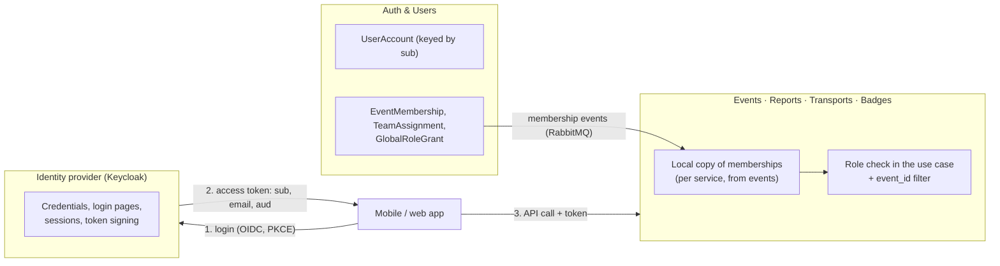
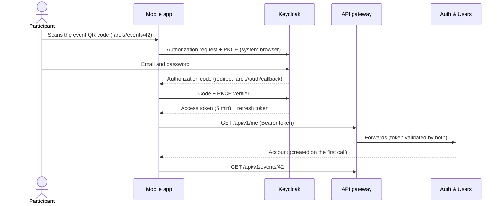

# Identity and Access: Options and Recommendation

> LABDSOF 2026/27 · Sprint A · Assignment §6.6 (authentication and authorisation), §7.1.2 items 8 (ADR) and 9 (Security and Privacy Assessment)
> **Scope:** questions **E1–E4** of the [architecture decisions guide](../architecture-decisions-guide.md) (owner: Guerra) and the future **ADR-006**. E5, the Security and Privacy Assessment, is a separate document; §9 lists what this one gives it.
> **Status (17 October 2026):** investigation. Everything below is **[PROPOSED]** until the team decides. The decisions already taken (guide ✅) are treated as fixed.
> Legend: see [`product-vision.md`](../../Product/product-vision.md#legend).

## 0. Summary

| Question | Recommendation **[PROPOSED]** | Section |
|---|---|---|
| E1 · Identity provider | **Keycloak**, self-hosted in a container, from the walking skeleton on. In Sprint B its realm import with test accounts *is* the mocked authentication, so no throwaway code is written | §3 |
| Principle | **The identity provider proves who the user is; Auth & Users decides what they can do.** Tokens carry the user id, not event roles. Roles per event stay in Auth & Users and reach the other services as events (C4) | §2 |
| E2 · Where the token is validated and the role checked | **Every service validates the JWT** (Spring Security resource server) and **checks the event role in its application layer** against its local copy of the memberships. The gateway also validates, to reject bad tokens early | §4 |
| E2 · `PlatformAdmin` | A **global role kept in Auth & Users** (`GlobalRoleGrant`), never in the identity provider. It gives no access to any event's operational data | §4.3 |
| E3 · Service-to-service authentication | Services never call each other over HTTP (C4), so E3 reduces to **private networking**, **one RabbitMQ user per service** with permissions limited to its own exchanges and queues, and **client credentials** for the one call to the Keycloak Admin API | §5 |
| E4 · Secrets | `.env` (git-ignored) locally, **GitHub Actions secrets** in CI, the **platform's secret store** in the cloud, injected as environment variables; **gitleaks** on every PR | §6 |
| Clients | **Authorization Code + PKCE** through the system browser for both apps; no password grant, no embedded web view | §7 |

---

## 1. What has to be decided, and what already constrains it

### 1.1 Open questions (guide §E)

| # | Question |
|---|---|
| E1 | Which identity provider (mock, Keycloak, Entra External ID, …)? It must fit the Auth & Users service (A2) |
| E2 | Where is the token validated, and where is the role per event checked? Is `PlatformAdmin` a global role? |
| E3 | How do services authenticate to each other? |
| E4 | Where do secrets live? |

### 1.2 Constraints from decisions already taken

| Source | Constraint |
|---|---|
| Guide A2 | **Auth & Users** owns authentication, authorisation, accounts, roles per event and friends (F1, F2, roles of F4, F18) |
| Guide C4 | **Only events between services.** Each service keeps a local copy of what it needs; "every service keeps the roles per event from Auth & Users" ([`architecture.md`](../architecture.md) §4) |
| Guide D1, D2, D3 | PostgreSQL only; one database per service; `event_id` on every event table, with an isolation test per service |
| Guide F1 | Two clients: **React Native** mobile app (participants, operators, responders) and **React** web app (event management) |
| Guide G1 | Deployment platform still open (Azure, ECS or Vercel). The identity choice should not depend on it |
| Guide G6 | Local execution with `docker compose` |
| Guide H8 | The repository is private |
| Assignment §6.6, footnote 1 | Mocked authentication is acceptable for the MVP |
| Assignment §11 | *"Security controls must not be disabled solely to simplify the demonstration."* A mock must still be a real token flow |
| Branch `docs/resilience-and-degraded-modes` (#43, not merged) | If the identity provider is external: JWKS keys cached for 5 min, refreshed on an unknown `kid`; connect timeout 2 s, response 3 s; on failure the cached keys stay in use. **Waits for E1** |
| Branch `docs/initial-backlog` (#45, not merged) | Sprint B uses mocked authentication with seeded accounts; US-01, US-04, US-05 and US-25 are in Sprint B; US-02 (sign-up), US-28 (Owner transfer) and US-29 (account deletion) in Sprint C. E1 and E2 block US-01 and US-25 |

### 1.3 Requirements from the product

| Requirement | Source |
|---|---|
| Login is mandatory for every user, participants included; one account for every event | F1; DM-1 (9 October 2026) |
| The participant logs in once and stays logged in on the phone | [`personas.md`](../../Product/personas.md) P1, *Design implications* |
| Scanning an event QR code while logged out asks for login, then opens that event | US-01 |
| A wrong login does not say which field was wrong | US-01 |
| Per-event roles `Owner`, `Admin`, `Operator`, `Responder`, and membership of a response team | F4, US-05; domain model `EventMembership`, `TeamAssignment` |
| A role change applies at the member's next action and is recorded with who and when | US-05 |
| `PlatformAdmin` creates events and names their Owner, but **never sees** help requests, reports or participants | P4, US-25; domain model `GlobalRoleGrant` |
| Deleting the account deletes personal data and badges | F2, US-02 (US-29 on #45) |
| 0 successful cross-event access attempts | SC8, US-04 |
| Every change to a help request is audited | Domain model `AuditEntry`; SC9 |

---

## 2. Principle: the identity provider proves who you are, Auth & Users decides what you can do



- The **access token** carries only identity: `sub` (the user id), `email`, `name`, `aud = farol-api`, expiry. No event roles.
- **All authorisation data** (`EventMembership`, `TeamAssignment`, `GlobalRoleGrant`) lives in the Auth & Users database. Auth & Users publishes a membership event every time it changes; each service that needs roles keeps a copy (decision C4).
- **Why:**
  1. **The identity provider becomes replaceable.** Mock, Keycloak, Entra External ID or Cognito: switching changes configuration, not code, because no domain data lives in the provider. This keeps G1 open.
  2. **Small tokens.** A member of many events would otherwise carry every role in every request.
  3. **Fast revocation.** A revoked role stops working as soon as the event reaches the service (seconds), not when the token expires.
  4. **It matches the domain model and A2:** `GlobalRoleGrant` and `EventMembership` are already Auth & Users entities.
- **Cost:** revocation is eventually consistent. Between the change in Auth & Users and the copy in a service, the old role still applies. Proposed target: **≤ 5 s** (measured in an integration test). If a service has no copy for a user and event, it **denies** (fail closed).

**Rejected alternative: roles as token claims** (Keycloak groups or client roles per event, e.g. `/events/<id>/operators`). Every invitation becomes a call to the Keycloak Admin API, tokens grow with the number of events, roles stay stale until the token is refreshed, and the domain is split between two systems.

---

## 3. E1 · Identity provider

### 3.1 Options

| | **I1 · Mock only** | **I2 · Keycloak** (self-hosted) | **I3 · Spring Authorization Server inside Auth & Users** | **I4 · Managed CIAM** (Entra External ID, Amazon Cognito, Auth0) |
|---|---|---|---|---|
| What it is | Seeded users; a development endpoint signs JWTs with a fixed key | Open-source OpenID Connect server (Red Hat / CNCF), run as one more container | Auth & Users itself becomes the OpenID Connect provider. Spring Authorization Server became part of **Spring Security 7.0** (Spring Boot 4), same Maven coordinates | A cloud identity service: free tiers, nothing to host |
| Login, sign-up, password reset, brute-force protection | ❌ we build or skip them | ✅ out of the box, themable login pages | ⚠️ protocol built in; login, sign-up and reset pages, brute-force protection written by us | ✅ out of the box |
| Work before the Sprint B review | ✅ least | ⚠️ realm configuration and export (about a day) | ❌ most: pages, flows, security of our own code | ⚠️ tenant setup, no hosting |
| Same locally, in CI and in the cloud (G6) | ✅ | ✅ same image everywhere; Testcontainers module for tests | ✅ | ❌ needs the cloud tenant, even locally; tests need a fake |
| Independent of the platform (G1) | ✅ | ✅ | ✅ | ⚠️ vendor account and data region (G3) |
| Cost | Free | Free; one more container (JVM, on the order of 1 GB memory; check Keycloak's sizing guide) and its own database | Free; runs inside an existing service | Free tiers (Entra External ID: first 50,000 monthly active users free), paid add-ons |
| Personal data in one place (deletion, US-29) | ✅ | ⚠️ credentials in Keycloak, profile in Auth & Users | ✅ all in Auth & Users | ⚠️ credentials at the vendor |
| Fit with A2 | ✅ | ✅ Auth & Users keeps accounts and authorisation; authentication is delegated | ✅ complete | ✅ like I2 |
| Main risk | Not a product: no real sign-up; looks like a disabled security control (§11) | Footprint on a small cloud budget; another system to configure and upgrade | We own security-critical code with two sprints left | Lock-in while G1 is open; harder local development and testing |

### 3.2 Recommendation: I2 Keycloak **[PROPOSED]**

- It gives the security features we should not write ourselves (password hashing and policy, brute-force detection, session management, token signing and key rotation, optional MFA), in a standard OpenID Connect server the professors know.
- It runs the same way in `docker compose`, in CI (Testcontainers) and in the cloud, so it does not wait for G1.
- With the principle in §2, it can still be replaced by I4 later with configuration only.
- **For Sprint B it is the mock.** The realm export committed to the repository contains test accounts, so "mocked authentication with seeded accounts" (#45) is the real token flow from the first day, and US-02 (sign-up) in Sprint C is a setting, not new code.

**When to choose another option:**
- **I3** if the chosen platform cannot afford one more JVM container, or if the team prefers all personal data in one store. Expect at least one extra week of work.
- **I4** if G1 lands on Azure or AWS and the team prefers no identity infrastructure at all. Entra External ID or Cognito then replaces Keycloak; the services do not change.
- **I1** is not recommended on its own (§3.1); its useful part, seeded accounts, is covered by the realm import.

### 3.3 How Keycloak would be set up **[PROPOSED]**

| Item | Setting |
|---|---|
| Version | Latest Keycloak 26.x at setup time (check keycloak.org) |
| Realm | `farol`, exported to `infra/keycloak/farol-realm.json` (no production secrets; test users only) |
| Clients | `farol-mobile`: public, Authorization Code + PKCE, redirect `farol://auth/callback` · `farol-web`: public, Authorization Code + PKCE, redirect to the web app origin · `farol-auth-users`: confidential, service account limited to managing users (for deletion, §3.4) |
| Audience | An audience mapper adds `aud = farol-api` to both public clients; every service requires it |
| Login | Email as username; Portuguese and English login pages; generic error on wrong credentials (US-01, Keycloak default) |
| Brute-force detection | On (per account, not per IP; see the CGNAT note in the [API gateway document](api-gateway.md#5-rate-limiting)) |
| Password policy | Minimum length 10, not equal to the email **[PROPOSED]** |
| Sign-up | Off in Sprint B (seeded accounts); on in Sprint C for US-02, with the terms accepted on the form |
| Email verification and password reset by email | Need an SMTP server. **Out of the MVP** unless the platform gives one; documented as a known limitation |
| Token lifetimes | Access token **5 min**; refresh tokens rotated on every use · mobile: `offline_access`, session idle **30 days** (P1 stays logged in) · web: session idle **12 h** (one night shift) **[PROPOSED]** |
| Database | Its own database `keycloak` on the same PostgreSQL server (D1: one technology; D2: each owner has its own database) |
| Public address | Its own hostname (e.g. `auth.<domain>`), exposed by the platform ingress, **not** through the API gateway (the browser talks to it directly during login). `KC_HOSTNAME` set to that public URL |
| Local | `docker compose` service: `start-dev --import-realm` |

### 3.4 How Auth & Users works with Keycloak

| Flow | How |
|---|---|
| **Account creation** | **Just-in-time provisioning:** the first authenticated call to `GET /api/v1/me` creates the `UserAccount` from the token (`sub`, `email`, `name`) and publishes `UserAccountCreated`. No webhook from Keycloak is needed |
| **First platform admin** | A configuration property (e.g. `FAROL_BOOTSTRAP_PLATFORM_ADMIN_EMAIL`) grants `PlatformAdmin` at provisioning when the email matches. There is no screen to create platform admins in the MVP |
| **Account deletion** (F2; D7, owner Bruno) | Auth & Users calls the Keycloak Admin API with client credentials to delete the user, deletes its own data, then publishes `UserAccountDeleted` so Badges and the others delete theirs. If Keycloak is down, the deletion is marked pending and retried (Resilience4j, #43). To agree with Bruno |
| **Disabling an account** | Disabled in Keycloak (sessions revoked) **and** published as `UserAccountDisabled`, so services deny at once instead of waiting up to 5 min for the access token to expire |
| **Audit** | Keycloak keeps login events; Auth & Users records every membership change with actor and time (US-05, US-25) |

### 3.5 Membership events (input to the event catalogue, C8, Bruno) **[PROPOSED]**

| Event | Published by | Consumed by |
|---|---|---|
| `UserAccountCreated`, `UserAccountDisabled`, `UserAccountDeleted` | Auth & Users | Every service that stores user data |
| `EventMembershipGranted`, `EventMembershipChanged`, `EventMembershipRevoked` (role, team assignments) | Auth & Users | Events, Reports, Transports |
| `GlobalRoleGranted`, `GlobalRoleRevoked` | Auth & Users | Events (event creation and suspension) |
| `EventCreated` (with the named Owner) | Events | Auth & Users, which creates the Owner membership |

---

## 4. E2 · Where the token is validated and where the role is checked

### 4.1 Options

| | **V1 · Gateway only** | **V2 · Every service, plus the gateway** | **V3 · Token exchange at the gateway** |
|---|---|---|---|
| How | The gateway validates the token and passes `X-User-Id` to the services, which trust it | Each service is an OAuth2 resource server and validates the JWT signature, issuer, audience and expiry. The gateway validates too, so bad tokens never reach a service | The gateway swaps the external token for an internal one (opaque "phantom token" or RFC 8693 token exchange) |
| Security | ❌ anyone who reaches a service directly can forge the header | ✅ defence in depth; nothing trusts the network | ✅ |
| Work | Least | Low: one Spring Boot starter and a few properties per service | High, for no MVP benefit |
| **Verdict** | Rejected | **Recommended** | Rejected for the MVP |

### 4.2 Configuration in each service (Spring Boot 4)

```yaml
spring:
  security:
    oauth2:
      resourceserver:
        jwt:
          issuer-uri: ${FAROL_ISSUER_URI}   # public issuer, e.g. https://auth.<domain>/realms/farol; checked against the iss claim
          jwk-set-uri: ${FAROL_JWKS_URI}    # internal address, e.g. http://keycloak:8080/realms/farol/protocol/openid-connect/certs
          audiences: farol-api
```

- Setting `jwk-set-uri` avoids OpenID discovery at startup: a service starts even when Keycloak is down, and fetches keys only when a token arrives. This is what #43 assumes (cached keys, refresh on an unknown `kid`).
- The two URIs differ on purpose: inside `docker compose` the services reach Keycloak as `keycloak:8080`, but the tokens carry the public issuer.
- Unit and web-layer tests use `spring-security-test` (`jwt()` request post-processor); service integration tests serve a static JWKS from WireMock (already chosen in #43); only end-to-end tests run the Keycloak container.

### 4.3 Where the event role is checked

**In the application layer (use cases), not in controllers and not in the domain.** Each use case that touches event data calls an `EventAccess` port backed by the service's local membership copy, and every repository query filters by `event_id` (D3). This keeps the hexagonal layout (B5): the domain has no framework code, and the rule is tested with the use case.

```java
// application layer, Reports service (sketch)
public HelpRequestView dispatch(UUID eventId, UUID requestId, DispatchCommand cmd, Actor actor) {
    eventAccess.require(actor, eventId, EventRole.OPERATOR, EventRole.ADMIN); // throws AccessDenied → 403
    HelpRequest request = helpRequests.findByEventIdAndId(eventId, requestId)  // event_id filter (D3)
                                      .orElseThrow(NotFound::new);             // another event's id → 404
    ...
}
```

- **Deny by default:** no copy for (user, event) means no access.
- **Not found, not forbidden**, when the resource belongs to another event: the caller learns nothing about other events (US-04).
- **`PlatformAdmin` is not an event role.** Services never accept it for operational data. Only Events checks it, for creating, suspending and listing events (P4). An isolation test per service proves that a platform admin gets 403/404 on help requests, reports and participants.

### 4.4 Permission matrix **[PROPOSED]** (from F3–F16 and US-05, US-19, US-25, US-26)

| Capability | Participant (any account) | Responder | Operator | Admin | Owner | PlatformAdmin |
|---|---|---|---|---|---|---|
| Open a published event, send help requests and reports, see own requests and badges | ✅ | ✅ | ✅ | ✅ | ✅ | ✅ (as a participant) |
| See tasks dispatched to own team; accept, resolve, answer a report check | | ✅ | ✅ | ✅ | ✅ | |
| See the event's help-request queue; set priority, dispatch, close | | | ✅ | ✅ | ✅ | |
| Confirm, reject, unconfirm reports | | | own team's types | any type | any type | |
| Configure the event: map, points, transport, announcements | | | | ✅ | ✅ | |
| Invite members, change roles and teams | | | | ✅ (not Owner) | ✅ | |
| Publish and close the event | | | | | ✅ | |
| Create an event, name or transfer its Owner, suspend it | | | | | | ✅ |
| See any event's help requests, reports or participants | | | | | | ❌ never |

---

## 5. E3 · Service-to-service authentication

Decision C4 means **no service calls another service's API**. The only connections are:

| Connection | Recommendation **[PROPOSED]** |
|---|---|
| Gateway → services (HTTP) | Services are **not publicly reachable** (internal network or internal ingress, depending on G1). The user's token is forwarded and validated by the service (§4). No extra service token |
| Services ↔ RabbitMQ | **One RabbitMQ user per service** in a `farol` virtual host, with configure/write/read permissions limited by regular expression to its own exchanges and queues, so a service cannot publish another service's events. TLS (AMQPS) in the cloud. Events carry the acting user's `sub` for audit |
| Auth & Users → Keycloak Admin API | **OAuth2 client credentials** (`farol-auth-users`), with only the user-management permissions it needs |
| Transports → transport source; Reports → AI provider | API keys or tokens of those providers, stored as secrets (§6) |

**Rejected for the MVP:** mutual TLS between all containers (a service mesh), because there is no service-to-service HTTP to protect; signed messages, because broker permissions already restrict who publishes what.

---

## 6. E4 · Secrets

| Secret | Local (`docker compose`) | CI (GitHub Actions) | Cloud (depends on G1) |
|---|---|---|---|
| Database passwords (one per service, plus Keycloak) | `.env`, git-ignored; `.env.example` committed with placeholders | Generated per run for Testcontainers; none stored | Platform secret store (Azure Key Vault referenced by Container Apps, or AWS Secrets Manager for ECS), injected as environment variables |
| RabbitMQ users (one per service) | `.env` | Generated per run | Platform secret store |
| Keycloak admin and `farol-auth-users` client secret | `.env` | Not needed | Platform secret store |
| AI provider key, transport API key | `.env` (each member's own key) | GitHub Actions secret, only where a test needs it | Platform secret store |
| Cloud deployment credentials (H6, Bruno) | — | **OpenID Connect federation** from GitHub Actions to the cloud (no long-lived keys in GitHub) | — |
| Token signing keys | Generated and rotated by Keycloak, in its database | — | — |

- Spring Boot reads every secret from an environment variable (`${...}`); no secret in `application.yml`.
- **gitleaks** runs in CI on every PR and fails it on a finding. GitHub's own secret scanning for private repositories is not part of the free plan (check *Settings → Code security*), so we cannot rely on it.
- The realm export (§3.3) holds **test accounts only**, marked as such, and is never imported in production.

---

## 7. How the apps log in

| | Mobile (React Native) | Web (React, event management) |
|---|---|---|
| Flow | **Authorization Code + PKCE** in the system browser (RFC 8252). Never the password grant (deprecated by the OAuth 2.0 Security Best Current Practice, RFC 9700) and never an embedded web view | **Authorization Code + PKCE**, public client |
| Library | `expo-auth-session` if the app uses Expo, `react-native-app-auth` if it is bare React Native (**depends on F4**, Bruno) | `oidc-client-ts` (with `react-oidc-context`) |
| Token storage | Secure storage (`expo-secure-store`, i.e. Keychain / Keystore) | Memory only; refresh token rotation |
| Staying logged in | Refresh with the offline token in the background (30 days idle, §3.3) | Session for the night (12 h idle) |
| QR code (US-01) | Deep link `farol://events/<id>`; with no session, the app logs in first and then opens the event | — |
| Hardening later | — | A backend-for-frontend (tokens kept server-side, HTTP-only cookie) protects better against XSS; a future improvement |



---

## 8. Plan by sprint **[PROPOSED]**

| When | What |
|---|---|
| Before Sprint B (by 1 November 2026) | Team decision on E1–E4; **ADR-006** written (§11); Keycloak and its realm export in `docker compose`; the walking skeleton validates a token end to end |
| Sprint B | US-01 with seeded accounts; just-in-time provisioning; membership events and local copies; `EventAccess` checks; isolation tests per service (US-04, SC8); RabbitMQ users per service |
| Sprint C | Sign-up with terms (US-02), account deletion (US-29, with Bruno), Owner transfer (US-28); password policy and token lifetimes confirmed; security review and updated threat model (§7.3.2 item 6) |

## 9. What this gives the Security and Privacy Assessment (E5)

| Threat | Mitigation in this design |
|---|---|
| A member of event X reads or changes event Y (top risk, report §5) | `event_id` filter + `EventAccess` in every use case; 404 for other events; isolation test per service (D3, SC8) |
| Stale role after revocation | Roles not in tokens; membership events; fail closed; ≤ 5 s target, tested |
| Platform admin sees operational data | Global role never accepted for event data; dedicated test (P4) |
| Password guessing | Keycloak brute-force detection; password policy; generic login error (US-01) |
| Stolen token on a phone | Secure storage; 5-min access tokens; rotated refresh tokens; sessions revoked when the account is disabled |
| Forged events on the broker | One RabbitMQ user per service, limited to its own exchanges; AMQPS |
| Leaked secrets | Environment variables only; platform secret store; gitleaks in CI; OIDC federation for deployment |
| Personal data left behind after deletion | Deletion in Keycloak and Auth & Users, then `UserAccountDeleted` to every service |
| Account enumeration on sign-up | Keycloak's sign-up form says when an email is taken. **Accepted for the MVP**, documented as a known limitation |

## 10. Decisions for the team

1. **E1:** Keycloak (recommended), Spring Authorization Server, or a managed service?
2. **Principle (§2):** event roles outside the token, replicated as events?
3. **E2:** validation in every service plus the gateway; role checks in the use case; `PlatformAdmin` as a global role in Auth & Users?
4. **Token lifetimes** (§3.3) and **revocation target** of 5 s.
5. **E3/E4:** as in §5 and §6.
6. **With Bruno:** the deletion flow (D7) and the membership events in the event catalogue (C8); the mobile login library once F4 is decided.
7. **With Tomás:** Keycloak hosting and its memory budget on the chosen platform (G1, G2).

## 11. ADR-006 draft (if §10 is accepted)

> **ADR-006 · Identity and access control** · Status: *Proposed*
>
> **Context.** Login is mandatory for every user (F1). Auth & Users owns authentication and authorisation (A2); services talk only through events (C4); the deployment platform is open (G1); mocked authentication is allowed for the MVP, but security controls must not be switched off for the demo (assignment §6.6, §11).
>
> **Decision.** Keycloak is the OpenID Connect provider, self-hosted. Tokens carry identity only. Roles per event and the global `PlatformAdmin` role live in Auth & Users and reach the other services as events. Every service validates the JWT and checks the role per event in its use cases, filtering by `event_id`. Both apps use Authorization Code + PKCE. Services authenticate to RabbitMQ with one user each; secrets come from environment variables backed by the platform's secret store.
>
> **Consequences.** One more container and database to run. The identity provider can be replaced by configuration. Role revocation is eventually consistent (target ≤ 5 s). Account deletion spans Keycloak and Auth & Users. Email verification and reset by email wait for an SMTP server.
>
> **Alternatives considered.** Mock only (I1); Spring Authorization Server inside Auth & Users (I3); a managed service such as Entra External ID or Cognito (I4); roles as token claims; validation only at the gateway (V1); token exchange (V3); mutual TLS between services.

## Sources

- Spring blog, [Spring Authorization Server moving to Spring Security 7.0](https://spring.io/blog/2025/09/11/spring-authorization-server-moving-to-spring-security-7-0) (11 September 2025)
- Microsoft, [Microsoft Entra External ID pricing](https://azure.microsoft.com/en-us/pricing/details/microsoft-entra-external-id/) (free for the first 50,000 monthly active users)
- Keycloak, [Configuring the hostname](https://www.keycloak.org/server/hostname) and the [Server Administration Guide](https://www.keycloak.org/docs/latest/server_admin/) (brute-force detection, sessions, realm import)
- [testcontainers-keycloak](https://github.com/dasniko/testcontainers-keycloak)
- IETF, [RFC 8252 · OAuth 2.0 for Native Apps](https://www.rfc-editor.org/rfc/rfc8252) and [RFC 9700 · OAuth 2.0 Security Best Current Practice](https://www.rfc-editor.org/rfc/rfc9700)
- Expo, [AuthSession](https://docs.expo.dev/versions/latest/sdk/auth-session/) · [react-native-app-auth](https://github.com/FormidableLabs/react-native-app-auth) · [oidc-client-ts](https://github.com/authts/oidc-client-ts)
