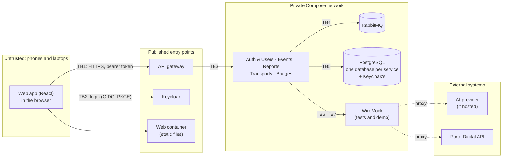

# Security and Privacy Assessment

> LABDSOF 2026/27 · Sprint A · Assignment §7.1.2 (deliverable 9: *initial threat model, sensitive data, access-control requirements, data-minimisation measures, retention considerations*), §6.4, §6.6 and §11
> **Guide item:** E5. **Status (25 October 2026):** first version, **to review with the team**. **Updated 29 October 2026** (#159): retention and backups (§7) follow the values the team decided for NFR-13 and NFR-19. Controls that are already decided link to their ADR; every new control or number is marked **[PROPOSED]**. Nothing is implemented yet, so this assesses the design, and §11 names the test that will prove each control. The threat model is updated with the implementation in Sprint C (assignment §7.3.2, item 6).
> **Sources:** [`architecture.md`](architecture.md), [`domain-model.md`](domain-model.md), [ADR-003](adr/0003-database-and-data-ownership.md), [ADR-004](adr/0004-service-communication.md), [ADR-005](adr/0005-ai-triage-provider-and-evaluation.md), [ADR-006](adr/0006-identity-and-access.md), [ADR-007](adr/0007-venue-map-representation.md), [ADR-011](adr/0011-deployment-and-infrastructure.md), [ADR-012](adr/0012-observability.md), [ADR-013](adr/0013-api-gateway.md), [`features.md`](../Product/features.md), the [non-functional requirements](../Product/non-functional-requirements.md), [`local-delivery.md`](local-delivery.md), the [local observability plan](plans/local-observability.md), the API outline draft (#123, not merged yet) and the [Responsible AI assessment](../Research/architecture-investigation/responsible-ai.md).

## Summary

- **The most sensitive data is the help request:** a point on the venue map and an optional text that can describe someone's health, an assault or another person. It stays in Reports, is seen only by the people who handle it, never reaches logs or the message broker, and is minimised before any AI call.
- **The top risk is one event, or one participant, reading another's data** (SC8). The cross-event controls are decided (ADR-003, ADR-006). This assessment adds the check *inside* an event, with its test (T6).
- **Three findings need a change before the features that depend on them are built:** the FarolAdmin bootstrap trusts an unverified e-mail (T4), phones cannot log in to the local demo safely over plain HTTP (§9), and the triage message carries the help-request text through RabbitMQ (T11).
- **Retention, decided (NFR-13, NFR-19):** help-request content is deleted 30 days after the event closes, and only anonymous statistics stay. Container logs rotate at 10 MiB × 2 files, metrics are kept 1 day and no traces are stored. The six databases are dumped before every demo and every update, and each dump is kept at most 30 days.
- **The MVP uses only test accounts and synthetic data** (assignment §11). A real deployment would also need a DPIA and data-processing agreements with the organisers and with any hosted AI provider (§12).

## 1. Scope and method

| | |
|---|---|
| **Assessed** | The MVP as designed on 25 October 2026: one React web app, the API gateway, Keycloak, the five services, RabbitMQ, PostgreSQL (one database per service), WireMock for tests and the demo, the AI provider and the Porto Digital API. Local-only delivery on one machine ([ADR-011](adr/0011-deployment-and-infrastructure.md)) |
| **Not assessed** | Physical safety at the venue; ticketing (F20) and chat (F19), which are out of the release; the cloud alternative, except where §9 says what would change |
| **Threat model** | STRIDE (spoofing, tampering, repudiation, information disclosure, denial of service, elevation of privilege) on each trust boundary of §2 |
| **Privacy** | GDPR principles: purpose limitation, data minimisation, storage limitation, special categories of data (art. 9) and data-subject rights. This is the team's reading for the design, not legal advice |
| **Risk** | **High:** could expose help requests or give someone admin rights. **Medium:** limited exposure, or needs a second failure. **Low:** little harm or very unlikely |
| **People whose data Farol holds** | Participants (P1), event team members and volunteers (P2, P3, P5), the FarolAdmin (P4), and **third parties** described in a help request (e.g. "my friend fainted") |

## 2. Trust boundaries

| # | Boundary | What crosses it | Main threats (§4) |
|---|---|---|---|
| TB1 | Browser → gateway | Every API call, with the access token | Forged or stolen tokens, other people's data, floods, injected text (T2, T5–T7, T10, T15) |
| TB2 | Browser → Keycloak | Passwords, sign-up, sessions | Credential guessing, account takeover, scripted sign-ups (T1, T4, T14) |
| TB3 | Gateway → services | Calls already checked by the gateway | Bypassing the gateway, forged identity headers (T3) |
| TB4 | Services ↔ RabbitMQ | Domain events (memberships, teams, help requests) | Forged events, personal data at rest in queues (T8, T11) |
| TB5 | Services → PostgreSQL | All stored data | A service reading another's database (AC-8) |
| TB6 | Reports → AI provider | Category and sanitised text of a help request | Disclosure to a third party, prompt injection (T12, T21) |
| TB7 | Transports → Porto Digital | Bus positions coming in; nothing personal goes out | Invalid or hostile data (T20) |
| TB8 | Operators → admin surfaces | Keycloak admin console, RabbitMQ management, WireMock admin API, Grafana, Actuator, PostgreSQL | Full control of the system (T16, §9) |

## 3. Sensitive data

Every item Farol stores, where it lives and who can see it. Retention is in §7.

| Data | Stored in | Who can see it | Class | Why Farol needs it |
|---|---|---|---|---|
| Password hash, sessions, brute-force counters | Keycloak's database | Nobody in Farol; Keycloak admin only | **Secret** | Login (F1) |
| E-mail | Keycloak; Auth & Users | The user; the FarolAdmin when looking up an account (AC-9) | Personal | Login name; naming an EventAdmin (US-06, US-08) |
| Display name | Auth & Users; copies in Reports and Events (`UserProfileChanged`) | The event team, for the members who act (who is on the way); the FarolAdmin, for EventAdmins | Personal | Accountability in the backoffice (US-07, US-32) |
| `sub` (account id) | Every service, logs | The team (developers) | Pseudonymous | Links records to an account without a name |
| Memberships, roles, team assignments | Auth & Users; copies in every service that checks permissions | EventAdmins of that event; the member | Personal | Access control (ADR-006) |
| **Help request:** category, map point, optional text, times, status | Reports | The requester (status only); `HelpRequests.Triage`; EventAdmins; the routed team | **Special category possible** | Core journey (F6, F7) |
| Triage suggestion and its reason | Reports | `HelpRequests.Triage` | Same as the request | AI assistance (F8) |
| Audit entries: actor, time, old and new values | Each service | `HelpRequests.Triage` (history), EventAdmins | Personal | Accountability (assignment §6.6, SC9) |
| Community report: type, map point, reporter, times | Reports; Badges keeps report id, type and reporter | Reviewers of its type; other participants only when confirmed, **without the reporter** (US-49) | Personal (where a person was, when) | F12, F13, badges (F14) |
| Check-in: account, event, time | Events; the count in Badges | The user | Personal (presence at an event) | Attendance badge (F15, F16) |
| Badge progress and preferences | Badges | The user; others never (outline D9) | Personal | F14, F15 |
| Consent records (§8.4) | Auth & Users | The user | Personal | Proof of consent (GDPR art. 7(1)) |
| Login and admin events (IP address, account, result) | Keycloak | Keycloak admin | Personal | Account protection |
| Container logs and metrics (no traces are stored) | Docker logs, and sanitised exports of them; Prometheus | The team | Pseudonymous: `sub` and correlation id only (ADR-012) | Operations (assignment §6.7) |
| Database dumps | `backups/` on the demo machine and the backup laptop; never in git | The team | Same as the databases they copy, Keycloak's included | Recovery (NFR-13) |
| Rate-limit counters | Gateway memory | Nobody | Pseudonymous, minutes | ADR-013 |
| Friends (Could, US-61) | Auth & Users | The two users | Personal (social graph) | F18, after the MVP |
| Event, venue map, points of interest, announcements, teams, shuttles | Events, Transports | Members of the event | Not personal | Operational information |
| Uploaded map files | Events volume | `Map.Edit`; clients get only the rendered image (ADR-007) | Not personal, but the original file can hold metadata (author, GPS in a photo) | F5 |
| Bus positions | Transports | Members of the event | Not personal: public open data about vehicles, latest position only | F9 |
| User research | Google Forms (outside the repository) | The team | Anonymous: no name or e-mail collected (survey script, `setCollectEmail(false)`) | Problem validation |

**Why help requests are the most sensitive data.** The category `Health` and the optional text can reveal health data (GDPR art. 9) about the requester or about someone else who cannot be asked ("friend fainted near the bar"); `Safety` and `Theft` can describe an aggressor; and the map point says where a person was at a given minute. The problem report already flags this ([report §5, regulatory risks](../Deliverables/problem-opportunity-report-queima.md); architecture driver D5). Everything in §5 to §8 is strictest for this data.

## 4. Initial threat model

**Status:** *Decided* links to an ADR or story; **[PROPOSED]** is new and waits for the team. Tests for each threat are in §11.

| # | Threat | STRIDE | Risk | Controls |
|---|---|---|---|---|
| T1 | Guessed or reused password of an event team member, then reading help requests | S | High | *Decided:* Keycloak brute-force detection per account, never per IP (venue NAT); password of at least 10 characters, not equal to the e-mail; generic login error (ADR-006, US-01). **[PROPOSED]:** the bootstrap FarolAdmin account must set up a one-time-password app at first login (Keycloak *Configure OTP* required action in the realm export). Multi-factor login for event teams stays a known limitation (§12) |
| T2 | Forged, expired or wrong-audience token | S | High | *Decided:* the gateway and every service check signature, issuer, audience `farol-api` and expiry (ADR-006) |
| T3 | Calling a service directly, around the gateway, or sending forged identity headers | S, E | Medium | *Decided:* only the gateway, Keycloak and the web container are published; services validate the token themselves; client identity headers are never passed on (ADR-013) |
| T4 | **Becoming FarolAdmin by signing up with the bootstrap e-mail.** ADR-006 grants `FarolAdmin` when a new account's e-mail equals `FAROL_BOOTSTRAP_FAROL_ADMIN_EMAIL`, but e-mails are not verified (no SMTP) and sign-up opens in Sprint C (US-03): whoever signs up first with that e-mail gets the role | E | **High** | **[PROPOSED]:** grant the role only when the token says `email_verified: true`. The realm import creates the bootstrap account already verified; a self-registered account is never verified while there is no SMTP. Amends ADR-006 |
| T5 | Reading or changing another event's data by changing `{eventId}` | I, T | High | *Decided:* `event_id` filter on every query; membership checked in the use case against the local copy; non-members get 404; an isolation test in every service (ADR-003, ADR-006, US-14) |
| T6 | **Reading another participant's help request or pending report in the same event** by changing its id (broken object-level authorisation) | I | High | The API outline restricts `GET …/help-requests/{id}` to the requester, `HelpRequests.Triage` and the routed team, but no story tests it. **[PROPOSED]:** every query by id filters by `eventId` and by who may see the object (AC-3); US-14's isolation test gets a within-event case: a RegularUser of event X opens another participant's request of event X and gets 404 |
| T7 | Setting fields the caller must not set (priority, status, team, reporter, actor) in a request body | T, E | Medium | *Decided:* contract-first DTOs (guide C7). **[PROPOSED]:** request DTOs hold only the fields the use case accepts; actor and reporter always come from the token's `sub`; unknown fields answer 400 |
| T8 | A forged domain event, e.g. a `MembershipChanged` that makes someone EventAdmin | S, E | Medium | *Decided:* broker only on the private network; one RabbitMQ user per service (ADR-006, E3). **[PROPOSED]:** each user can write only to its own exchange `farol.<service>` and read only its own queues (AC-8); the default `guest` user is removed |
| T9 | Hostile venue-map upload: decompression or PDF bomb, script inside an SVG or PDF, a file disguised by its extension | T, D | Medium | *Decided:* at most 20 MB at the gateway (ADR-013, L-4); single-page PDFs rendered to PNG of at most 4096 px; clients download only the rendered image (ADR-007). **[PROPOSED]:** type read from the file content (PNG, JPEG or PDF; never SVG); every upload re-encoded to PNG, which drops EXIF and PDF metadata and any active content; PDFBox with a memory limit and a render timeout; served with a fixed `Content-Type` and `X-Content-Type-Options: nosniff` |
| T10 | Stored cross-site scripting through text other people see (help-request text, team, point and announcement names, the AI's reason, route names from Porto Digital), which could steal the tokens held in memory | T, I, E | High | *Decided:* tokens in memory only, refresh tokens rotated (ADR-006). **[PROPOSED]:** all such text is rendered as plain text (React escaping; no `dangerouslySetInnerHTML`; no HTML or Markdown in user text); a Content Security Policy on the web container: `default-src 'self'`, `connect-src` only the gateway and Keycloak, `object-src 'none'`, `frame-ancestors 'none'`; no third-party scripts, fonts or analytics |
| T11 | **Personal data in logs, traces, queues or test recordings.** The outline's `HelpRequestSubmitted` carries the location and text, so they sit in RabbitMQ, in a dead-letter queue if the message fails, and in message traces | I | **High** | *Decided:* no request text, prompts, exact locations, names or tokens in logs or metric labels (ADR-012). **[PROPOSED]:** the triage message carries only `requestId`, and the triage worker, which is part of Reports, reads the request from Reports' own database (M-5); dead-letter handling logs the message id, type and reason, never the body; WireMock records Porto Digital only, never the AI provider |
| T12 | Help-request text sent to a hosted AI provider that keeps it or trains on it | I | High with real data | *Proposed in ADR-005:* only the category and sanitised text, no ids or location; synthetic data until the provider is reviewed. **[PROPOSED]:** the redaction of M-4 and the provider checklist of §8.5 |
| T13 | A lost or shared phone of a field-team member with an open session (sessions last up to 30 days with *Remember me*) | S, I | Medium | *Decided:* access token of 5 min, refresh tokens rotated, logout (ADR-006, US-02). **[PROPOSED]:** actions that need an operational permission require a login in the last 12 h (AC-7); a routed team sees a request only while its field task is open (AC-3) |
| T14 | Account enumeration, and the wrong person named EventAdmin: an account with the organiser's e-mail may not belong to the organiser, because e-mails are not verified | S, I | Medium | *Decided:* Keycloak's sign-up form reveals whether an e-mail is taken; accepted for the MVP (ADR-006). **[PROPOSED]:** the lookup rules of AC-9, which answer outline O4 |
| T15 | Floods: help requests, polling or uploads from one account; scripted sign-ups once sign-up opens | D | Medium | *Decided:* limits L-1 to L-5 per account, Keycloak brute-force detection (ADR-013). **[PROPOSED]:** calls with no valid token get a per-IP limit at the gateway; only broken clients or attackers send them, so crowds behind one address are not affected. Scripted sign-ups without e-mail verification: known limitation (§12) |
| T16 | Exposed admin surfaces: Keycloak admin console, RabbitMQ management, WireMock admin API (fake bus data or fake AI suggestions), Grafana, Actuator, PostgreSQL | E, T | High | *Decided:* Actuator on a management port that is not published (ADR-013). **[PROPOSED]:** the port rules of §9 |
| T17 | Secrets in the repository: `.env`, the realm export (client secret of `farol-auth-users`, test passwords), an AI API key | I, E | Medium | *Decided:* `.env` outside git, GitHub Actions secrets in CI, gitleaks on every PR (ADR-006, E4). **[PROPOSED]:** the realm export uses `${…}` placeholders for client secrets, filled from the environment at import; a `.env.example` lists names, never values; test passwords exist only for seeded test accounts |
| T18 | A vulnerable dependency or base image | T, E | Medium | **[PROPOSED]** for the pipeline (ADR-010): dependency updates and checks (e.g. Dependabot) and a container-image scan (e.g. Trivy) on every PR, failing on critical findings (assignment §8.5, *dependency or security checks*) |
| T19 | A team member denies having changed a priority, closed a request or unconfirmed a report | R | Medium | *Decided:* audit entry with actor, time, old and new values (SC9, US-28, US-51); the acting user's `sub` in the event envelope (ADR-006). **[PROPOSED]:** the application only appends audit entries; it has no code path that updates or deletes them, except the retention clean-up (§7) |
| T20 | Invalid or hostile data from Porto Digital: oversized payloads, strings shown in the UI | T, D | Low | *Decided:* timeouts, validation, whole import rejected, geo-query that limits the size (ADR-008, J1, US-40). Strings rendered as text (T10) |
| T21 | Prompt injection through the help-request text | T | Medium | Covered by the [Responsible AI assessment](../Research/architecture-investigation/responsible-ai.md): untrusted JSON input, no tools, fixed output schema, the operator decides (ADR-005). Privacy side: the model's reason can repeat the text, so it is shown only to the control room |

## 5. Access-control requirements

The permission model is decided in [ADR-006](adr/0006-identity-and-access.md) (*Where each permission is checked*) and [`features.md` §4](../Product/features.md#4-roles-teams-and-permissions-22-october-2026). These are the rules every service must meet; each one is testable.

| # | Requirement | Status |
|---|---|---|
| AC-1 | **Authentication:** every `/api/v1` call needs a valid access token. There is no public API endpoint; login and sign-up happen in Keycloak | *Decided* (ADR-006, ADR-013) |
| AC-2 | **Event scope:** a call about an event needs a membership of that event, checked in the use case against the service's local copy. A non-member gets 404; no copy means no access | *Decided* (ADR-006, US-14) |
| AC-3 | **Object scope inside an event:** see the table below | **[PROPOSED]** |
| AC-4 | **Permissions:** each use case checks one permission from the fixed list. An EventAdmin has every permission of their own event. `FarolAdmin` is never accepted for an event's help requests, reports or participants | *Decided* (ADR-006, US-07) |
| AC-5 | **Changes to roles, teams and permissions:** only EventAdmins of the event, who can also make another member of the event EventAdmin or remove that role (US-15); the FarolAdmin names an event's first EventAdmin, or a new one (US-06, US-08); an event always keeps one EventAdmin; every change audited; applied in ≤ 5 s | *Decided* (ADR-006, US-06, US-08, US-15 to US-18) |
| AC-6 | **Revocation:** a disabled or deleted account is refused at once by every service (account-disabled event, `UserDeleted`), and its sessions end in Keycloak | *Decided* (ADR-006) |
| AC-7 | **Recent login for operational actions:** calls that need `HelpRequests.*` or `Reports.*` are refused when the token's `auth_time` is older than 12 h, with `401` and `WWW-Authenticate: Bearer error="insufficient_user_authentication"` (RFC 9470); the web app then sends the user to log in again. A participant on their own phone keeps the 30-day session | **[PROPOSED]** |
| AC-8 | **Service-to-service:** no HTTP between services. RabbitMQ: each service's user can configure and write only its own exchange (`farol.<service>`, and its dead-letter exchange) and queues named `<service>.…`, and read only its own queues and the exchanges it binds them to. PostgreSQL: one login per service, owner of its own database only, `CONNECT` revoked on the others, no superuser. Keycloak: the `farol-auth-users` service account has only the user-management roles that account deletion needs | *Decided:* the principle (ADR-006, E3). **[PROPOSED]:** these grants |
| AC-9 | **Account lookup by e-mail** (answers outline O4): FarolAdmin only; exact match, no partial search and no list of accounts; answers only the account id and display name; audited; under the normal rate limit. Because e-mails are not verified, the FarolAdmin confirms with the organisation, outside Farol, that the account is theirs before naming them EventAdmin (US-06 already asks to confirm that the requester represents the organisation) | **[PROPOSED]** |
| AC-10 | **Audit records** (assignment §6.6): changes to help requests and reports (actor, time, old and new values); role, team, permission and membership changes; EventAdmins named, by an EventAdmin (US-15) or by the FarolAdmin (US-08); events suspended by the FarolAdmin; refused cross-event attempts (user, event, time; US-14); account deletions (only that one happened, and when). Logins in Keycloak's event log | *Decided:* help requests, reports, roles (SC9, ADR-006). **[PROPOSED]:** the rest |
| AC-11 | **Infrastructure admin access:** see §9 | **[PROPOSED]** |

**AC-3, who may see and change each object:**

| Object | Who may read it | Who may change it |
|---|---|---|
| Help request | The requester: only id, category, status and time of the last change (US-24). `HelpRequests.Triage` and EventAdmins: all of it. Members of the routed team: category and map point, **while the field task is open** **[PROPOSED]** | `HelpRequests.Triage`: priority, status, team, close. The member who accepted the field task: accept and resolve |
| Help-request history | `HelpRequests.Triage`, EventAdmins | Nobody: append only (T19) |
| Community report | The reporter: their own, in any status. Other participants: confirmed and active, without the reporter (US-49). `Reports.Review` for its type: all of it, **without the reporter's name** **[PROPOSED]**. EventAdmins: also the reporter, to act on misuse (features §6.4) | `Reports.Review` for its type: confirm, reject, unconfirm, dispatch. The member who accepted the field task: answer, resolve |
| Check-in, badges | The user only; no endpoint for another user's badges (outline D9) | The user: badge preferences (US-56) |
| Account | The user; the FarolAdmin, through AC-9 only | The user (US-04, US-05) |
| Memberships and team assignments | EventAdmins of that event; the member, for their own | EventAdmins of that event, including making a member EventAdmin (US-15); the FarolAdmin, only to name the first or a new EventAdmin (US-06, US-08) |

## 6. Data-minimisation measures

| # | Measure | Status |
|---|---|---|
| M-1 | **Location is a point the participant marks on the venue map**, normalised to one map version; the app never asks the phone for GPS. It is less precise on purpose and works inside a crowd | *Decided* (F6, user-workflows W2) |
| M-2 | The help-request text is **optional, at most 500 characters**, with a hint above it: *"Describe what is happening. Do not write names or phone numbers."* | **[PROPOSED]** (500, as in the Responsible AI assessment) |
| M-3 | The requester sees only the status of their request; its location goes only to the people who handle it (AC-3) | *Decided* (US-23, US-24) |
| M-4 | The AI gets only the category, the sanitised text and the priority floor: no account or event id, no location, no names (ADR-005). **[PROPOSED]:** before sending, phone numbers, e-mail addresses and document numbers are replaced with a placeholder. Redaction is not anonymisation: the text can still say something sensitive | *Proposed in ADR-005*; redaction **[PROPOSED]** |
| M-5 | **The triage message carries only `requestId`.** Producer and consumer are both Reports, so the worker can read the request from its own database: no personal text in RabbitMQ, in dead-letter queues or in message traces. An exception to the outline's full-state rule for one internal queue | *Decided* (API outline §7.3, #123, 26 October 2026) |
| M-6 | **The account holds an e-mail and a display name only.** No phone number, birth date, student number, photo or university. The display name can be a nickname | **[PROPOSED]** |
| M-7 | Names are copied only where they are shown: `userId` and display name, to Reports and Events (`UserProfileChanged`); Badges and Transports get no names | *Decided* in the API outline draft (#123, its decision D4) |
| M-8 | Other participants never see who made a report; Badges receives the reporter, type and status of a report, not its location | *Decided* (US-49; `ReportConfirmed` in the API outline draft) |
| M-9 | A check-in is one time per account and event: no location, no list of nights; badges never show which nights or where (features §6.4) | *Decided* (US-58) |
| M-10 | Logs and metrics hold no request text, locations, names or tokens; only `sub` and the correlation id identify a request (ADR-012). **[PROPOSED]:** no client IP addresses in application logs; Keycloak's login events keep them for account protection (§7) | *Proposed in ADR-012*; IPs **[PROPOSED]** |
| M-11 | Map uploads are re-encoded to PNG, so the photo's GPS position and the PDF's author are dropped; participants receive only that image | *Proposed in ADR-007*; re-encoding **[PROPOSED]** (T9) |
| M-12 | Bus data: only buses within 2 km of the venue, and only the latest position of each; no history of vehicle positions | *Decided* (J1, domain model) |
| M-13 | **Tests and demo use synthetic data only:** seeded accounts with fictitious names and e-mails under the reserved `.test` domain; help-request texts written for the purpose; WireMock records Porto Digital, never the AI provider | *Decided:* synthetic data (assignment §11, ADR-005). **[PROPOSED]:** the rest |
| M-14 | No analytics, trackers or third-party scripts in the web app; the Content Security Policy of T10 enforces it | **[PROPOSED]** |

## 7. Retention and deletion

Assignment §6.4 asks for retention and deletion, and the privacy notice (§8) must say how long data is kept. The team decided the periods below on 26 October 2026, as NFR-19 and NFR-13 ([non-functional requirements §5](../Product/non-functional-requirements.md#5-validated-with-the-team-on-26-october-2026); guide D5 and G7). Telemetry follows the [local observability plan](plans/local-observability.md), simplified on 27 October 2026 (#153), and backups follow [`local-delivery.md` §6](local-delivery.md#6-backup-and-recovery-g7). Until the clean-up jobs exist (Sprint C, one scheduled job in Reports and one in Events), the periods of help requests, reports and check-ins are a promise that is not enforced yet (§12).

| Data | Kept | Then | Why |
|---|---|---|---|
| Help request: text, map point, triage suggestion and reason, field tasks, audit entries | Until the event closes, plus **30 days** | Deleted. Category, priority, status, times and team stay as statistics, without the requester or the actors | Long enough for the organiser to deal with what follows a festival night (a complaint, a lost-person case, an insurance or police question); short for data that can be about health (problem report: *"short retention"*) |
| Community report | On the map until it expires (20–60 min, features §6.1); in Reports until the event closes, plus 30 days | Deleted from Reports. Badges keeps report id, type and reporter until the account is deleted | The all-time *Report history* badge needs the count across years |
| Check-in | In Events until the event closes, plus 30 days | Deleted; the attendance count stays in Badges | Same as above |
| Account, memberships, team assignments, badges, consent records | While the account exists | Deleted when the user deletes it (US-05) | The user's own history of events and badges |
| Keycloak login and admin events | **30 days** (realm setting) | Expire | Enough to investigate a brute-force attempt during an 8-night festival |
| Container logs | Rotated at **10 MiB × 2 files** per container (Docker) | Overwritten | Enough to follow one correlation id through a demo; there is no separate log store |
| Sanitised log exports | At most **14 days** | Deleted | Only as evidence of a demo or a drill; sanitised, so they hold no request text, locations, names or tokens (M-10) |
| Metrics | **1 day** or **512 MiB**, whichever comes first (Prometheus) | Deleted | Dashboards and alerts need only the recent window; labels hold no personal data (M-10) |
| Traces | **Not stored** | — | Correlation ids in the logs replace distributed tracing (ADR-012) |
| Dead-letter messages | Until they are replayed or judged invalid (architecture §6) | Deleted | With M-5 they hold no help-request text |
| Rate-limit counters | In memory, at most 10 min | Gone | Only the current window matters |
| Database dumps | A dump of the six databases, Keycloak's included, before every demo and every update; each dump kept at most **30 days** | Deleted | So account deletions and the periods above reach the dumps within 30 days. Volumes are not backups (ADR-011), and queued RabbitMQ messages are not dumped |
| User-research data | Survey answers are anonymous and stay outside the repository | Deleted when the course ends | Only the published summaries are needed |

**Restoring a dump.** A restored dump brings back everything deleted after it was taken, accounts deleted with US-05 included, and Keycloak's dump brings back their login. The MVP holds only synthetic data (M-13), so this is accepted as a known limitation (§12). A real deployment would need a list of deleted accounts kept outside the dumps and applied again after every restore.

**Account deletion** (US-05). *Decided* (guide D7, #135, 27 October 2026), from the proposal of this section; flow in the [API outline §2](api-outline.md#2-auth--users). The account is refused at once (`UserStatusChanged`, `Disabled`); Auth & Users deletes the user in Keycloak, then its own data, then publishes `UserDeleted`. Every service keeps a tombstone with only the opaque `sub`, so the account stays refused and late events do not bring a copy back. What each service does with it:

| Service | On `UserDeleted` |
|---|---|
| Auth & Users | Deletes the account, the `FarolAdmin` grant, memberships, team assignments, friendships and consent records. Refuses the deletion (`422`) while the user is the last EventAdmin of an event or the last `FarolAdmin` |
| Reports | Closes the user's open help requests. Removes the requester from their help requests and the reporter from their reports, and deletes their text and map point **at once**, not after the 30 days above: only category or type, priority, status, times and team stay, as statistics. Deletes the copied display name and membership copies. Audit entries, `acceptedBy` and field tasks keep the opaque `sub`, which no longer points to anyone once the account is gone |
| Events | Deletes the user's check-ins and the copies of memberships, `FarolAdmin` grant and display name; audit entries keep the opaque `sub` |
| Badges | Deletes progress, preferences and the copies of reports and check-ins |
| Transports | Deletes the membership copies (corrected: it keeps them to check `Transport.Edit`, outline §7.5) |

## 8. Consent, transparency and the sign-up terms

Assignment §6.6 asks for *account and consent management*. Sign-up and account deletion (US-03 to US-05) are in Sprint C, and their terms follow this section ([`features.md` §8.5](../Product/features.md#85-why-this-plan)).

### 8.1 Who is responsible, in a real deployment

For the course, Farol runs only on the team's machine with test accounts, so no one's real data is processed. In a real deployment, the **organiser of each event** decides why that event's data is processed (help requests, reports, check-ins, its teams) and would be its **controller**; the **Farol operator** would process it on the organiser's behalf (**processor**, with a data-processing agreement), and would be the controller of the accounts and badges, which span events.

### 8.2 Lawful basis

| Processing | Basis (GDPR) |
|---|---|
| Account, login, memberships | Contract (art. 6(1)(b)): needed to use Farol |
| Help request | Contract for the request itself. Where it reveals health: **explicit consent** (art. 9(2)(a)), asked as in §8.3. For a third party who cannot be asked (a friend who fainted): vital interests (art. 9(2)(c)) |
| AI suggestion on a help request | Same basis as the request. A person always decides, so it is not a decision based solely on automated processing (art. 22) |
| Community reports | Contract: a feature the user chooses to use |
| Badges and check-in | Consent: optional, and the user can stop or hide them at any time (US-56) |
| Security logs (logins, refused access, audit) | Legitimate interest (art. 6(1)(f)): protecting accounts and the events' data |

### 8.3 Consent for help requests **[PROPOSED]**

- Asked **when the participant joins an event** (US-12), so it is never seen for the first time in an emergency. One short screen: the control room and the team sent to help see the category, the map point and the text; the text can describe health; an AI may suggest a priority and a person decides; how long it is kept (§7); *"Farol is not an emergency service. In an emergency, call 112."*
- Optional when joining. If it was declined, *Ask for help* shows the same screen again. If it is declined again, the page shows **112 and the first-aid points on the map**, so nobody is left without a way to get help.
- Recorded with its time and the version of the text; it can be withdrawn in the account (F2) and applies to later requests.

### 8.4 What the sign-up terms must say (US-03)

- Who runs Farol, who runs each event, and how to contact them about personal data.
- What is collected and why, who sees it and how long it is kept: a short version of §3 and §7.
- That help requests are not an emergency service, and the 112 number.
- That an AI may suggest a priority for help requests, that a person decides, and, if a hosted provider is used, which one and where it processes the text.
- The user's rights: access, correction (US-04), deletion (US-05), withdrawing a consent, objecting; and the right to complain to the CNPD.
- **Not bundled into the terms:** the help-request consent (§8.3) and badges (US-56) are separate, optional choices.
- **[PROPOSED] records:** Auth & Users stores the version and time of the accepted terms, and each membership the version and time of the help-request consent.

### 8.5 Before a hosted AI provider receives real text

The gate of ADR-005, item 5, written as a checklist **[PROPOSED]**. All of it must be true; until then only synthetic text goes to a hosted provider.

- [ ] A data-processing agreement is signed with the provider, and its subprocessors are listed.
- [ ] The text is processed in the EU/EEA, or under an adequacy decision or standard contractual clauses.
- [ ] Inputs are not used for training, and the provider keeps them at most 30 days, or not at all (zero retention), on the plan actually used.
- [ ] The endpoint and the model version are fixed and recorded.
- [ ] The provider is named in the privacy notice (§8.4).

A local model (Ollama) avoids the transfer altogether; that is a privacy argument for it in K1.

## 9. The local demo environment

The delivery runs on one machine ([ADR-011](adr/0011-deployment-and-infrastructure.md)), and the demo uses the web app's phone pages. That brings its own risks.

**How phones reach the demo.** ADR-013 publishes the gateway, Keycloak and the web app on `localhost`. A phone must reach the machine's address on a Wi-Fi network instead, and two things then fail over plain HTTP: anyone on that network can read the tokens, and the browser makes the Web Crypto digest that PKCE needs available only on HTTPS pages or `localhost` (secure contexts), so login breaks. **[PROPOSED]:** a certificate for the demo machine's name from a local certificate authority (e.g. mkcert), with HTTPS on the gateway, Keycloak and the web container, and that authority installed on the demo phones; or the phone pages shown in a laptop browser's device mode. **Not acceptable** (assignment §11): turning off PKCE, token validation, CORS or Keycloak's HTTPS requirement to make the demo work.

**Ports [PROPOSED]:**

| Reachable from | What |
|---|---|
| The Wi-Fi network (phones) | Gateway, Keycloak's login pages, web container: HTTPS only |
| The demo machine only (bound to `127.0.0.1`) | Keycloak admin console, RabbitMQ management, Grafana, WireMock admin API |
| Nothing outside Compose | The five services, PostgreSQL, RabbitMQ's AMQP port, Actuator management ports |

**Also [PROPOSED]:**
- Keycloak, RabbitMQ, PostgreSQL and Grafana admin passwords come from `.env`, are generated per machine, and are never the image defaults.
- The demo machine and the backup laptop have full-disk encryption (BitLocker or FileVault) and a screen lock: they hold every database and its dumps (§7). Dumps are never committed or copied anywhere else.
- Every security control stays on during the demo: rate limits, token validation, isolation, CORS (assignment §11). Scenarios D1 and D2 break a dependency, not a control.

## 10. Findings and proposed actions

The owners of each decision are in the [decisions guide](architecture-decisions-guide.md); none of this is agreed until the team reviews it.

| # | Finding | Proposal | Decided in | Needed by |
|---|---|---|---|---|
| 1 | FarolAdmin bootstrap trusts an unverified e-mail (T4) | Grant only with `email_verified: true`; amend ADR-006 | ADR-006 | Walking skeleton, and before sign-up opens (US-03) |
| 2 | Phones and plain HTTP: tokens exposed and PKCE login broken (§9) | Local HTTPS with mkcert, or device mode | Guide G4, with Compose (G5–G6) | First demo on phones, Sprint B |
| 3 | Help-request text and location travel through RabbitMQ (T11) | Triage message with `requestId` only (M-5) | API outline and event catalogue: ✅ decided in #123 (26 October 2026) | Before US-34 |
| 4 | Object access inside an event is not tested (T6) | Within-event case in US-14 | Backlog (US-14) | Sprint B planning |
| 5 | WireMock admin API and recordings (T11, T16) | Admin API only on the demo machine; never record the AI provider | Guide J4 | Done: admin API on `127.0.0.1:8090` (`local-delivery.md` §1); only Porto Digital recorded, with no personal data ([`infra/wiremock/`](../../infra/wiremock/README.md), #155) |
| 6 | 30-day sessions on field-team phones (T13) | AC-7: login in the last 12 h for operational actions | ADR-006 | US-17, Sprint B |
| 7 | Account lookup by e-mail, outline O4 (T14) | AC-9 | API outline O4 | Now |
| 8 | Client secrets in the realm export (T17) | `${…}` placeholders | ADR-006 | Walking skeleton |
| 9 | RabbitMQ and PostgreSQL grants not specified (T8) | AC-8 | This assessment, with Compose (G5–G6) | Walking skeleton |
| 10 | Upload hardening (T9) | Content type, re-encoding, PDFBox limits | ADR-007 | US-19 |
| 11 | Content Security Policy, no third-party scripts (T10, M-14) | Headers on the web container | The web container | Walking skeleton |
| 12 | No dependency or image scanning (T18) | Checks in CI | ADR-010 | Sprint B |
| 13 | Retention periods and clean-up jobs (§7) | The periods of §7 | Team (guide D5): ✅ decided as NFR-19 and NFR-13 (26 October 2026; telemetry simplified 27 October 2026) | Clean-up jobs in Sprint C |
| 14 | Consent records and the help-request consent (§8.3, §8.4) | New fields; criteria in US-03 and US-12 | Domain model; stories | US-12, Sprint B |
| 15 | Reviewers see who made a report (AC-3) | Reporter visible to EventAdmins only | Team | Before US-50 |

## 11. How the controls are verified

The security tests that the strategy in assignment §8.3 asks for.

| Threat or rule | Test | When |
|---|---|---|
| T2 | Tokens with the wrong issuer or audience, expired, unsigned (`alg: none`) or signed with another key get 401, in every service and in the gateway | Every PR |
| T5, T6, AC-2, AC-3 | Per-service isolation test (US-14), with the cross-event and the within-event cases | Every PR |
| AC-4 | The FarolAdmin is refused an event's help requests, reports and participants (US-07) | Every PR |
| T4 | A self-registered account with the bootstrap e-mail does not get `FarolAdmin` | Every PR (Auth & Users) |
| T8, AC-8 | The `reports` RabbitMQ user publishing to `farol.auth-users` is refused; the `reports` database login cannot connect to the `events` database | Every PR (Testcontainers) |
| T9 | Uploads that are too large, of the wrong type, disguised by their extension, or multi-page PDFs are refused; a JPEG's EXIF is gone from the stored image | Every PR (Events) |
| T11, M-10 | Logs captured during the help-request integration test contain neither the text nor the map point | Every PR (Reports) |
| T15 | The 121st call in a minute and the 6th help request in 10 minutes get 429 with `Retry-After` (L-1, L-2) | Every PR (gateway) |
| T17 | gitleaks | Every PR (E4) |
| T18 | Dependency check and image scan | Every PR |
| §9 | From another computer on the network, only the gateway, Keycloak and the web container answer, and only over HTTPS | Before each demo |
| Whole system | An OWASP ZAP baseline scan against the local stack; its results update §4 | Sprint C (assignment §7.3.2, item 6) |

## 12. Known limitations

- **E-mails are not verified and passwords cannot be reset by e-mail** (no SMTP, ADR-006). An e-mail does not prove who owns an account (T4, AC-9), and scripted sign-ups are possible once sign-up opens. A local mail catcher (e.g. Mailpit) would let the demo show verification without a real mail server: **[PROPOSED]** option for Sprint C.
- **Tokens in browser memory:** a cross-site scripting bug would expose them (T10). A backend-for-frontend is a later hardening (ADR-006).
- **Multi-factor login only for the FarolAdmin** (T1).
- **Dumps only before demos and updates** (NFR-13): if the disk is lost, anything saved after the last dump is lost too, and queued messages are not dumped. A restored dump brings back data deleted after it was taken, accounts included (§7).
- **One machine holds everything:** physical access to it is access to every database (§9).
- **Retention not enforced until the clean-up jobs exist** (§7).
- **No export of a user's data** beyond what the screens show; the right of access is answered by hand.
- **A real deployment would need more:** a data-protection impact assessment (GDPR art. 35), likely required because Farol processes health-related data and the location of many people; data-processing agreements with each organiser and any hosted AI provider; a published privacy notice; and a contact for data requests. This document is the starting point for that assessment.
- **This assesses a design.** Sprint C updates it with what was built and the results of §11.
