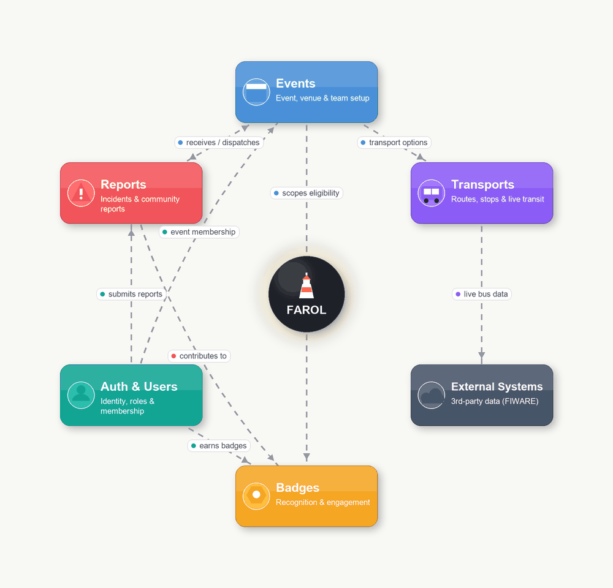

# Farol


**Group:**
- [António Guerra 1190409](mailto:1190409@isep.ipp.pt)
- [Bruno Lopes 1240441](mailto:1240441@isep.ipp.pt)
- [Tiago Teixeira 1240493](mailto:1240493@isep.ipp.pt)
- [Tomás Oliveira 1230213](mailto:1230213@isep.ipp.pt)

## Index

- [Documentation](Docs/README.md)

## Run with observability

Optional, for the local demo (#148, [ADR-012](Docs/Technical/adr/0012-observability.md), [plan](Docs/Technical/plans/local-observability.md)): Prometheus and Grafana on top of the normal stack. Without `--profile observability` the stack is exactly the usual one.

```bash
cp infra/.env.example infra/.env   # once; an older infra/.env needs the four lines of its "Local observability" block
docker compose -f infra/compose.yaml --env-file infra/.env --profile observability up --build -d --wait
python3 -I infra/tests/observability_smoke.py infra/.env
```

- Grafana: <http://127.0.0.1:3001>, user and password `GRAFANA_ADMIN_USER`/`GRAFANA_ADMIN_PASSWORD` of `infra/.env`. Dashboard *Farol › Farol local operations*; the three alert rules under *Alerting › Alert rules* (no notifications are sent).
- Prometheus: <http://127.0.0.1:9090> (*Status › Targets*).
- Logs are JSON lines with a `correlationId`: `docker compose -f infra/compose.yaml --env-file infra/.env logs gateway reports | grep <id>`.
- Stop with the same profile, or Prometheus and Grafana keep running: `docker compose -f infra/compose.yaml --env-file infra/.env --profile observability down`.
